@section gui-connectors

The providers around your servers, driven from the panel: **28 connectors** for clouds and VPS, domains and DNS, object storage, email, monitoring and security scanners. Create a Droplet or an EC2 instance, point a DNS record at a server **by its name**, publish the DNS a mail domain asks for on Cloudflare, make a bucket and a key an app can use on that bucket only, resolve a Sentry issue, snooze an Oh Dear check, ignore an Aikido finding — without opening twenty dashboards.

<figure class="gui-shot">
<div class="gui-shot-frame">
<div class="gui-shot-bar" aria-hidden="true"><i></i><i></i><i></i><span class="gui-shot-url">panel.example.com</span></div>
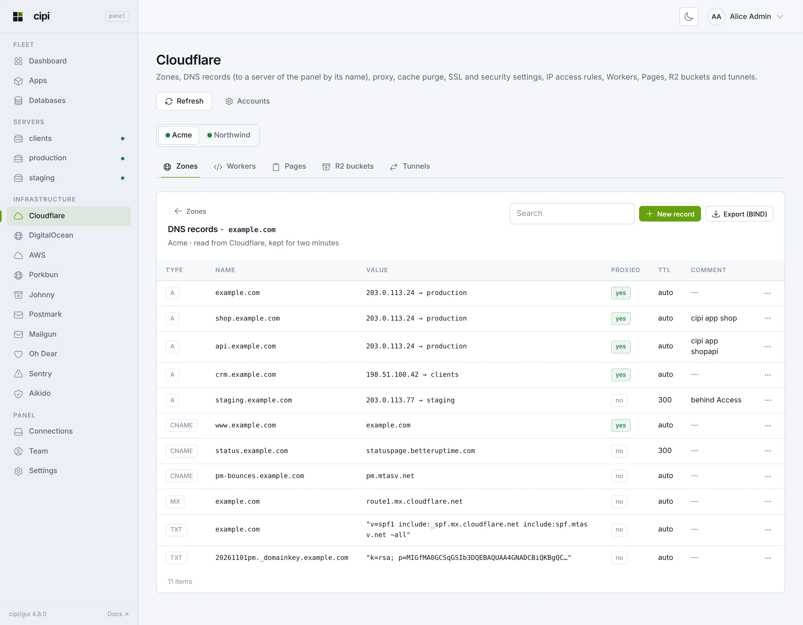
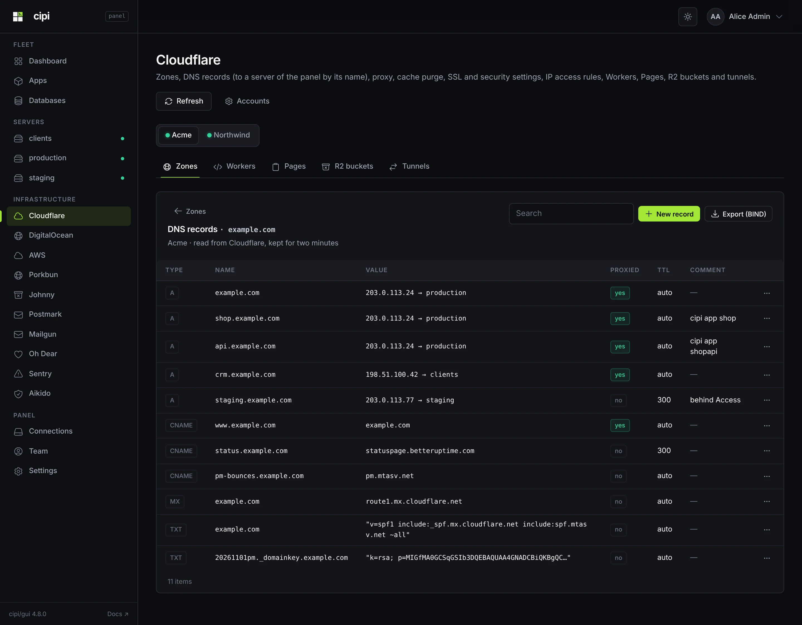
</div>
<figcaption>Cloudflare, a zone&rsquo;s DNS records: every address that is a server of the panel says which one (<code>203.0.113.24 → production</code>). Two Cloudflare accounts, one click apart.</figcaption>
</figure>

> [!tip] **Admins only, and optional.** Connectors are a page of the panel, not of Cipi: the calls go from the panel to the provider with credentials saved in the panel. The Cipi servers, their API and the CLI are not involved, and nothing changes on a server unless you change it from there yourself.

## Every connector {#list}

AWS, Cloudflare and DigitalOcean appear in more than one group: their S3, SES and CloudWatch, R2 and Spaces sit where you'd look for them. Each name links to what the panel does with it and **how to make its credentials**, with the permissions they need — the same steps Settings → Connectors shows next to the form.

### Clouds and servers {#list-clouds}

| Connector | What the panel does with it |
| --- | --- |
| [DigitalOcean](#digitalocean) | Droplets, domains and DNS, firewalls, volumes, reserved IPs, databases, App Platform, Kubernetes and Spaces, one team per account. |
| [Hetzner](#hetzner) | Hetzner Cloud servers, firewalls, volumes, IPs, networks, load balancers, snapshots and DNS, one project per account. |
| [AWS](#aws) | EC2 (instances, key pairs, security groups, Elastic IPs, volumes, AMIs), all of Lightsail, RDS, S3 with its objects and app keys, Route 53, CloudFront, SES and CloudWatch, one AWS account per access key. |
| [Google Cloud](#gcp) | Compute Engine instances, firewall rules, static addresses, disks and snapshots, Cloud DNS, Cloud SQL and Storage buckets of a project. |
| [Microsoft Azure](#azure) | Virtual machines, resource groups, public IP addresses, network security groups, DNS zones and storage accounts of a subscription. |
| [OVHcloud](#ovh) | VPS, dedicated servers, Public Cloud instances, DNS zones and records. |
| [Vultr](#vultr) | Instances, SSH keys, DNS domains, firewall groups, snapshots, block storage and reserved IPs. |
| [Akamai (Linode)](#linode) | Linodes, domains and records, Cloud Firewalls, volumes, NodeBalancers, Object Storage buckets and SSH keys. |
| [Scaleway](#scaleway) | Instances, flexible IPs, security groups, DNS zones and records, managed databases and load balancers. |
| [Contabo](#contabo) | VPS and VDS instances (power, rename), their snapshots, object storages and SSH keys. New servers are ordered in the Control Panel. |
| [UpCloud](#upcloud) | Cloud servers (create with an SSH key, power, delete) and their firewall, storages and backups, IP addresses and reverse DNS. |

### Domains and DNS {#list-dns}

| Connector | What the panel does with it |
| --- | --- |
| [Cloudflare](#cloudflare) | Zones, DNS records (to a server of the panel by its name), proxy, cache purge, SSL and security settings, IP access rules, Workers, Pages, R2 buckets and tunnels. |
| [Porkbun](#porkbun) | Domains with their expiry and nameservers (by hand, or to their Cloudflare zone), DNS records pointed at a server of the panel by its name. |
| [Gandi](#gandi) | Domains with expiry and auto-renewal, nameservers (by hand, or to their Cloudflare zone), LiveDNS records pointed at a server of the panel by its name. |
| [Namecheap](#namecheap) | Domains with expiry and auto-renewal, nameservers (Namecheap's, custom, or their Cloudflare zone), host records pointed at a server of the panel by its name. |

### Object storage {#list-storage}

| Connector | What the panel does with it |
| --- | --- |
| [Johnny](#johnny) | Your own S3 (johnny.web.ap.it): buckets with quotas, CORS and expiry, scoped keys, a bucket and its key for an app in one go, imports, exports and syncs with other providers. |
| [Backblaze B2](#backblaze) | Buckets public or private, their files with links that expire, application keys per bucket with the .env of an app on B2's S3 endpoint. |
| [Wasabi](#wasabi) | Buckets in every region, their objects with links that expire, CORS, and keys for one bucket each with the .env of the app. |
| [Cloudflare](#cloudflare) | R2: buckets, custom domains, the public r2.dev address, CORS and expiry rules. |
| [DigitalOcean](#digitalocean) | Spaces: buckets by region, their files with links that expire, CORS, and Spaces keys scoped to a bucket. |
| [AWS](#aws) | S3: buckets, their objects with links that expire, CORS, and keys an app can use on one bucket only. |

### Email {#list-email}

| Connector | What the panel does with it |
| --- | --- |
| [Postmark](#postmark) | Servers with the .env of each app, outbound figures and bounces; domains with their DKIM and Return-Path published on Cloudflare; sender signatures. |
| [Mailgun](#mailgun) | Sending domains with their DNS published on Cloudflare, 30-day figures, a sending key and the .env of each app; bounces, complaints and unsubscribes. |
| [Resend](#resend) | Domains with their DNS published on Cloudflare, verification and tracking; sending keys per domain with the .env of each app. |
| [AWS](#aws) | SES: domains and addresses, their DKIM records published on Cloudflare, sending quota, suppressed addresses. |

### Monitoring and errors {#list-monitoring}

| Connector | What the panel does with it |
| --- | --- |
| [Boogle](#boogle) | Your errors and uptime (boogle.web.ap.it): projects with the .env of the client, uptime on or off, exceptions to read, fix and close. |
| [Oh Dear](#ohdear) | Monitors and every check (uptime, certificates, broken links, DNS, scheduled tasks), runs on demand, snoozes, maintenance windows, 30-day uptime, status page updates. |
| [Better Stack](#betterstack) | Uptime monitors (pause, resume, 30-day availability), heartbeats for cron jobs and queues, incidents to acknowledge and resolve, status pages. |
| [Sentry](#sentry) | Issues by project and state to resolve, ignore or reopen; projects with the DSN of each app; releases and deploys. |
| [Datadog](#datadog) | Monitors and their state, muted for a while with a downtime and back; downtimes; hosts reporting and muted; dashboards; SLOs. |
| [AWS](#aws) | CloudWatch: alarms (mute, test, delete), log groups and their retention, recent log events. |

### Security {#list-security}

| Connector | What the panel does with it |
| --- | --- |
| [Aikido](#aikido) | Open issues by severity with how to fix them, ignore or snooze; repositories and their scans; containers; domains scanned from outside; Zen firewall apps. |
| [Hackly](#hackly) | Your scanner (hackly.web.ap.it): posture score, targets with their ownership TXT published on Cloudflare, repositories, scans with reports, findings to triage. |

## Add an account {#accounts}

**Settings → Connectors** lists every provider by group. Open one, give the account a name (*Acme*, *Client X*, *EU*) and paste what it asks for. Any number of accounts per provider: a list shows one account at a time, with the others one click away.

<figure class="gui-shot">
<div class="gui-shot-frame">
<div class="gui-shot-bar" aria-hidden="true"><i></i><i></i><i></i><span class="gui-shot-url">panel.example.com</span></div>
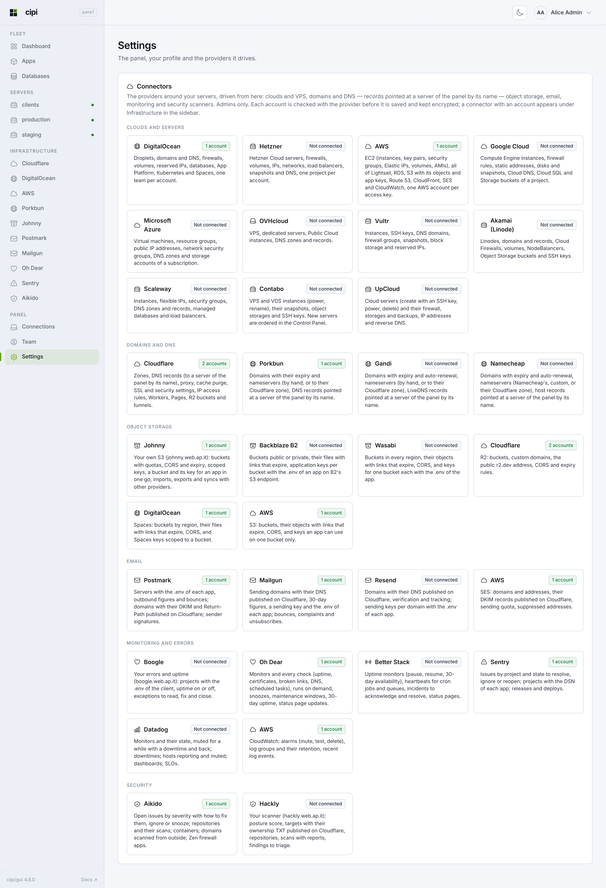
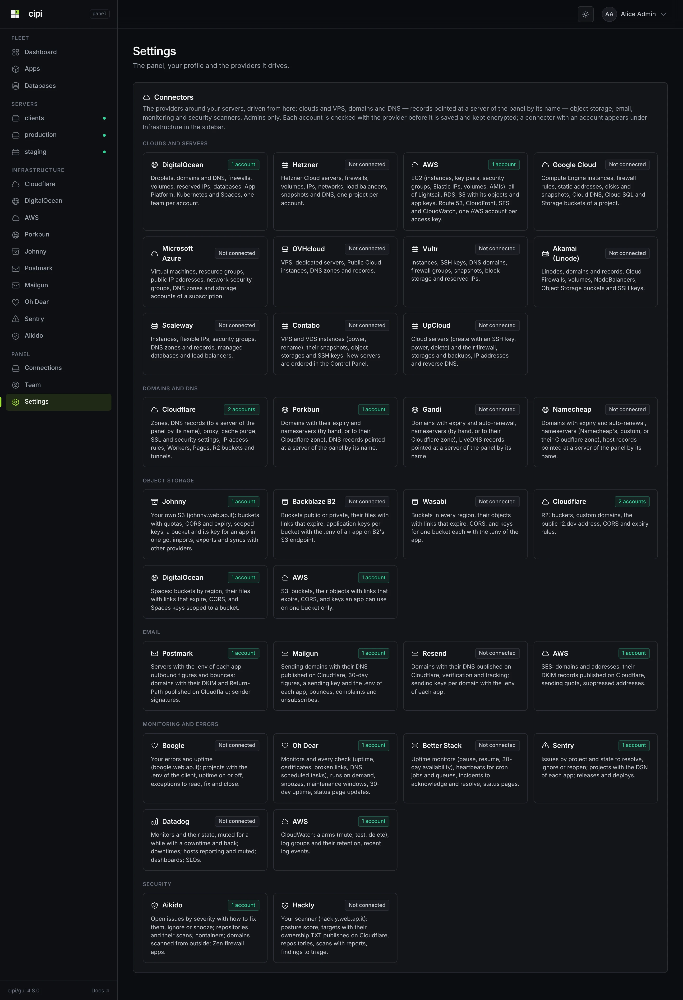
</div>
<figcaption>Settings → Connectors: clouds and servers, domains and DNS, object storage, email, monitoring, security. A provider with an account shows how many.</figcaption>
</figure>

> [!security] An account is **checked with the provider before it is saved** (a wrong key never lands in the database), stored **encrypted** with the panel's `APP_KEY` and **never sent back to the page**: editing an account shows its secret fields empty, and an empty secret keeps the stored one. What a list reads is cached for two minutes, encrypted too, and forgotten after anything done from that page. Every action is written to the panel's log as `cipi-gui.infrastructure`, with who did it.

Give each connector the narrowest credentials that do what you need: the steps below name the permissions, and a read-only token works where the provider has one — the actions that change something then answer with the provider's refusal.

## The Infrastructure pages {#pages}

A provider with an account appears under **Infrastructure** in the sidebar. Its page has the provider's resources as tabs (grouped where there are many: AWS has *EC2*, *Lightsail*, *Databases*, *Storage & CDN*, *Route 53*, *SES*, *CloudWatch*), a search, filters (a region, a project, a CloudWatch log search), the actions of each row in its menu and the forms to create. A destructive action asks first. What is shown once — a secret key, a DSN, the `.env` of an app — is shown once, with a copy button.

<figure class="gui-shot">
<div class="gui-shot-frame">
<div class="gui-shot-bar" aria-hidden="true"><i></i><i></i><i></i><span class="gui-shot-url">panel.example.com</span></div>
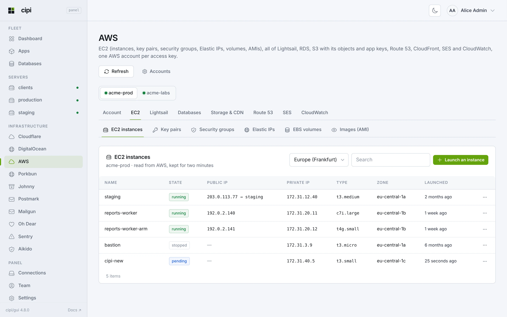
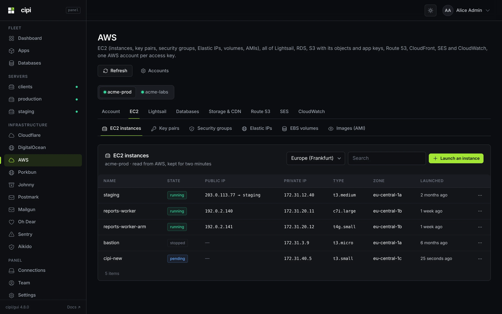
</div>
<figcaption>AWS → EC2: two AWS accounts, the region as a filter, *Launch an instance*; the instance that is the <code>staging</code> server of the panel says so.</figcaption>
</figure>

## Servers by their name {#servers}

The panel already knows your servers and their addresses (Connections). Connectors use that:

- **A DNS record can point at a server by its name.** In the record form, the value suggests the servers of the panel: type `production` and the record is saved with its IP. An A record takes a server with an IPv4, an AAAA one with an IPv6; the wrong family is refused, and so is a server's name as a CNAME. This works in every DNS the panel drives — Cloudflare, DigitalOcean, Hetzner, Route 53, Cloud DNS, Azure, OVHcloud, Vultr, Akamai, Scaleway, Porkbun, Gandi and Namecheap.
- **Every address says which server it is.** In every list of records, and in the public addresses of Droplets, EC2 and Lightsail instances, Hetzner servers and every VPS list: `203.0.113.24 → production`. Also in Cloudflare's IP access rules.

<figure class="gui-shot">
<div class="gui-shot-frame">
<div class="gui-shot-bar" aria-hidden="true"><i></i><i></i><i></i><span class="gui-shot-url">panel.example.com</span></div>
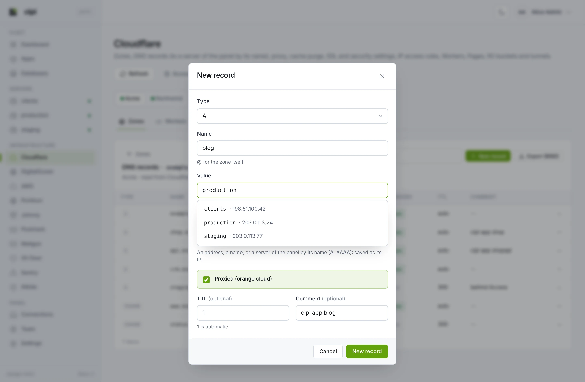
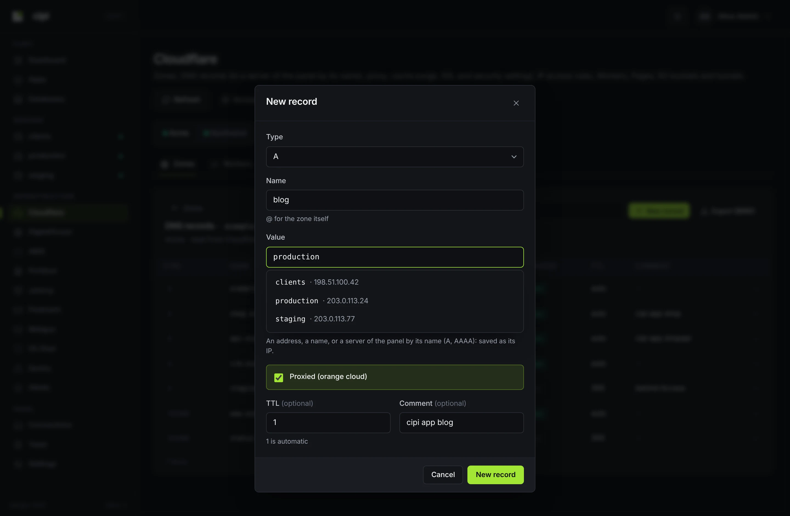
</div>
<figcaption>A new record for <code>blog</code>: the value suggests the panel&rsquo;s servers, and <code>production</code> is saved as <code>203.0.113.24</code>.</figcaption>
</figure>

<figure class="gui-shot">
<div class="gui-shot-frame">
<div class="gui-shot-bar" aria-hidden="true"><i></i><i></i><i></i><span class="gui-shot-url">panel.example.com</span></div>
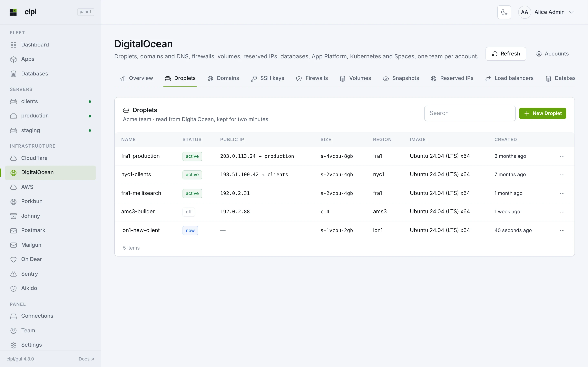
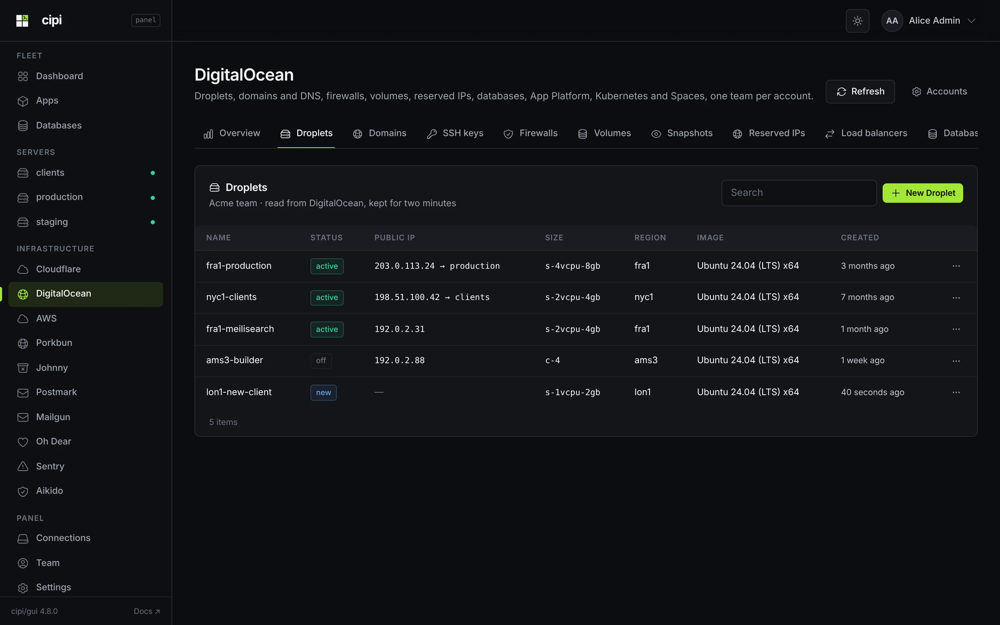
</div>
<figcaption>DigitalOcean → Droplets: <code>fra1-production</code> and <code>nyc1-clients</code> are the panel&rsquo;s <code>production</code> and <code>clients</code>. *New Droplet* takes a size, a region, SSH keys and cloud-init.</figcaption>
</figure>

A new server from a provider is a fresh Ubuntu machine: install Cipi on it (`wget -O - https://cipi.sh/setup.sh | bash`, or as the cloud-init of DigitalOcean, Hetzner, EC2 and Lightsail), then add it on Connections. See [installation](/docs/installation).

## DNS for email, on Cloudflare {#publish-dns}

A mail domain on Postmark, Mailgun, Resend or Amazon SES, a target to verify on Hackly: each asks for DNS records. **Publish DNS on Cloudflare** writes them into the Cloudflare zone of the domain, on whichever Cloudflare account of the panel has it. Records already there are kept; a CNAME that points elsewhere is reported, never overwritten. The outcome lists what was added and what was already there.

<figure class="gui-shot">
<div class="gui-shot-frame">
<div class="gui-shot-bar" aria-hidden="true"><i></i><i></i><i></i><span class="gui-shot-url">panel.example.com</span></div>
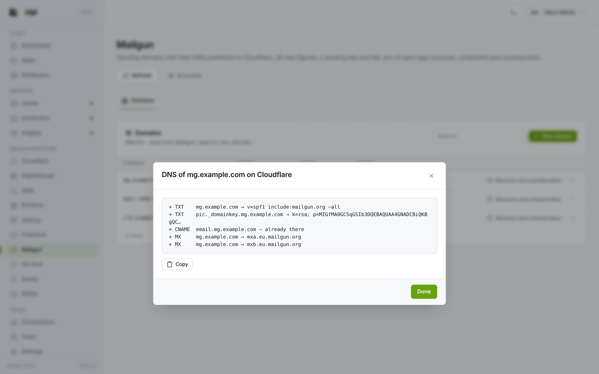
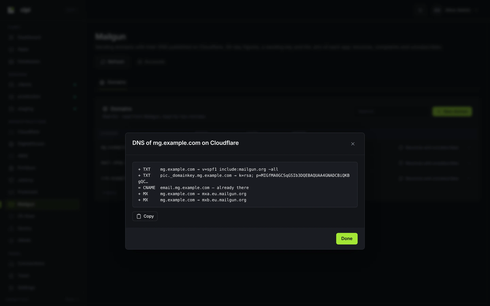
</div>
<figcaption>Mailgun → mg.example.com → Publish DNS on Cloudflare: SPF, DKIM and the MX records added, the tracking CNAME already there.</figcaption>
</figure>

On the registrars — Porkbun, Gandi and Namecheap — **Point to Cloudflare** sets a domain's nameservers to the ones Cloudflare assigned to its zone (add the zone on Cloudflare first, from the panel too). Nameservers can also be set by hand.

## A bucket and its key for an app {#bucket-keys}

On AWS S3, Wasabi, DigitalOcean Spaces, Backblaze B2 and Johnny, **Key for an app** makes a key that opens **that bucket only** — read and write, or read only — and shows the lines of the app's `.env`:

```bash
AWS_ACCESS_KEY_ID=AKIA…
AWS_SECRET_ACCESS_KEY=…
AWS_DEFAULT_REGION=eu-central-1
AWS_BUCKET=shop-uploads
AWS_USE_PATH_STYLE_ENDPOINT=false

# The secret is shown once. The key opens shop-uploads only (user cipi-shop-uploads-…).
```

Paste them in the app's [environment](/docs/environment) and Laravel's `s3` disk works. On AWS and Wasabi the key is an IAM user under the path `/cipi/` with a policy for that bucket, listed under *App keys* and revoked from there. Buckets themselves: created private, browsed folder by folder with links that expire, CORS for a site (`https://app.example.com`), expiry rules where the provider has them. Postmark, Mailgun, Resend, Sentry and Boogle give the `.env` of an app the same way: a server token, a sending key, a DSN.

## Errors, uptime and security {#errors}

What breaks, next to where it runs. Sentry's unresolved issues with their events and users, resolved (now or in the next release), ignored or reopened, with the latest event's stack; Oh Dear and Better Stack monitors with every check; Aikido's findings by severity with how to fix them.

<figure class="gui-shot">
<div class="gui-shot-frame">
<div class="gui-shot-bar" aria-hidden="true"><i></i><i></i><i></i><span class="gui-shot-url">panel.example.com</span></div>
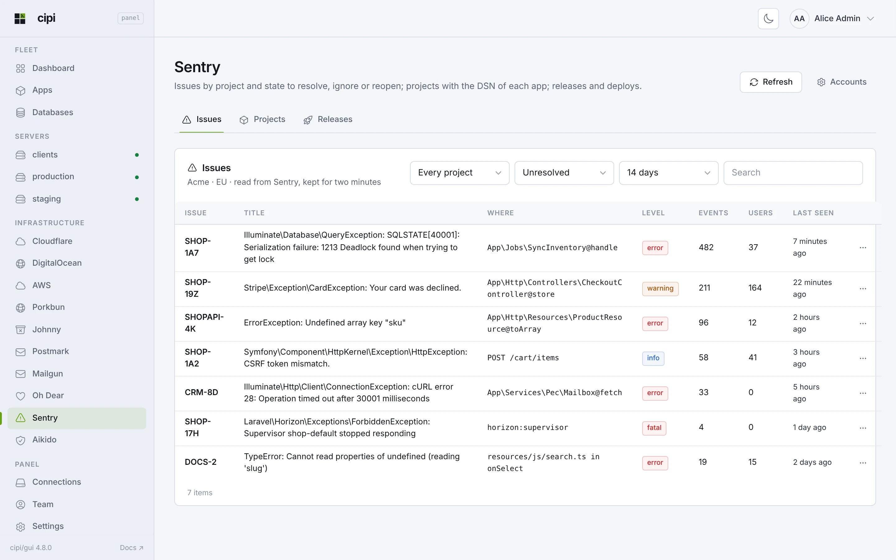
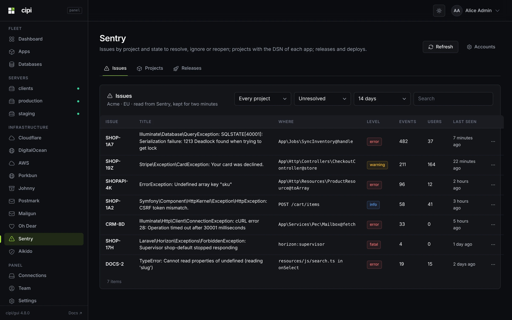
</div>
<figcaption>Sentry → Issues: every project or one, with the actions of each issue in its menu.</figcaption>
</figure>

<div class="gui-shot-grid">
<figure class="gui-shot">
<div class="gui-shot-frame">
<div class="gui-shot-bar" aria-hidden="true"><i></i><i></i><i></i><span class="gui-shot-url">panel.example.com</span></div>
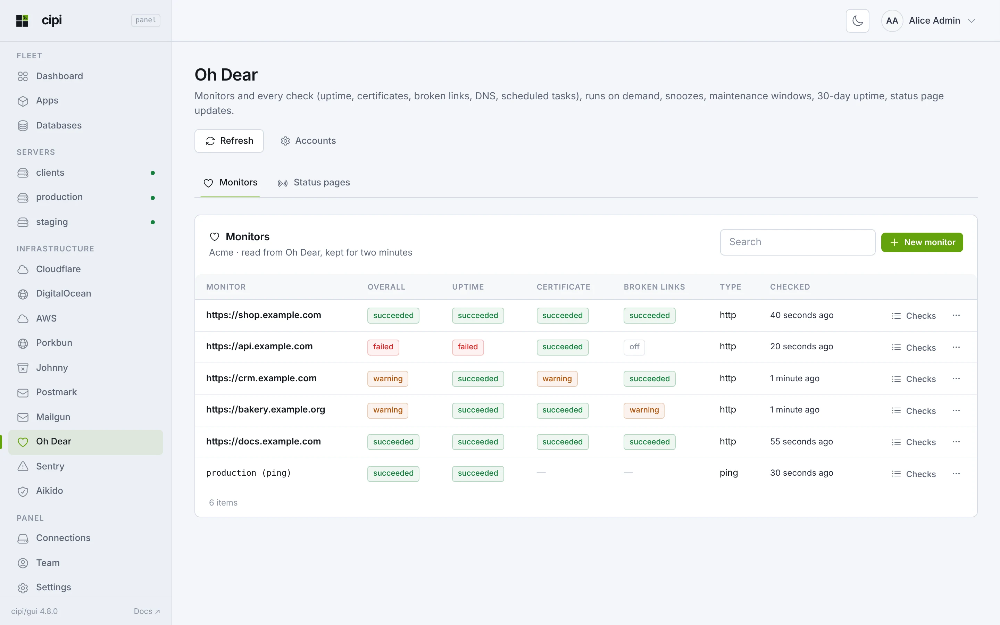
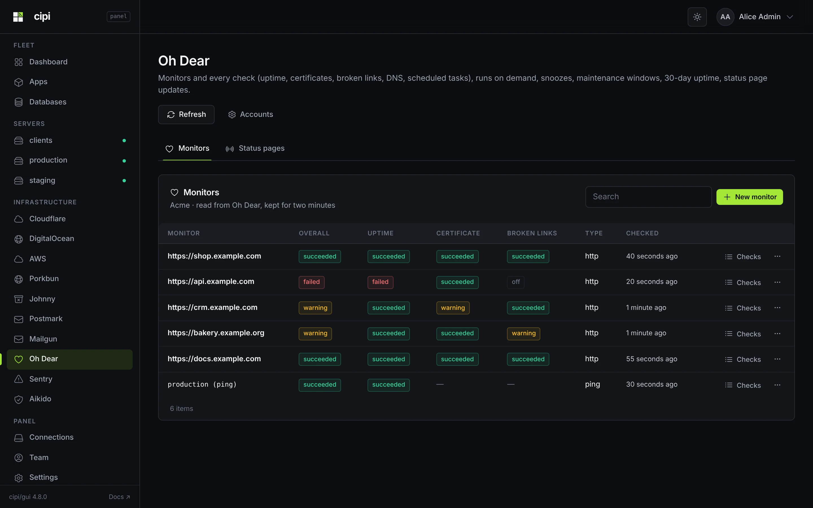
</div>
<figcaption>Oh Dear: each monitor with its checks, run on demand, snoozed, a maintenance window.</figcaption>
</figure>
<figure class="gui-shot">
<div class="gui-shot-frame">
<div class="gui-shot-bar" aria-hidden="true"><i></i><i></i><i></i><span class="gui-shot-url">panel.example.com</span></div>
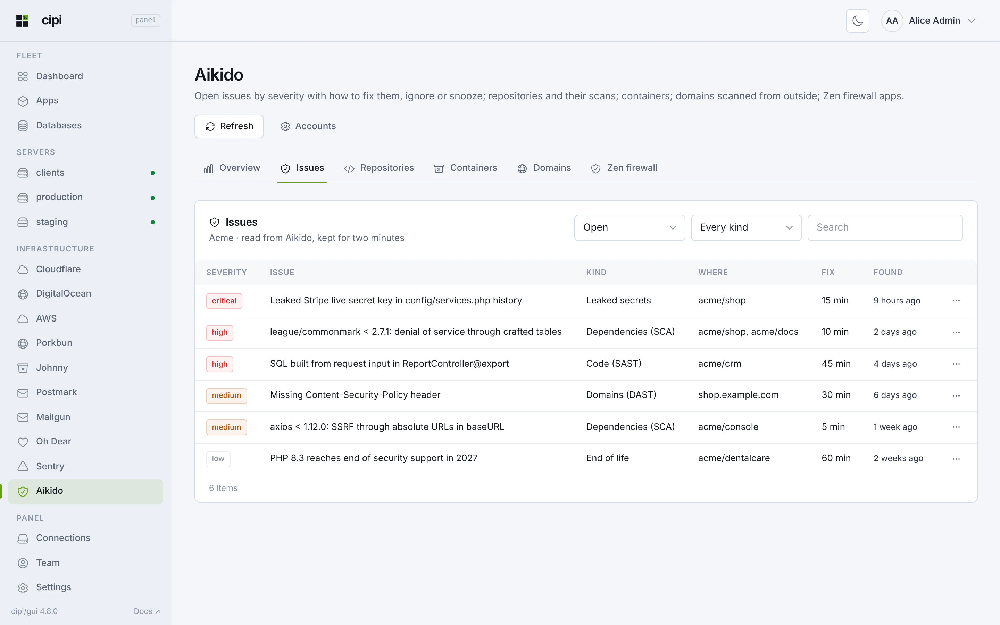
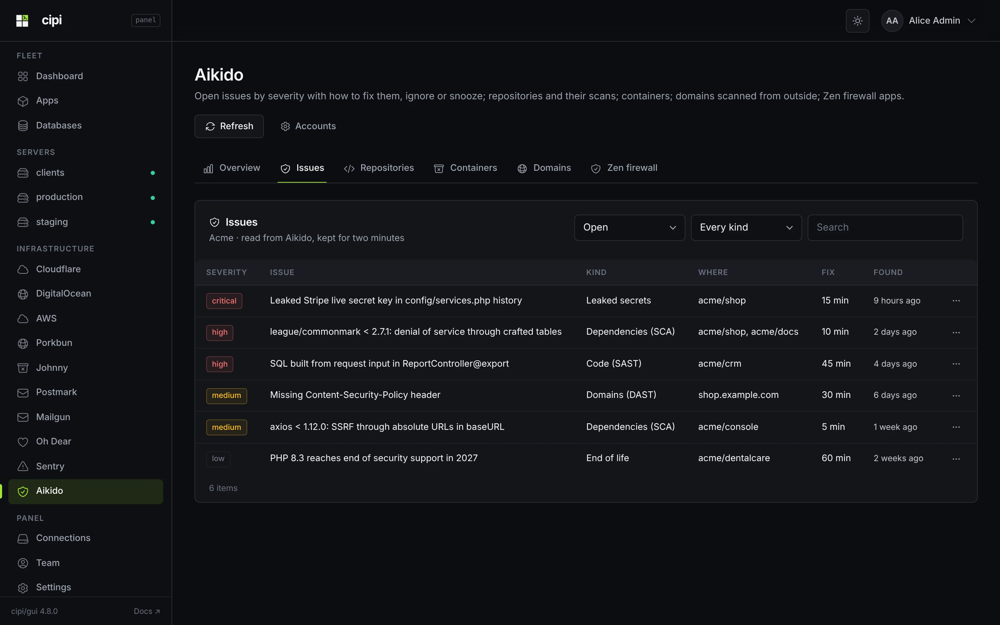
</div>
<figcaption>Aikido: open issues by severity, kind and where, with the time to fix.</figcaption>
</figure>
</div>

## Clouds and servers {#clouds}

### DigitalOcean {#digitalocean}

Droplets, domains and DNS, firewalls, volumes, reserved IPs, databases, App Platform, Kubernetes and Spaces, one team per account.

In the panel: Overview · Droplets · Domains · SSH keys · Firewalls · Volumes · Snapshots · Reserved IPs · Load balancers · Databases · App Platform · Kubernetes · Spaces · Spaces keys.

Also under *Object storage*: Spaces: buckets by region, their files with links that expire, CORS, and Spaces keys scoped to a bucket.

The account asks for **Personal access token**, **Spaces access key** (optional), **Spaces secret key** (optional).

1. cloud.digitalocean.com → API → Tokens → Generate New Token.
2. Scopes: Full Access, or Custom Scopes with read and the actions you use: droplet, domain, firewall, ssh_key, snapshot, volume, reserved_ip, load_balancer, database, app, kubernetes, spaces_key.
3. A token belongs to one team: add an account per team. Set an expiry and renew it here when it ends.
4. Spaces: the token manages the Spaces keys (scope spaces_key). Buckets and their files speak S3, with a Spaces key: make one with full access in the Spaces keys tab, or Spaces Object Storage → Access Keys, and paste it in the two Spaces fields.

- **Personal access token** — API → Tokens → Generate New Token, with read and write scope (or full access) for the team.
- **Spaces access key** — Only to browse Spaces buckets: a Spaces key with full access (the Spaces keys tab makes one). The token alone manages the keys.

DigitalOcean's own guide: [docs.digitalocean.com](https://docs.digitalocean.com/reference/api/create-personal-access-token/).

### Hetzner {#hetzner}

Hetzner Cloud servers, firewalls, volumes, IPs, networks, load balancers, snapshots and DNS, one project per account.

In the panel: Servers · SSH keys · Firewalls · Volumes · Floating IPs · Primary IPs · Networks · Load balancers · Snapshots & backups · Certificates · DNS zones.

The account asks for **API token**.

1. console.hetzner.com → the project → Security → API tokens → Generate API token.
2. Permission: Read & Write (Read alone shows the lists; every action then answers 403).
3. A token reaches one project — its servers, firewalls, volumes, networks, load balancers and DNS zones: add an account per project.

- **API token** — Hetzner Console → the project → Security → API tokens, with Read & Write. A token belongs to one project: add one account per project.

Hetzner's own guide: [docs.hetzner.com](https://docs.hetzner.com/cloud/api/getting-started/generating-api-token/).

### AWS {#aws}

EC2 (instances, key pairs, security groups, Elastic IPs, volumes, AMIs), all of Lightsail, RDS, S3 with its objects and app keys, Route 53, CloudFront, SES and CloudWatch, one AWS account per access key.

In the panel: **Account**: Overview; **EC2**: EC2 instances, Key pairs, Security groups, Elastic IPs, EBS volumes, Images (AMI); **Lightsail**: Instances, Instance snapshots, Static IPs, Disks, Disk snapshots, Key pairs, Databases, Load balancers, Container services, Buckets, DNS zones, Distributions (CDN), Certificates, Alarms, Operations; **Databases**: RDS; **Storage & CDN**: S3 buckets, App keys, CloudFront; **Route 53**; **SES**: SES identities, SES sending, SES suppressed; **CloudWatch**: Alarms, Log groups.

Also under *Object storage*: S3: buckets, their objects with links that expire, CORS, and keys an app can use on one bucket only.

Also under *Email*: SES: domains and addresses, their DKIM records published on Cloudflare, sending quota, suppressed addresses.

Also under *Monitoring and errors*: CloudWatch: alarms (mute, test, delete), log groups and their retention, recent log events.

The account asks for **Access key ID**, **Secret access key**, **Default region**, **Session token** (optional).

1. AWS console → IAM → Users → Create user (no console access), e.g. cipi-panel.
2. Permissions → Attach policies directly: AmazonEC2FullAccess, AmazonLightsailFullAccess, AmazonRDSFullAccess, AmazonS3FullAccess, AmazonRoute53FullAccess, CloudFrontFullAccess, AmazonSESFullAccess, CloudWatchFullAccess and AWSBillingReadOnlyAccess (or their ReadOnly counterparts for a read-only panel).
3. "Key for an app" on a bucket makes an IAM user under `/cipi/` with a policy for that bucket only: it needs IAMFullAccess, or a policy allowing iam:CreateUser, PutUserPolicy, CreateAccessKey, ListUsers, ListAccessKeys, DeleteAccessKey, DeleteUserPolicy and DeleteUser on `arn:aws:iam::*:user/cipi/*`.
4. The user → Security credentials → Create access key → "Application running outside AWS": the key ID and the secret, shown once.
5. The region here is the default one; EC2, Lightsail and RDS pages pick another from their filter.

- **Session token** — Only for temporary credentials. Prefer an IAM user of its own with the policies the panel needs (EC2, Lightsail, RDS, S3, Route 53, CloudFront, SES, CloudWatch).

AWS's own guide: [docs.aws.amazon.com](https://docs.aws.amazon.com/IAM/latest/UserGuide/id_credentials_access-keys.html).

### Google Cloud {#gcp}

Compute Engine instances, firewall rules, static addresses, disks and snapshots, Cloud DNS, Cloud SQL and Storage buckets of a project.

In the panel: VM instances · Firewall rules · Static addresses · Disks · Snapshots · Cloud DNS · Cloud SQL · Storage buckets.

The account asks for **Service account key (JSON)**, **Project ID** (optional).

1. console.cloud.google.com → the project → APIs & Services: enable Compute Engine API, Cloud DNS API and Cloud SQL Admin API.
2. IAM & Admin → Service accounts → Create service account (cipi-panel).
3. Roles: Compute Admin, DNS Administrator, Cloud SQL Viewer (Cloud SQL Admin to restart), Storage Admin — or their Viewer roles for a read-only panel.
4. The account → Keys → Add key → Create new key → JSON: paste the whole file here.
5. One account per project; a key reaches others only where the service account has a role.

- **Service account key (JSON)** — The whole JSON file Google downloads: the panel keeps it encrypted and never shows it again.
- **Project ID** — Empty: the project of the key.

Google Cloud's own guide: [cloud.google.com](https://cloud.google.com/iam/docs/keys-create-delete).

### Microsoft Azure {#azure}

Virtual machines, resource groups, public IP addresses, network security groups, DNS zones and storage accounts of a subscription.

In the panel: Virtual machines · Resource groups · Public IP addresses · Network security groups · DNS zones · Storage accounts.

The account asks for **Tenant ID**, **Application (client) ID**, **Client secret**, **Subscription ID**.

1. portal.azure.com → Microsoft Entra ID → App registrations → New registration (cipi-panel, single tenant): its Application (client) ID and the Tenant ID are on its overview.
2. The app → Certificates & secrets → New client secret: copy its Value now, it is shown once.
3. Subscriptions → the subscription → Access control (IAM) → Add role assignment → Contributor (or Reader, plus Virtual Machine Contributor, Network Contributor and DNS Zone Contributor) → Members: the app.
4. One account per subscription.

- **Tenant ID** — Microsoft Entra ID → Overview → Tenant ID (or the tenant domain)
- **Client secret** — The secret's Value, not its ID

Microsoft Azure's own guide: [learn.microsoft.com](https://learn.microsoft.com/entra/identity-platform/howto-create-service-principal-portal).

### OVHcloud {#ovh}

VPS, dedicated servers, Public Cloud instances, DNS zones and records.

In the panel: VPS · Dedicated servers · Public Cloud · DNS zones.

The account asks for **Region**, **Application key**, **Application secret**, **Consumer key**.

1. Europe: eu.api.ovh.com/createToken — Canada: ca.api.ovh.com/createToken — US: api.us.ovhcloud.com/createToken. Sign in with the account that owns the services.
2. Rights: GET /*, POST /*, PUT /*, DELETE /* for the whole account — or narrower, e.g. GET /vps*, POST /vps/*/reboot, GET /domain/zone*, POST /domain/zone/*, PUT /domain/zone/*, DELETE /domain/zone/*, GET /cloud/*, POST /cloud/*.
3. Validity: unlimited, or a date to renew it here. The page shows the application key, the application secret and the consumer key at once: paste the three.

OVHcloud's own guide: [help.ovhcloud.com](https://help.ovhcloud.com/csm/en-gb-api-getting-started-ovhcloud-api?id=kb_article_view&sysparm_article=KB0042784).

### Vultr {#vultr}

Instances, SSH keys, DNS domains, firewall groups, snapshots, block storage and reserved IPs.

In the panel: Instances · SSH keys · DNS · Firewall groups · Snapshots · Block storage · Reserved IPs.

The account asks for **API key**.

1. my.vultr.com → Account → API → Enable API: the Personal Access Token.
2. Access Control: add the panel server's address (Vultr refuses the key from any other one), or "Allow all IPv4" and "Allow all IPv6".
3. The key has every permission of the user: for a smaller one, a sub-user with the permissions you want (Account → Users) and its own key.

Vultr's own guide: [www.vultr.com](https://www.vultr.com/api/#section/Authentication).

### Akamai (Linode) {#linode}

Linodes, domains and records, Cloud Firewalls, volumes, NodeBalancers, Object Storage buckets and SSH keys.

In the panel: Linodes · Domains · Cloud Firewalls · Volumes · NodeBalancers · Object Storage · SSH keys.

The account asks for **Personal access token**.

1. cloud.linode.com → the profile menu → API Tokens → Create a Personal Access Token.
2. Access: Read/Write for Linodes, Domains, Firewalls, Volumes, NodeBalancers, Object Storage and IPs; Read Only for Account (the name and balance). Expiry: as you like — renew it here.

Akamai (Linode)'s own guide: [techdocs.akamai.com](https://techdocs.akamai.com/cloud-computing/docs/manage-personal-access-tokens).

### Scaleway {#scaleway}

Instances, flexible IPs, security groups, DNS zones and records, managed databases and load balancers.

In the panel: Instances · Flexible IPs · Security groups · DNS zones · Databases · Load balancers.

The account asks for **Secret key**.

1. console.scaleway.com → IAM → Applications → Create application (cipi-panel), then a policy for it: InstancesFullAccess, DomainsDNSFullAccess, RelationalDatabasesReadOnly, LoadBalancersReadOnly (or the FullAccess ones) on the project.
2. The application → API keys → Generate API key: paste the secret key, shown once (the access key is not needed).
3. Instances, IPs, security groups and load balancers have a zone filter, databases a region filter.

Scaleway's own guide: [www.scaleway.com](https://www.scaleway.com/en/docs/iam/how-to/create-api-keys/).

### Contabo {#contabo}

VPS and VDS instances (power, rename), their snapshots, object storages and SSH keys. New servers are ordered in the Control Panel.

In the panel: Instances · Object storage · SSH keys and passwords.

The account asks for **Client ID**, **Client secret**, **API user**, **API password**.

1. my.contabo.com → API: the Client ID, the Client Secret and the API User (your email).
2. API Password: set it from the same page ("Send link"): it is not the password of the Control Panel.

Contabo's own guide: [contabo.com](https://contabo.com/blog/kb/103000270527-how-can-i-access-the-contabo-api).

### UpCloud {#upcloud}

Cloud servers (create with an SSH key, power, delete) and their firewall, storages and backups, IP addresses and reverse DNS.

In the panel: Servers · Storages · IP addresses.

The account asks for **API token** (optional), **Subaccount** (optional), **Subaccount password** (optional).

1. hub.upcloud.com → Account → API tokens → Create token: it starts with ucat_. Set an expiry and, for safety, the panel server's address as the only allowed range.
2. Or People → Create subaccount with "API connections" allowed (and from the panel server's address): its username and password go in the two fields below the token.

- **API token** — Or a subaccount with API access, below.

UpCloud's own guide: [upcloud.com](https://upcloud.com/docs/guides/managing-api-tokens/).

## Domains and DNS {#dns}

### Cloudflare {#cloudflare}

Zones, DNS records (to a server of the panel by its name), proxy, cache purge, SSL and security settings, IP access rules, Workers, Pages, R2 buckets and tunnels.

In the panel: Zones · Workers · Pages · R2 buckets · Tunnels.

Also under *Object storage*: R2: buckets, custom domains, the public r2.dev address, CORS and expiry rules.

The account asks for **API token**.

1. dash.cloudflare.com → My Profile → API Tokens → Create Token → Create Custom Token.
2. Zone permissions: Zone — Edit (add, pause, delete zones), DNS — Edit, Zone Settings — Edit, Cache Purge — Purge, Firewall Services — Edit (IP access rules).
3. Account permissions, for what you use: Account Settings — Read (the account names), Workers Scripts — Edit, Cloudflare Pages — Edit, Workers R2 Storage — Edit, Cloudflare Tunnel — Read.
4. Zone Resources: All zones (or the account or the zones the panel manages). Client IP filtering: the panel server's address, if you want it tighter.
5. Read-only is possible: the same permissions as Read; the actions that change something then answer 403.
6. The servers' Zero Trust token (`sudo cipi zt token set`) is a different one: it lives on each server, this one in the panel.

- **API token** — An API token, not the Global API Key. One token can reach several Cloudflare accounts: each is a filter of the page.

Cloudflare's own guide: [developers.cloudflare.com](https://developers.cloudflare.com/fundamentals/api/get-started/create-token/).

### Porkbun {#porkbun}

Domains with their expiry and nameservers (by hand, or to their Cloudflare zone), DNS records pointed at a server of the panel by its name.

In the panel: Domains.

The account asks for **API key**, **Secret API key**.

1. porkbun.com → Account → API Access → Create API Key: the API key and the secret, shown once.
2. Domain Management → each domain → Details → API Access: on. Without it Porkbun answers that the domain is not opted in.

Porkbun's own guide: [kb.porkbun.com](https://kb.porkbun.com/article/190-getting-started-with-the-porkbun-api).

### Gandi {#gandi}

Domains with expiry and auto-renewal, nameservers (by hand, or to their Cloudflare zone), LiveDNS records pointed at a server of the panel by its name.

In the panel: Domains.

The account asks for **Personal access token**.

1. admin.gandi.net → Organizations → your organization → Personal Access Tokens → Create a token.
2. Permissions: Domains — "See and renew domain names" and "Manage domain name technical configurations" (nameservers, LiveDNS); restrict it to the domains you want, and set an expiry.

Gandi's own guide: [api.gandi.net](https://api.gandi.net/docs/authentication/).

### Namecheap {#namecheap}

Domains with expiry and auto-renewal, nameservers (Namecheap's, custom, or their Cloudflare zone), host records pointed at a server of the panel by its name.

In the panel: Domains.

The account asks for **API user**, **API key**, **Panel address (IPv4)**, **Sandbox (api.sandbox.namecheap.com)** (optional).

1. namecheap.com → Profile → Tools → Business & Dev Tools → Namecheap API Access → ON (the account needs $50 of balance, 20 domains or $50 spent in the last two years).
2. Whitelisted IPs: add the public IPv4 of the server the panel runs on, and type the same one here.
3. The API key is on the same page; the API user is your username.

- **API user** — Your Namecheap username.
- **Panel address (IPv4)** — The public IPv4 the panel calls from: Namecheap answers only allowlisted addresses.

Namecheap's own guide: [www.namecheap.com](https://www.namecheap.com/support/api/intro/).

## Object storage {#storage}

### Johnny {#johnny}

Your own S3 (johnny.web.ap.it): buckets with quotas, CORS and expiry, scoped keys, a bucket and its key for an app in one go, imports, exports and syncs with other providers.

In the panel: Buckets · Access keys · Connections · Transfers · Scheduled syncs.

The account asks for **Panel address**, **Panel API token**.

1. Johnny panel → Settings → Panel API tokens → New token (e.g. cipi-panel), or on its server: sudo -u www-data php /opt/johnny/panel/artisan johnny:api-token you@example.com --name=cipi-panel.
2. The token acts as the user it belongs to: one of the panel's users, with its password and 2FA, is enough.
3. The panel address is the one you open in the browser, with https://.

- **Panel address** — Where the Johnny panel answers; the API is under /api.

Johnny's own guide: [github.com](https://github.com/andreapollastri/johnny#panel-api).

### Backblaze B2 {#backblaze}

Buckets public or private, their files with links that expire, application keys per bucket with the .env of an app on B2's S3 endpoint.

In the panel: Buckets · Application keys.

The account asks for **Key ID**, **Application key**.

1. secure.backblaze.com → Application Keys → Add a New Application Key.
2. Allow access to: All buckets, Type of access: Read and Write, and tick "Allow List All Bucket Names". The panel then lists buckets and makes keys for apps.
3. Creating and removing keys needs the master application key, or a key with the writeKeys capability (B2 CLI: b2 key create --all-capabilities).
4. The key ID and the key are shown once: paste both here.

Backblaze B2's own guide: [www.backblaze.com](https://www.backblaze.com/docs/cloud-storage-application-keys).

### Wasabi {#wasabi}

Buckets in every region, their objects with links that expire, CORS, and keys for one bucket each with the .env of the app.

In the panel: Buckets · App keys.

The account asks for **Access key**, **Secret key**, **Default region**.

1. console.wasabisys.com → Users → Create User, e.g. cipi-panel, with "Programmatic (create API key)".
2. Policies: WasabiFullAccess, or AmazonS3FullAccess plus IAMFullAccess (IAM is what the "Key for an app" of a bucket uses).
3. Download the access key and the secret key: Wasabi shows the secret once.
4. The region is where new buckets go unless you pick another; the list shows the buckets of every region.

Wasabi's own guide: [docs.wasabi.com](https://docs.wasabi.com/docs/creating-a-user-account-and-access-key).

## Email {#email}

### Postmark {#postmark}

Servers with the .env of each app, outbound figures and bounces; domains with their DKIM and Return-Path published on Cloudflare; sender signatures.

In the panel: Servers · Domains · Sender signatures.

The account asks for **Account API token**.

1. account.postmarkapp.com → Account → API Tokens: the Account API token (only account owners and admins see it).
2. A server token opens one server only and is not enough here: the panel reads each server's token from the account when it needs it.

- **Account API token** — The account token, not a server token: it reaches every server and domain.

Postmark's own guide: [postmarkapp.com](https://postmarkapp.com/developer/api/overview#authentication).

### Mailgun {#mailgun}

Sending domains with their DNS published on Cloudflare, 30-day figures, a sending key and the .env of each app; bounces, complaints and unsubscribes.

In the panel: Domains.

The account asks for **Private API key**, **Region**.

1. app.mailgun.com → your name → API Security → Add new key: a private key with the Admin or Developer role (a domain sending key only sends).
2. The region is where the domains live: EU domains are on api.eu.mailgun.net, the others on api.mailgun.net. Domains of both regions need two accounts here.
3. IP allowlist (API Security): add the panel server's address if you use one.

Mailgun's own guide: [help.mailgun.com](https://help.mailgun.com/hc/en-us/articles/203380100-Where-can-I-find-my-API-keys-and-SMTP-credentials).

### Resend {#resend}

Domains with their DNS published on Cloudflare, verification and tracking; sending keys per domain with the .env of each app.

In the panel: Domains · API keys.

The account asks for **API key**.

1. resend.com → API Keys → Create API Key, permission Full access (a Sending access key cannot read domains).
2. The key is shown once. The apps get keys of their own, sending only, from the API keys tab here.

Resend's own guide: [resend.com](https://resend.com/docs/dashboard/api-keys/introduction).

## Monitoring and errors {#monitoring}

### Boogle {#boogle}

Your errors and uptime (boogle.web.ap.it): projects with the .env of the client, uptime on or off, exceptions to read, fix and close.

In the panel: Projects · Open exceptions · Groups.

The account asks for **Boogle address**, **API token**.

1. Boogle → Profile → API tokens → New token. The admin API answers admin users only: make the token as one.
2. The address is the one you open in the browser, with https://; the panel calls /api/admin under it.

- **API token** — An admin user's token: Boogle → Profile → API tokens.

Boogle's own guide: [github.com](https://github.com/andreapollastri/boogle#admin-api).

### Oh Dear {#ohdear}

Monitors and every check (uptime, certificates, broken links, DNS, scheduled tasks), runs on demand, snoozes, maintenance windows, 30-day uptime, status page updates.

In the panel: Monitors · Status pages.

The account asks for **API token**.

1. ohdear.app → your avatar → API tokens → Create token. The token reaches every team you are in.
2. New monitors go to a team: the form asks which one.

Oh Dear's own guide: [ohdear.app](https://ohdear.app/docs/api/introduction).

### Better Stack {#betterstack}

Uptime monitors (pause, resume, 30-day availability), heartbeats for cron jobs and queues, incidents to acknowledge and resolve, status pages.

In the panel: Monitors · Heartbeats · Incidents · Status pages.

The account asks for **Uptime API token**.

1. betterstack.com → Uptime → Settings (the team) → API tokens → Create API token: a team token reaches that team's monitors.
2. A global token reaches every team but needs a team name on each new monitor: prefer a team token, one account per team.

Better Stack's own guide: [betterstack.com](https://betterstack.com/docs/uptime/api/getting-started-with-uptime-api/).

### Sentry {#sentry}

Issues by project and state to resolve, ignore or reopen; projects with the DSN of each app; releases and deploys.

In the panel: Issues · Projects · Releases.

The account asks for **Sentry** (optional), **Self-hosted address** (optional), **Organization slug**, **Personal token**.

1. Sentry → User settings → Personal Tokens → Create New Token.
2. Scopes: org:read, team:read, project:read, project:write, project:releases, event:read, event:write (event:admin to delete issues).
3. An organization token (Settings → Developer Settings → Organization Tokens) only reads and makes releases: it cannot resolve issues.
4. EU organizations live on de.sentry.io: pick it, or the calls answer 404.

- **Sentry** — Self-hosted: type its address in "Self-hosted address" instead.
- **Organization slug** — In the address of Sentry: /organizations/<slug>/.

Sentry's own guide: [docs.sentry.io](https://docs.sentry.io/api/auth/).

### Datadog {#datadog}

Monitors and their state, muted for a while with a downtime and back; downtimes; hosts reporting and muted; dashboards; SLOs.

In the panel: Monitors · Downtimes · Hosts · Dashboards · SLOs.

The account asks for **Site**, **API key**, **Application key**.

1. Datadog → Organization Settings → API Keys → New Key: the API key.
2. Organization Settings → Application Keys → New Key, with scopes monitors_read, monitors_write, monitors_downtime, hosts_read, dashboards_read, slos_read (or no scope: the key gets your permissions).
3. The site is the one in the address of Datadog: app.datadoghq.eu is EU, us5.datadoghq.com is US5.

Datadog's own guide: [docs.datadoghq.com](https://docs.datadoghq.com/account_management/api-app-keys/).

## Security {#security}

### Aikido {#aikido}

Open issues by severity with how to fix them, ignore or snooze; repositories and their scans; containers; domains scanned from outside; Zen firewall apps.

In the panel: Overview · Issues · Repositories · Containers · Domains · Zen firewall.

The account asks for **Region**, **Client ID**, **Client secret**.

1. Aikido → Settings → Integrations → Public REST API → Add client (workspace admins only; the plan must include the REST API).
2. Scopes: basics:read, issues:read, issues:write, repositories:read, repositories:write, domains:read, domains:write, firewall:read, firewall:write.
3. The region is the one in the address of Aikido: app.aikido.dev is Europe, app.us.aikido.dev the US.

Aikido's own guide: [apidocs.aikido.dev](https://apidocs.aikido.dev/reference/authorization).

### Hackly {#hackly}

Your scanner (hackly.web.ap.it): posture score, targets with their ownership TXT published on Cloudflare, repositories, scans with reports, findings to triage.

In the panel: Posture · Targets · Repositories · Findings · Scans.

The account asks for **Hackly address**, **API token**.

1. Hackly → Profile → API tokens → New token with the ability "*" (or "write": scans and triage; "read" only lists), or on its server: php artisan hackly:token.
2. The address is the one you open in the browser, with https://; the panel calls /api/v1 under it.
3. Targets need their ownership TXT record before Hackly scans them: with a Cloudflare account in the panel, "Publish DNS on Cloudflare" writes it.

Hackly's own guide: [hackly.web.ap.it](https://hackly.web.ap.it/#docs).

## What stays out {#limits}

- **Not for users.** Connectors are for admins; the team's other accounts do not see them.
- **Not on the servers.** The Cloudflare token of the panel is not the one of [Zero Trust](/docs/zero-trust) (`sudo cipi zt token set`), which lives on each server; DNS for [certificates](/docs/ssl) keeps its own as well.
- **Not a billing console.** Accounts, plans and payment methods stay on each provider; Contabo's servers are ordered in its Control Panel.
