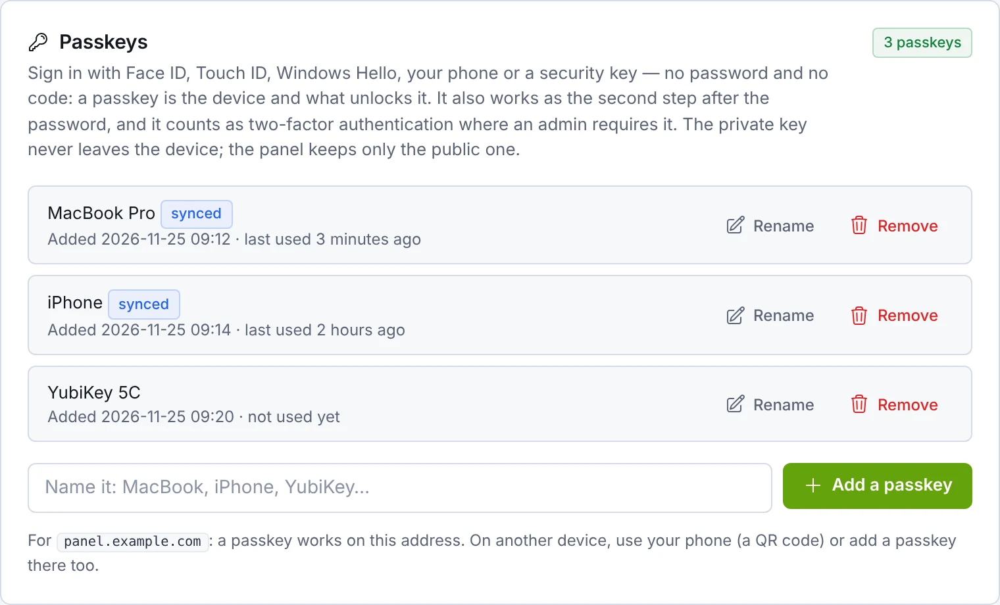
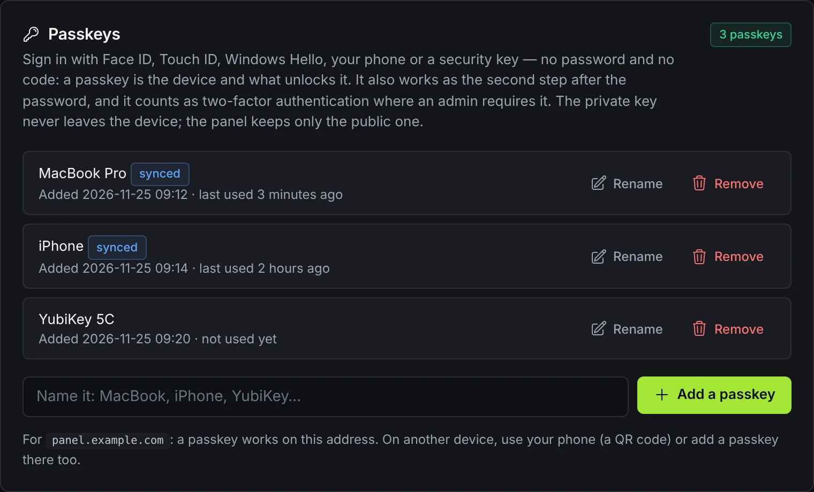
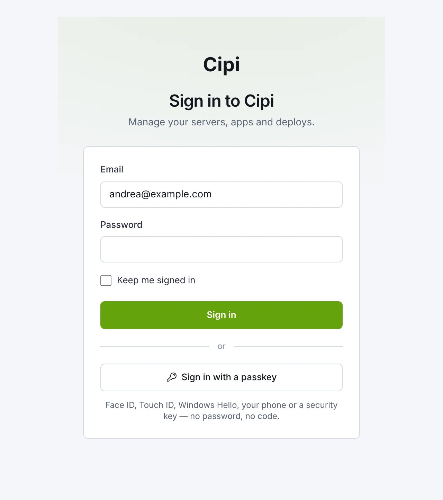
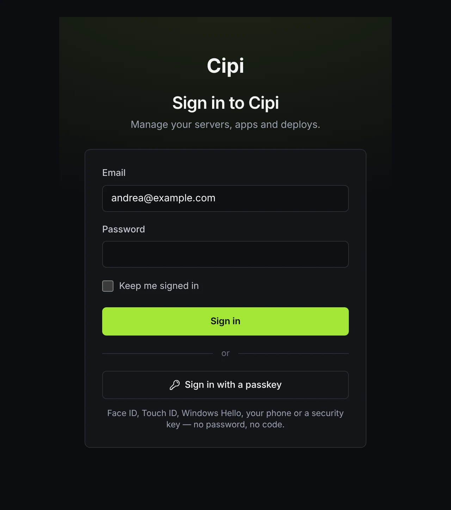

@section gui-requirements

<cipi-term name="gui-install"></cipi-term>

## Requirements {#requirements}

The panel talks to servers **only through the Cipi API**. Before installing it:

| You need | Details |
| --- | --- |
| A Cipi server to host it | One of the servers you manage, or a small dedicated box |
| A hostname of its own | e.g. `panel.example.com`, with an `A`/`AAAA` record pointing at that server. It can't share a hostname with an app or with the API (`api.example.com`); Cipi refuses a taken domain |
| `cipi api` on every managed server | With a full-access token, see [API setup](/docs/api) |

```bash
$ cipi api token create --name=gui --full-access   # every ability, including future ones
```

PHP, the FPM pool, the Nginx vhost and the scheduler are provisioned by the installer: no Laravel setup by hand.

@section gui-install

## Install: `cipi gui <domain>` {#install}

```bash
$ cipi gui panel.example.com
```

```flow
DNS check | domain must point here
> The panel's domain (e.g. `panel.example.com`) must already point at this server, or the certificate can't be issued. The installer checks it first.
Provision | FPM pool, vhost, cron
> Cipi creates the panel's own PHP-FPM pool, Nginx vhost and cron, isolated from your apps.
First admin | e-mail + password
> You choose the first administrator's e-mail and password. More users and roles come later, from the panel.
Certificate | Let's Encrypt, HTTPS on
> A Let's Encrypt certificate is issued and HTTPS is enforced. Open the URL and log in.
```

The app is bundled at `/opt/cipi/gui`; settings go to `/etc/cipi/gui.json`. The admin password needs **12+ characters** with upper and lower case, a digit and a symbol, and no more than 4 identical characters in a row.

| Flag | Use it when |
| --- | --- |
| `--skip-dns-check` | Behind a NAT or proxy the check can't see through |
| `--no-ssl` | You'll issue the certificate later with `cipi gui ssl` |

@section gui-ssl

## SSL: `cipi gui ssl` {#ssl}

Issues (or re-issues) the Let's Encrypt certificate and switches the panel to HTTPS, for a certificate skipped with `--no-ssl` or one that failed. It checks DNS first, exits 1 if certbot fails, and renews with the same automation as app domains.

```bash
$ cipi gui ssl
```

@section gui-move

## Change domain: `cipi gui move` {#move}

```bash
$ cipi gui move panel.newdomain.com           # move and issue the new certificate
$ cipi gui move panel.newdomain.com --no-ssl  # certificate later
```

| What happens | Detail |
| --- | --- |
| Kept | Accounts, 2FA enrolments, server connections (admins sign in again) |
| Vhost | Rewritten; if `nginx -t` rejects it, the old one comes back and nothing changes |
| Config | `/etc/cipi/gui.json` and `APP_URL` updated |
| SSL | Old certificate deleted, new one issued; on failure the panel stays on HTTP until `cipi gui ssl` |

Managed servers need no change: the panel calls their API URLs, and their allowlists are by IP. To move a server's API, use [`cipi api move`](/docs/api) there and update its URL under Connections.

> [!info] With [Cloudflare Zero Trust](/docs/zero-trust): run `cipi zt hostname remove --gui` before the move, then `cipi zt hostname add --gui` and `cipi zt access enable --gui`. The move refuses to run while the hostname is on the tunnel.

@section gui-2fa

## Two-factor authentication {#two-factor}

Session login with **TOTP** (Google Authenticator, 1Password, Aegis…) or a [passkey](#passkeys), enrolled from Settings: optional per user by default, or required for every account. With [single sign-on](/docs/gui-sso), MFA is the identity provider's job and the TOTP step is skipped for SSO sign-ins.

### Required for every account {#two-factor-required}

For policies that ask it of every account (ISO 27001, NIS2), an admin turns on **Team → Two-factor authentication** (setting `enforce_2fa`, off by default). Nothing changes on the servers.

| Who | What happens |
| --- | --- |
| An account without 2FA signing in with its password | Taken to the setup (`/2fa/setup`: QR code, setup key, the first code to confirm) before anything else, then to the page it asked for |
| A session already open when it's turned on | Taken there at its next page; an action from a page left open is refused the same way |
| A new user | The invite link opens on the setup |
| SSO sign-ins | Left to the identity provider's MFA, as always. The same account signing in with its password is asked |
| Accounts with 2FA | Can't turn it off while it's required; they can **move it to a new device** (the old one works until a code of the new one checks out) |

An admin can turn it on only once their own session passes it (2FA set up, or signed in through SSO). Team then shows who still has to set it up (*Setup pending*; *Via SSO* for linked accounts). [`cipi compliance`](/docs/compliance#controls), control `gui_2fa`, reads the policy: required with everyone enrolled is a pass.

### Passkeys {#passkeys}

Face ID, Touch ID, Windows Hello, a phone or a security key. A passkey is two factors in one — the device, and the face, finger or PIN that unlocks it — so it is used two ways:

- **alone**, from the login page: *Sign in with a passkey*, also offered by the browser as the email field is filled. No password, no code after it;
- **as the second step** after the password, instead of the authenticator's code. An account with both is offered both.

Each person adds, renames and removes their own in **Settings → Passkeys**, named after the device; synced passkeys (iCloud Keychain, Google Password Manager, 1Password) say so. Where an admin [requires 2FA](#two-factor-required), a passkey can be set up instead of an authenticator app and counts as 2FA: on Team, for the policy and for [`cipi compliance`](/docs/compliance#controls). The last one can't be removed while it is the account's only second factor under that policy.

<div class="gui-shot-grid">
<figure class="gui-shot">
<div class="gui-shot-frame">
<div class="gui-shot-bar" aria-hidden="true"><i></i><i></i><i></i><span class="gui-shot-url">panel.example.com</span></div>


</div>
<figcaption>Settings → Passkeys: three devices, two of them synced.</figcaption>
</figure>
<figure class="gui-shot">
<div class="gui-shot-frame">
<div class="gui-shot-bar" aria-hidden="true"><i></i><i></i><i></i><span class="gui-shot-url">panel.example.com</span></div>


</div>
<figcaption>The login page, with a passkey alone.</figcaption>
</figure>
</div>

The panel checks WebAuthn itself, with no library: a challenge used once and valid for five minutes, the origin, the relying party, user presence and verification, the signature and its counter; ES256 and RS256, no attestation asked. The private key never leaves the device; the panel keeps the public one.

| Setting (the panel's `.env`, `/opt/cipi/gui/.env`) | Effect |
| --- | --- |
| `CIPI_GUI_PASSKEYS=false` | Passkeys off: the button, Settings → Passkeys and the second step. On by default; off anyway where [SSO is the only way in](/docs/gui-sso) |
| `CIPI_GUI_PASSKEYS_RP_ID=example.com` | The relying party: by default the panel's host. A parent domain shares passkeys with its subdomains |

> [!note] A passkey belongs to the panel's domain. After [`cipi gui move`](#move) to another one, each person signs in with the password (and the authenticator's code) and adds a passkey again — unless `CIPI_GUI_PASSKEYS_RP_ID` names a parent domain of both. After changing the `.env`: `sudo -u www-data php /opt/cipi/gui/artisan config:clear`.

### Lost a second factor {#two-factor-reset}

An admin clicks **Reset 2FA** on the account in Team (not for your own account): it removes the authenticator and the account's passkeys. From the server, [`cipi gui reset-user`](/docs/gui-maintenance) rewrites an account and removes the enrolment, passkeys included. With 2FA required, the account sets it up again at its next sign-in.
