@section gui-overview

Cipi is **CLI-first**, and always will be. The web panel is an **optional** layer for people who prefer a browser: your team, a client, or you on a phone. It's a self-hosted Laravel app that drives one or many Cipi servers through the same [REST API](/docs/api) as the CLI client and WHMCS. No proprietary control plane, no SaaS, no extra cost.

<cipi-panel></cipi-panel>

Real screens of the panel, in motion. Pick a clip, or let them play. Every screen is in the [tour below](#gui-tour).

> [!tip] **Skip it and nothing changes.** Without the panel Cipi stays a lean CLI: no daemon, no web surface, nothing extra listening. Anything done in the browser can be done in the terminal, and the other way round.

<figure class="gui-shot">
<div class="gui-shot-frame">
<div class="gui-shot-bar" aria-hidden="true"><i></i><i></i><i></i><span class="gui-shot-url">panel.example.com</span></div>
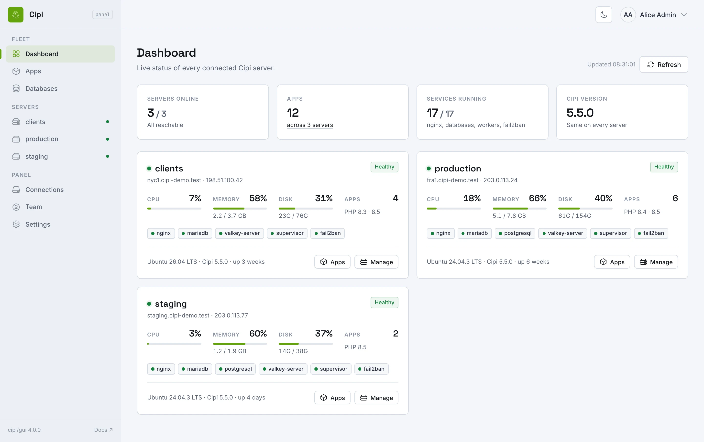
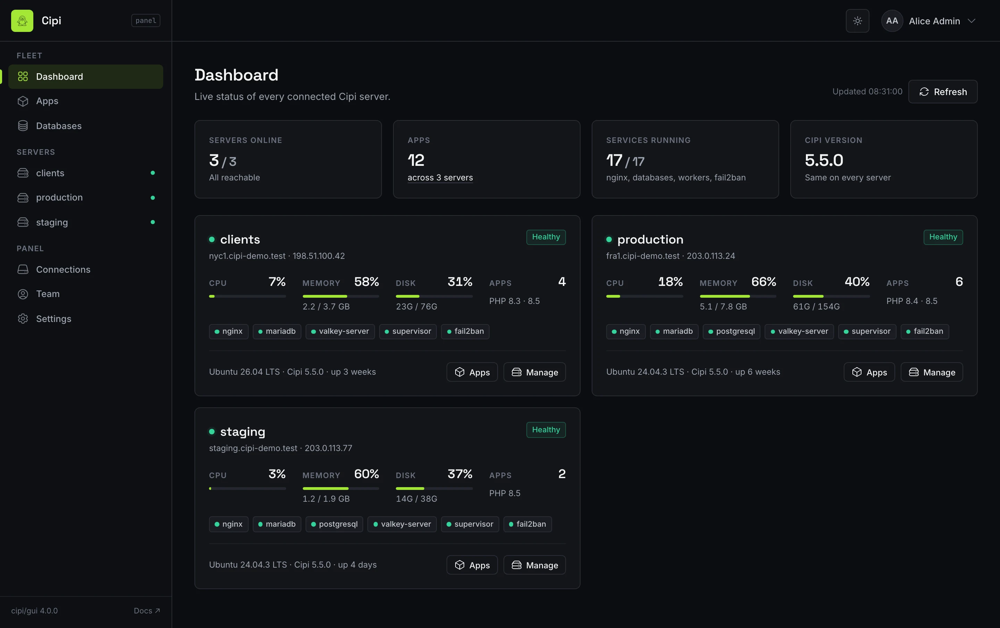
</div>
<figcaption>The dashboard queries every connected server at once — status, resources, services and Cipi version.</figcaption>
</figure>

```stack
Browser | panel.example.com
cipi/gui | Laravel app on one Cipi server
Cipi API | api.<server>, one per managed server
cipi CLI | does the work, as on SSH
```

## What you can do {#features}

| Area | From the panel |
| --- | --- |
| Apps | Create, edit, suspend, delete Laravel (FPM or Octane), Node (SPA, static, SSR with framework presets) and custom apps; environment label; aliases, www ↔ apex, SSL, basic auth |
| Deploy | Deploy, roll back, unlock; a deploy in progress, whoever started it, with its live log; a [paused commit](/docs/deploying#paused) with *Deploy now* and *Resume automatic deploys* (Cipi 5.13.0+); the hash-chained [deploy audit](/docs/deploy-audit) with durations; a log per deploy |
| `cipi.yml` | The file of the live release, whether it's valid, what applying would change, apply as a job, toggle auto-apply |
| Routing | Whole-app and path redirects, prefix reverse proxies |
| App tooling | `.env` editor with masked secrets and [drag-and-drop ordering](/docs/environment#order) (Cipi 5.13.0+), Composer `auth.json`, Artisan, allowlisted app commands, saved one-click commands |
| Databases | MariaDB (or [MySQL](/docs/databases#mysql), shown as such) or PostgreSQL per app; create, link to apps, back up, restore (also by uploading a `.sql`/`.sql.gz` from your computer, chunked), rotate passwords |
| Backups | A matrix of apps and databases against [backup profiles](/docs/backups): schedule, destination, retention, [paths left out](/docs/backups#exclude-paths), last run; run now, verify, test destinations |
| Metrics | Live charts of CPU, memory, load, network and, per app, requests, 5xx, response time, PHP-FPM and workers, from 1 hour to 30 days, with deploys and incidents marked; uptime bars per day; events; retention and heartbeat ([metrics](/docs/metrics), Cipi 5.11.0+; 5.11.2+ on Ubuntu 26.04) |
| Notifications | Every channel — SMTP, Resend, SES, Slack, Discord, Mattermost, Google Chat, Telegram, ntfy, Pushover, webhooks — added, edited (secrets kept), paused, tested, removed; every trigger on or off by category ([notifications](/docs/notifications#panel), Cipi 5.12.0+) |
| Server | Status, CPU, memory, disk, services, PHP versions, Node runtimes, SSH keys, health checks, IP allowlist, [disk usage](/docs/disk), monitor, Zero Trust status |
| Packages | The [optional packages](/docs/packages#panel) of the server — Browsershot, ffmpeg, LibreOffice, OCR, image optimisers and the rest of the catalog — with what each brings; **Install** and **Remove** as jobs (Cipi 5.14.0+) |
| Firewall | UFW rules in order, open a port or a range, remove what may be removed, block and unblock addresses, Fail2ban and CrowdSec bans with *Unban*, the SSH login threshold, CrowdSec on or off and its allowlist; SSH, 80 and 443 always stay open ([firewall](/docs/firewall#panel), Cipi 5.14.0+) |
| Logs and jobs | App and server logs with filters and live refresh; async jobs in an overlay with colour-coded output; one-time credentials with copy buttons |
| Fleet | Many servers under one login, all apps and databases in one list with a server filter |
| Team | Admins and users; per-server View/Manage and per-app View, Deploy, Edit, Environment, Logs, Commands, Delete; invite links (nothing is e-mailed); who still has to set up 2FA, and *Reset 2FA* after a lost phone |
| Sign-in | Password with TOTP, optional or [required for every account](/docs/gui-install#two-factor-required) (panel 4.6.0+), or [single sign-on](/docs/gui-sso) over OpenID Connect |

Light and dark themes, a phone layout, a time zone per account. A server with an older API or a narrower token keeps working for everything it supports.

> [!security] Permissions are checked on every request, server-side, against the app, server and job the page works on. Installing software, monitor thresholds, Zero Trust changes and the CrowdSec rescue stay on the CLI by design, and the server refuses to close its own SSH, 80 and 443 to the panel.

@section gui-tour

## Screenshot tour {#tour}

Real screenshots of the panel against its demo environment: three fictional servers, documentation-range domains and IPs (`./dev/demo.sh` in the package).

### Apps

Every app of every server in one list, with server and type filters, search and a deploy button per row.

<figure class="gui-shot">
<div class="gui-shot-frame">
<div class="gui-shot-bar" aria-hidden="true"><i></i><i></i><i></i><span class="gui-shot-url">panel.example.com</span></div>

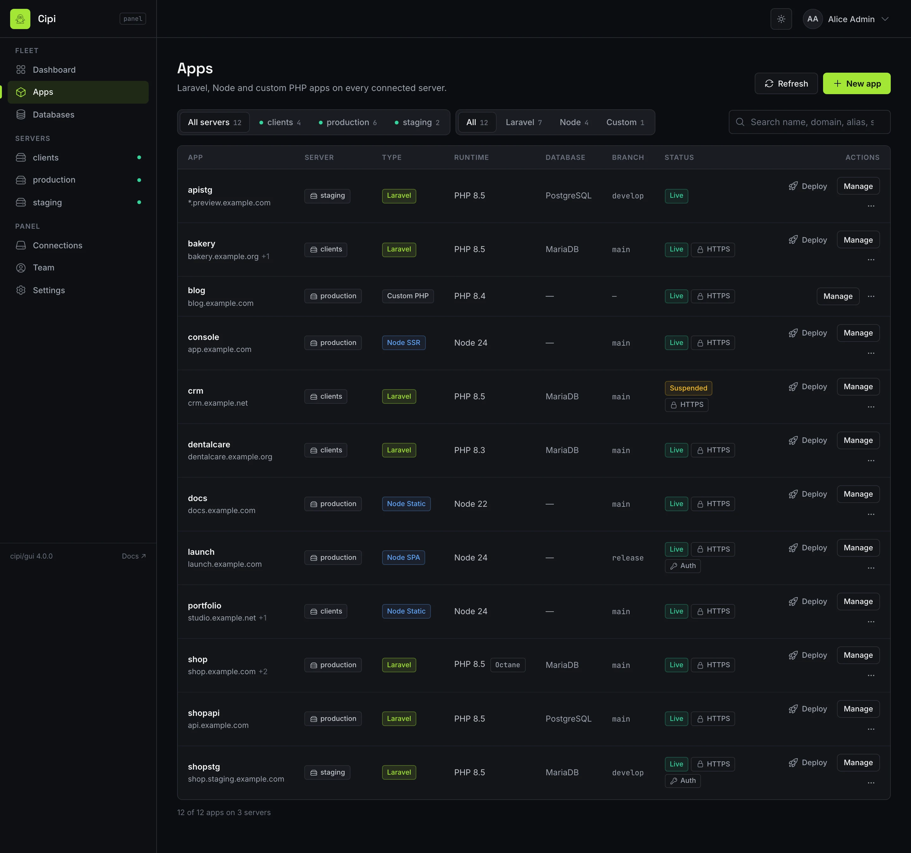
</div>
</figure>

Creating an app starts with its type. Node presets (Next.js, Nuxt, SvelteKit, Astro, Remix, Vite) fill the same defaults as `cipi app create --node`.

<div class="gui-shot-grid">
<figure class="gui-shot">
<div class="gui-shot-frame">
<div class="gui-shot-bar" aria-hidden="true"><i></i><i></i><i></i><span class="gui-shot-url">panel.example.com</span></div>
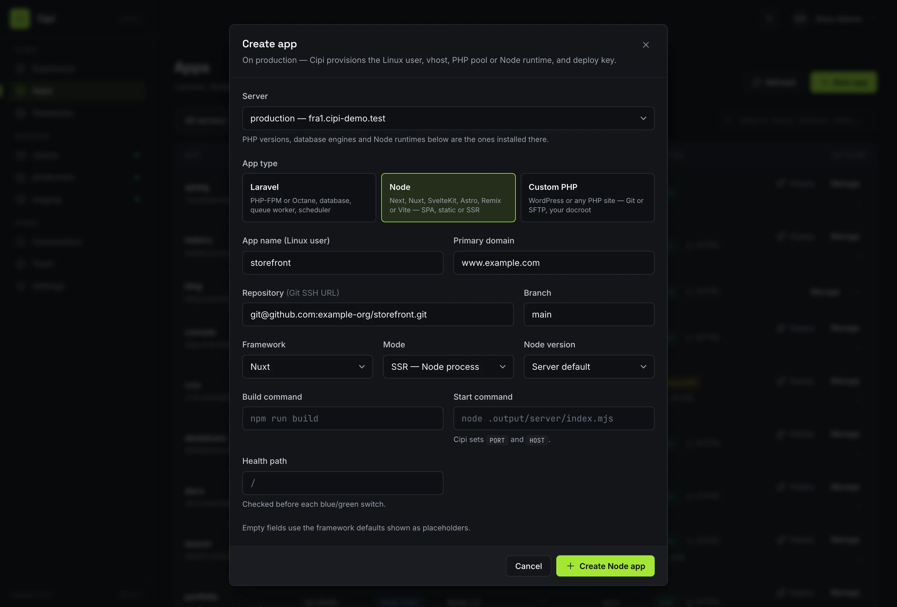
</div>
<figcaption>Create a Node SSR app with the Nuxt preset — with several servers connected, pick where it goes.</figcaption>
</figure>
<figure class="gui-shot">
<div class="gui-shot-frame">
<div class="gui-shot-bar" aria-hidden="true"><i></i><i></i><i></i><span class="gui-shot-url">panel.example.com</span></div>
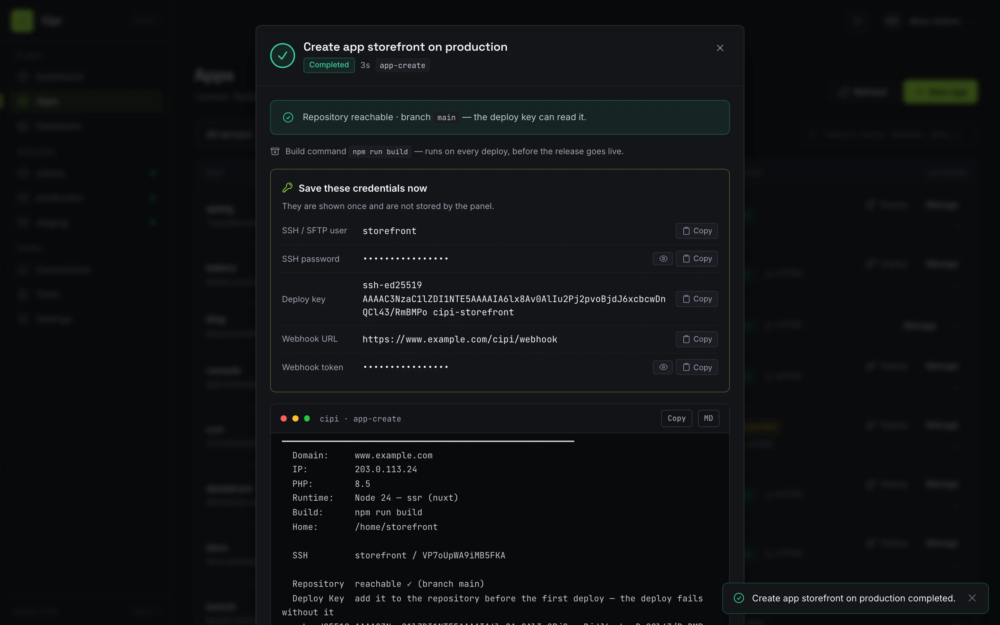
</div>
<figcaption>Credentials returned by the job, with reveal and copy.</figcaption>
</figure>
</div>

### App detail

A header with status, type, runtime and actions, then one tab per area. Tabs live in the URL (`?tab=deploy`), so they can be bookmarked.

<figure class="gui-shot">
<div class="gui-shot-frame">
<div class="gui-shot-bar" aria-hidden="true"><i></i><i></i><i></i><span class="gui-shot-url">panel.example.com</span></div>

</div>
<figcaption>Overview: details, configuration (PHP, Node pin, repository, branch, domain), HTTP healthcheck and Meilisearch.</figcaption>
</figure>

<figure class="gui-shot">
<div class="gui-shot-frame">
<div class="gui-shot-bar" aria-hidden="true"><i></i><i></i><i></i><span class="gui-shot-url">panel.example.com</span></div>

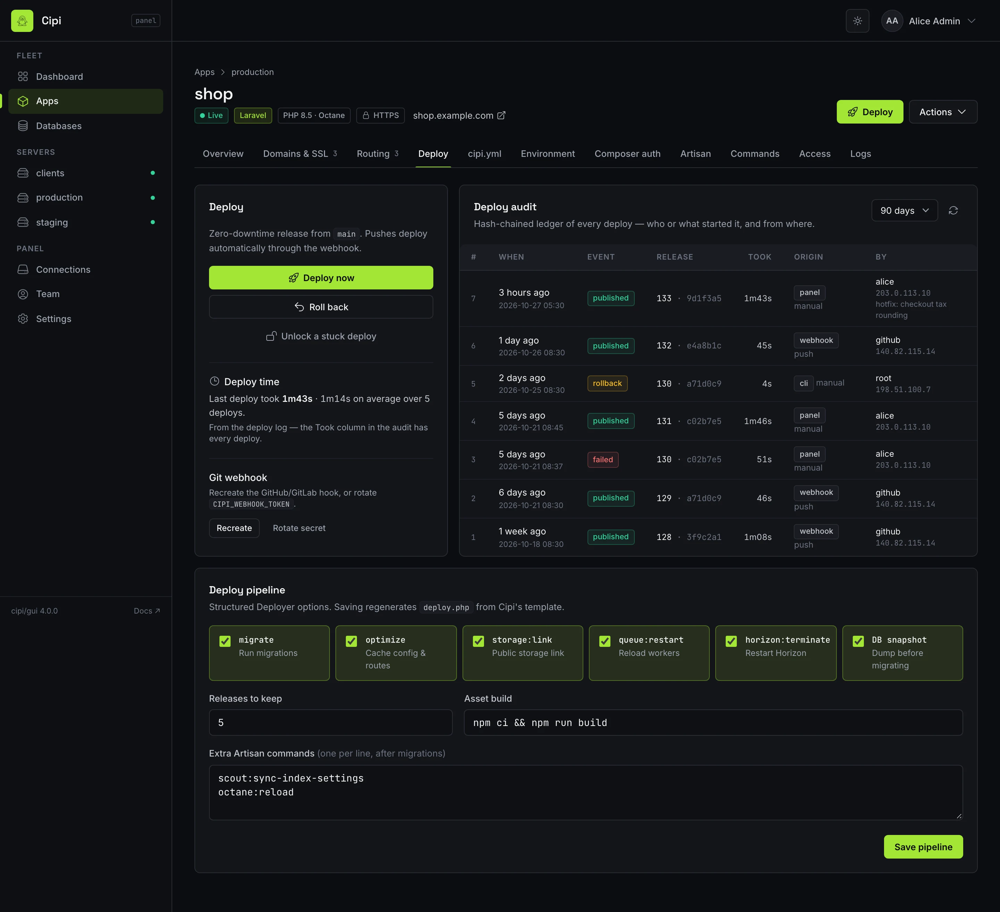
</div>
<figcaption>Deploy: actions, Git webhook, how long the last deploys took, the hash-chained deploy audit with a Took column, and the structured deploy.php pipeline.</figcaption>
</figure>

<div class="gui-shot-grid">
<figure class="gui-shot">
<div class="gui-shot-frame">
<div class="gui-shot-bar" aria-hidden="true"><i></i><i></i><i></i><span class="gui-shot-url">panel.example.com</span></div>
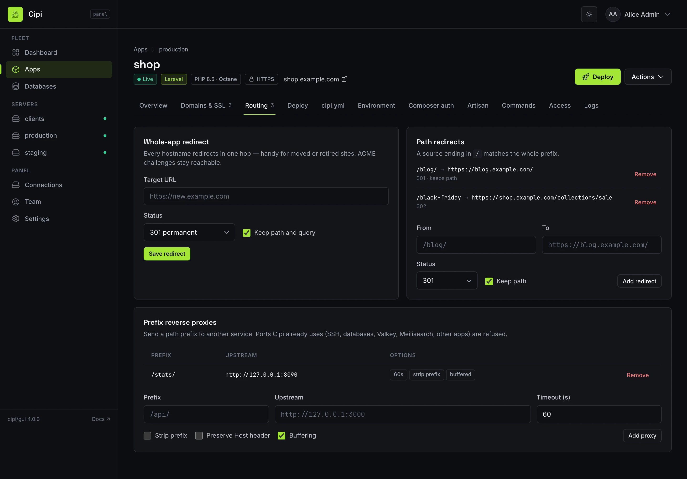
</div>
<figcaption>Routing: whole-app and path redirects, prefix proxies.</figcaption>
</figure>
<figure class="gui-shot">
<div class="gui-shot-frame">
<div class="gui-shot-bar" aria-hidden="true"><i></i><i></i><i></i><span class="gui-shot-url">panel.example.com</span></div>
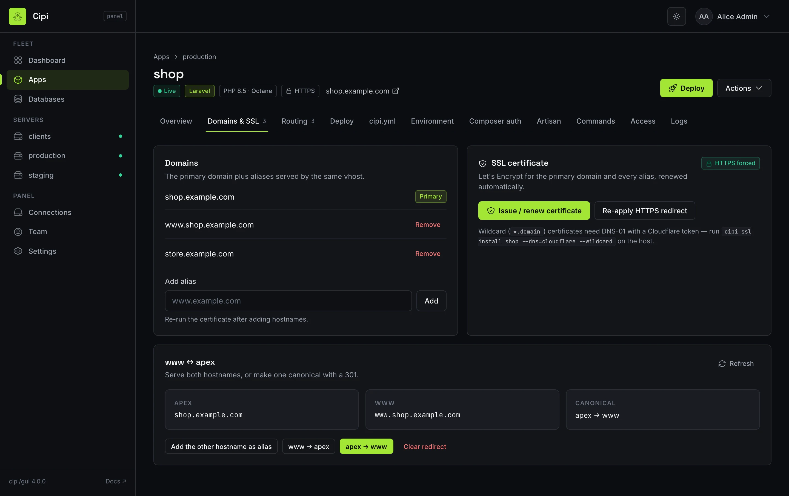
</div>
<figcaption>Domains, Let&rsquo;s Encrypt and www &harr; apex.</figcaption>
</figure>
<figure class="gui-shot">
<div class="gui-shot-frame">
<div class="gui-shot-bar" aria-hidden="true"><i></i><i></i><i></i><span class="gui-shot-url">panel.example.com</span></div>

</div>
<figcaption>.env editing with masked secrets, change tracking and drag-and-drop ordering.</figcaption>
</figure>
<figure class="gui-shot">
<div class="gui-shot-frame">
<div class="gui-shot-bar" aria-hidden="true"><i></i><i></i><i></i><span class="gui-shot-url">panel.example.com</span></div>
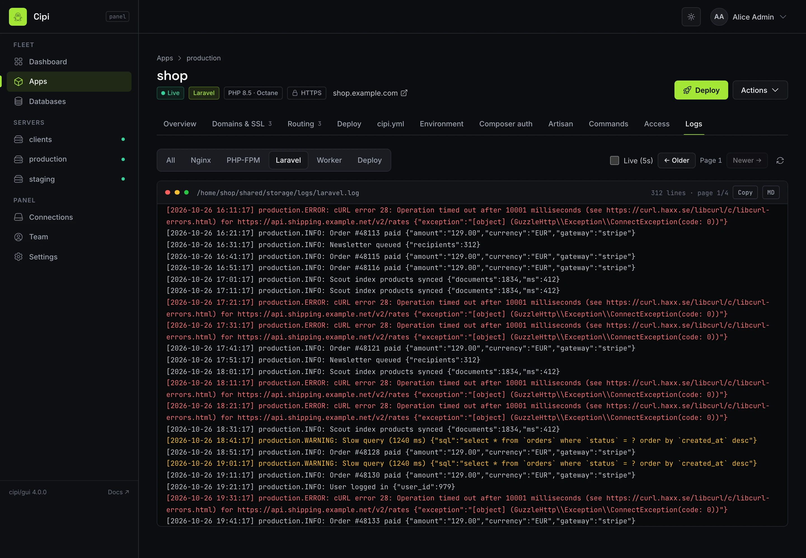
</div>
<figcaption>Logs by type, paginated, with live refresh.</figcaption>
</figure>
</div>

### Jobs

Deploys, SSL and database operations run as async jobs. The overlay polls `GET /api/jobs/{id}`, shows elapsed time and colour-codes the output; closing it leaves the job running.

<figure class="gui-shot">
<div class="gui-shot-frame">
<div class="gui-shot-bar" aria-hidden="true"><i></i><i></i><i></i><span class="gui-shot-url">panel.example.com</span></div>
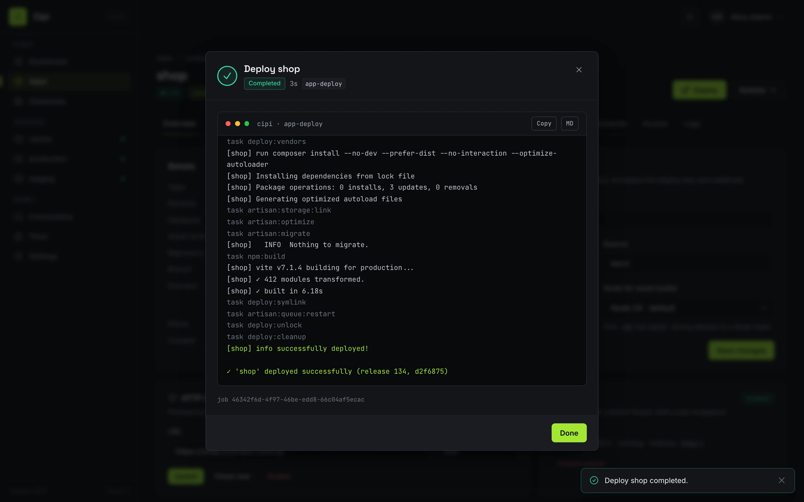
</div>
</figure>

### Databases and server

<div class="gui-shot-grid">
<figure class="gui-shot">
<div class="gui-shot-frame">
<div class="gui-shot-bar" aria-hidden="true"><i></i><i></i><i></i><span class="gui-shot-url">panel.example.com</span></div>

</div>
<figcaption>Databases: create, back up, restore, rotate passwords.</figcaption>
</figure>
<figure class="gui-shot">
<div class="gui-shot-frame">
<div class="gui-shot-bar" aria-hidden="true"><i></i><i></i><i></i><span class="gui-shot-url">panel.example.com</span></div>
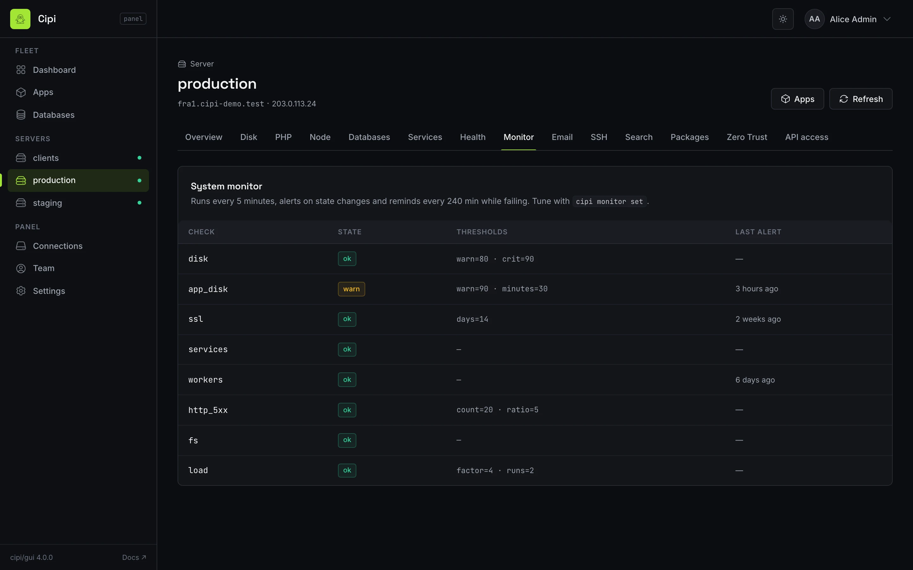
</div>
<figcaption>Monitor checks with thresholds and last alert.</figcaption>
</figure>
</div>

<figure class="gui-shot">
<div class="gui-shot-frame">
<div class="gui-shot-bar" aria-hidden="true"><i></i><i></i><i></i><span class="gui-shot-url">panel.example.com</span></div>
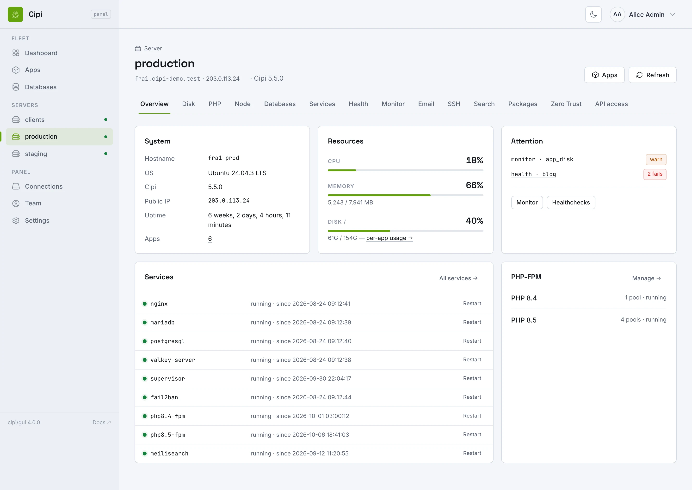
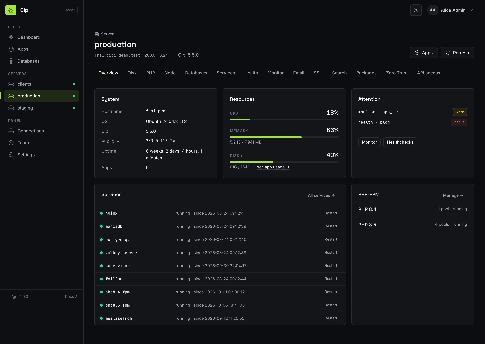
</div>
<figcaption>Server overview: system, resources, monitor and healthcheck alerts, services with restart, PHP-FPM pools.</figcaption>
</figure>

### Metrics

The Metrics tab of a server and of each app: charts from 1 hour to 30 days with releases and incidents marked, uptime per day and the events timeline, refreshed every 30 seconds while open. See [metrics](/docs/metrics).

<figure class="gui-shot">
<div class="gui-shot-frame">
<div class="gui-shot-bar" aria-hidden="true"><i></i><i></i><i></i><span class="gui-shot-url">panel.example.com</span></div>


</div>
<figcaption>Server metrics, with every app's health, requests and uptime below the charts.</figcaption>
</figure>

<figure class="gui-shot">
<div class="gui-shot-frame">
<div class="gui-shot-bar" aria-hidden="true"><i></i><i></i><i></i><span class="gui-shot-url">panel.example.com</span></div>


</div>
<figcaption>App metrics: requests and 5xx, response time, PHP-FPM against max_children, queue workers.</figcaption>
</figure>

<figure class="gui-shot">
<div class="gui-shot-frame">
<div class="gui-shot-bar" aria-hidden="true"><i></i><i></i><i></i><span class="gui-shot-url">panel.example.com</span></div>
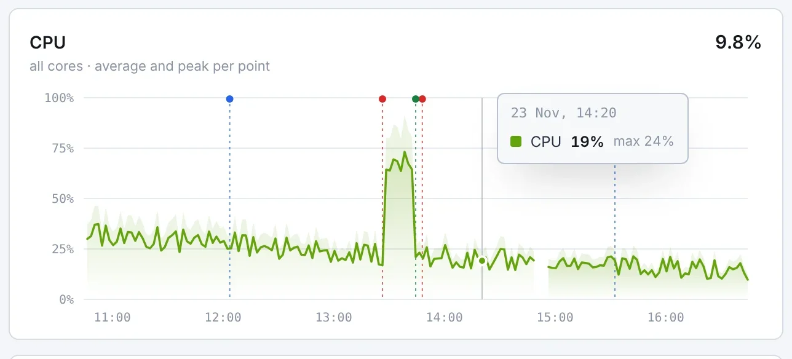
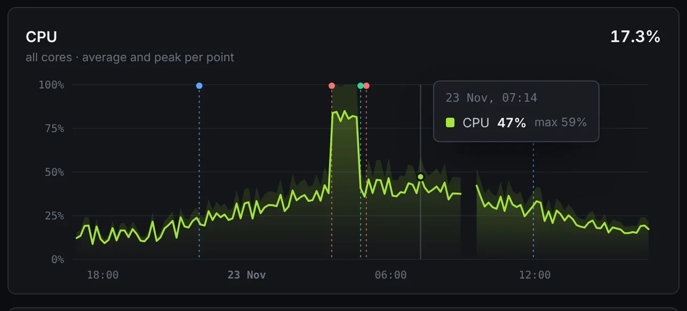
</div>
<figcaption>Hover any point for its time, average and peak.</figcaption>
</figure>

### Notifications

Every channel of the server and which events reach it. Secrets never come back to the panel; an empty secret field keeps the stored one. See [notifications](/docs/notifications#panel).

<figure class="gui-shot">
<div class="gui-shot-frame">
<div class="gui-shot-bar" aria-hidden="true"><i></i><i></i><i></i><span class="gui-shot-url">panel.example.com</span></div>
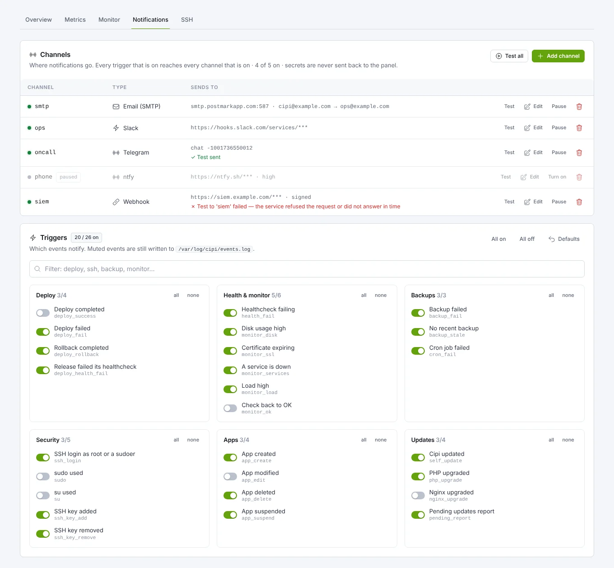
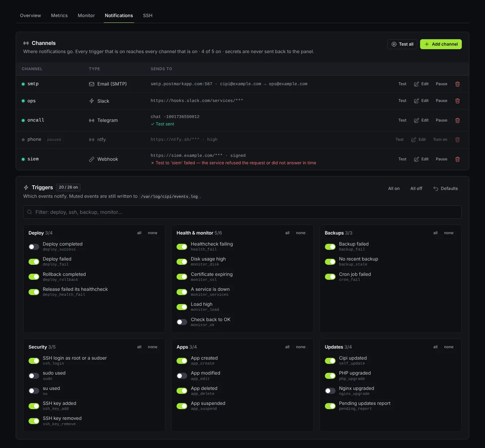
</div>
<figcaption>Channels with the last test result; triggers switched by category and saved together.</figcaption>
</figure>

<figure class="gui-shot">
<div class="gui-shot-frame">
<div class="gui-shot-bar" aria-hidden="true"><i></i><i></i><i></i><span class="gui-shot-url">panel.example.com</span></div>
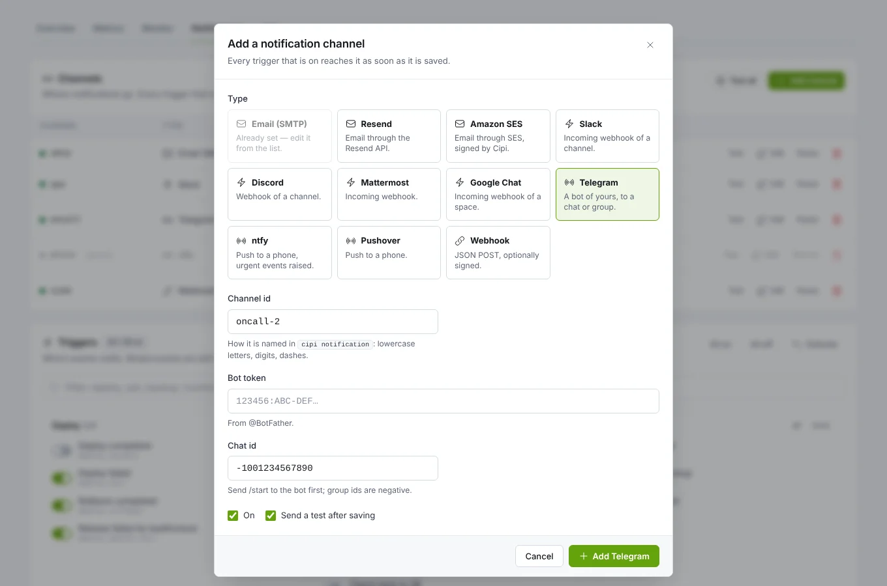

</div>
<figcaption>Adding a channel shows only the fields of its type.</figcaption>
</figure>

### Firewall

UFW, Fail2ban and CrowdSec of the server on one tab: the rules in UFW's order with *Kept open* on SSH, 80 and 443 and the Cipi feature that owns each one, blocked addresses, everything banned right now with *Unban*, the SSH login threshold and CrowdSec with its allowlist. Viewing needs a level on the server, changing needs Manage. See [firewall](/docs/firewall#panel).

### Connections and security

<div class="gui-shot-grid">
<figure class="gui-shot">
<div class="gui-shot-frame">
<div class="gui-shot-bar" aria-hidden="true"><i></i><i></i><i></i><span class="gui-shot-url">panel.example.com</span></div>

</div>
<figcaption>Connections (admins) — IPs copy on click — and token rotation.</figcaption>
</figure>
<figure class="gui-shot">
<div class="gui-shot-frame">
<div class="gui-shot-bar" aria-hidden="true"><i></i><i></i><i></i><span class="gui-shot-url">panel.example.com</span></div>
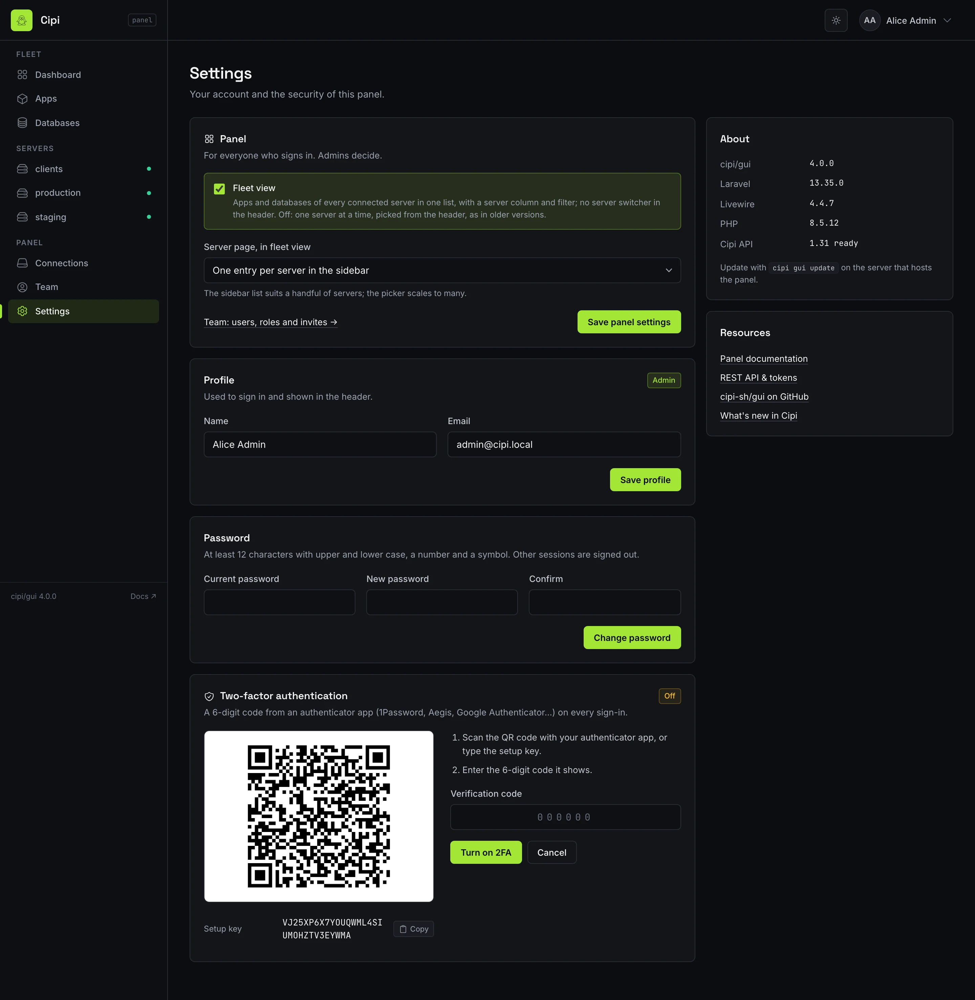
</div>
<figcaption>Panel settings (admins), profile with its time zone, password and TOTP two-factor setup.</figcaption>
</figure>
</div>

### Team and roles

Admins see and do everything. A user gets what an admin grants and is invited with a copyable link that works once and expires after seven days. An admin can [require two-factor authentication](/docs/gui-install#two-factor-required) for every account: the list then shows who still has to set it up.

<div class="gui-shot-grid">
<figure class="gui-shot">
<div class="gui-shot-frame">
<div class="gui-shot-bar" aria-hidden="true"><i></i><i></i><i></i><span class="gui-shot-url">panel.example.com</span></div>
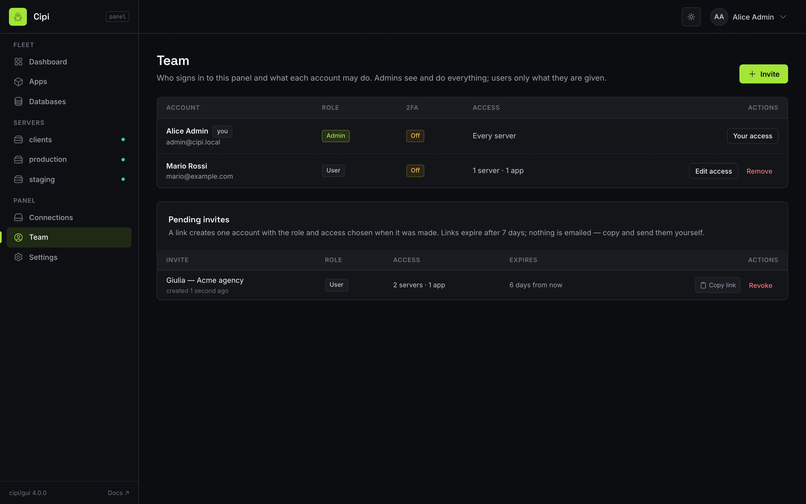
</div>
<figcaption>Team: accounts, roles, access and pending invite links.</figcaption>
</figure>
<figure class="gui-shot">
<div class="gui-shot-frame">
<div class="gui-shot-bar" aria-hidden="true"><i></i><i></i><i></i><span class="gui-shot-url">panel.example.com</span></div>

</div>
<figcaption>Inviting a user: a level per server, abilities per app, then a link to copy.</figcaption>
</figure>
</div>
