@section gui-overview

Cipi is **CLI-first**, and always will be. The web panel is an **optional** layer for people who prefer a browser: your team, a client, or you on a phone. It's a self-hosted Laravel app that drives one or many Cipi servers through the same [REST API](/docs/api) as the CLI client and WHMCS. No proprietary control plane, no SaaS, no extra cost.

<cipi-panel></cipi-panel>

Real screens of the panel, in motion. Pick a clip, or let them play. Every screen is in the [tour below](#gui-tour).

> [!tip] **Skip it and nothing changes.** Without the panel Cipi stays a lean CLI: no daemon, no web surface, nothing extra listening. Anything done in the browser can be done in the terminal, and the other way round.

<figure class="gui-shot">
<div class="gui-shot-frame">
<div class="gui-shot-bar" aria-hidden="true"><i></i><i></i><i></i><span class="gui-shot-url">panel.example.com</span></div>


</div>
<figcaption>The dashboard queries every connected server at once — status, resources, services and Cipi version.</figcaption>
</figure>

```stack
Browser | panel.example.com
cipi/gui | Laravel app on one Cipi server
Cipi API | api.<server>, one per managed server
cipi CLI | does the work, as on SSH
```

## What you can do {#features}

| Area | From the panel |
| --- | --- |
| Apps | Create, edit, suspend, delete Laravel (FPM or Octane), Node (SPA, static, SSR with framework presets) and custom apps; environment label; aliases, www ↔ apex, SSL, basic auth |
| Deploy | Deploy, roll back, unlock; a deploy in progress, whoever started it, with its live log; a [paused commit](/docs/deploying#paused) with *Deploy now* and *Resume automatic deploys*; the hash-chained [deploy audit](/docs/deploy-audit) with durations and each commit's title; a log per deploy |
| `cipi.yml` | The file of the live release, whether it's valid, what applying would change, apply as a job, toggle auto-apply |
| Routing | Whole-app and path redirects, prefix reverse proxies; for server managers, the app's [own Nginx directives](/docs/nginx#custom) — headers, caching, limits, `location` blocks — tested with `nginx -t` before the reload |
| Page cache | An app's [Nginx page cache](/docs/page-cache#panel): on and off, how long a page is kept, how much disk, the [paths that are never cached](/docs/page-cache#exclude), **Empty the cache now**, [**Purge some pages**](/docs/page-cache#purge) — only those, the rest stays warm — with what it is next to OPcache (which is on already), what it gives WordPress and content sites, what is never cached, the command for a deploy recipe of your own, and how to install the [WordPress plugin](/docs/page-cache#wordpress) and the [PHP package](/docs/page-cache#php) that purge what a change touches |
| Octane | For an Octane app: the PHP that answers the requests next to the PHP that runs Composer, artisan, cron and the workers, a warning when they are two versions, [**Switch PHP** by its number](/docs/octane#octane-panel), restart, update the FrankenPHP build |
| App tooling | `.env` editor with masked secrets and [drag-and-drop ordering](/docs/environment#order), a block of variables pasted or [edited as text](/docs/environment#in-the-panel), Composer `auth.json`, Artisan, allowlisted app commands, saved one-click commands |
| Databases | MariaDB (or [MySQL](/docs/databases#mysql), shown as such in the list, the engine filter and its card) or PostgreSQL per app; create, link to apps, back up, restore (also by uploading a `.sql`/`.sql.gz` from your computer, chunked), rotate passwords |
| Backups | A matrix of apps and databases against [backup profiles](/docs/backups): schedule, destination, retention, [paths left out](/docs/backups#exclude-paths), last run; run now, verify, test destinations; **[SFTP destinations](/docs/backups#sftp)** — a VPS, a Hetzner Storage Box — added, tested, changed and removed, with the key to install on the remote (no password, no secret through the panel) |
| Transfer | [Move apps to another server](/docs/sync#panel) as a wizard: which apps, with databases and files or not, the target from the panel's servers or by address, the connection checked first, the transfer as a job with its output — encryption handled by the servers, no passphrase to type; *Bring apps here* from the other side |
| Updates | [How the server updates Cipi](/docs/self-update#panel): only releases signed by a trusted key (the first time, with the fingerprint you compared — signed releases are not available at the moment), a delay before a new release is installed; the keys trusted, the release waiting, why the last one wasn't installed. Starting an update stays the server's |
| Metrics | Live charts of CPU, memory, load, network and, per app, requests, 5xx, response time, PHP-FPM and workers, from 1 hour to 30 days, with deploys and incidents marked; uptime bars per day; events; retention and heartbeat ([metrics](/docs/metrics)) |
| Notifications | Every channel — SMTP, Resend, SES, Slack, Discord, Mattermost, Google Chat, Telegram, ntfy, Pushover, webhooks — added, edited (secrets kept), paused, tested, removed; what each channel [receives](/docs/notifications#events) — everything, or *Urgent* and the categories you choose; every trigger on or off by category ([notifications](/docs/notifications#panel)); *Written as* — the [server's name and the time zone](/docs/notifications#written) of every notification, the panel's own name in one click |
| Server | Status, public IPv4 and IPv6, CPU, memory, disk, services, PHP versions, Node runtimes, SSH keys, health checks, IP allowlist, [disk usage](/docs/disk), monitor; [Valkey per app](/docs/valkey#panel) — who shares the server's instance, *Isolate* one app or all, empty the shared one; the machine's **hostname** next to the name the server has in the panel, in Connections, the dashboard and the switcher: it is what a notification calls it |
| Zero Trust | The server's [Cloudflare Tunnel](/docs/zero-trust#panel) in full, read-only: the tunnel as Cloudflare sees it and its connectors (this server and its replicas), what is closed, every hostname with its Access paths and people, service tokens, previews and cache purge, the panel and the API, TCP services, SSH and its short-lived certificates, what is not on the tunnel yet. And the [mesh network](/docs/mesh-network#panel) — Tailscale or NetBird — **managed**: join with a key, close SSH and 80/443 to the world and reopen them, Tailscale SSH, leave; what the server would refuse is greyed out with its reason |
| Packages | The [optional packages](/docs/packages#panel) of the server — Browsershot, ffmpeg, LibreOffice, OCR, image optimisers, the [security scanners](/docs/packages#sec) Hackly runs and the rest of the catalog — with what each brings; **Install**, **Update** and **Remove** as jobs |
| Firewall | UFW rules in order, open a port or a range, remove what may be removed, block and unblock addresses, Fail2ban and CrowdSec bans with *Unban*, the SSH login threshold, CrowdSec on or off and its allowlist, [Cloudflare real IP](/docs/nginx#real-ip-panel) on, refreshed or off; SSH, 80 and 443 always stay open ([firewall](/docs/firewall#panel)) |
| Logs and jobs | App and server logs with filters and live refresh; async jobs in an overlay that follows the command's output while it runs, colour-coded; one-time credentials with copy buttons |
| Fleet | Many servers under one login, all apps and databases in one list with a server filter |
| Infrastructure | [28 connectors](/docs/gui-connectors) for the providers around your servers (admins): clouds and VPS — DigitalOcean, Hetzner, AWS, Google Cloud, Azure, OVHcloud, Vultr, Akamai, Scaleway, Contabo, UpCloud — Cloudflare and the registrars, with DNS records [pointed at a server by its name](/docs/gui-connectors#servers); S3, R2, Spaces, B2, Wasabi and Johnny with [keys for one bucket](/docs/gui-connectors#bucket-keys); Postmark, Mailgun, Resend and SES with their DNS [published on Cloudflare](/docs/gui-connectors#publish-dns); Sentry, Oh Dear, Better Stack, Datadog, CloudWatch, Boogle; Aikido and Hackly |
| Team | Admins and users; per-server View/Manage and per-app View, Deploy, Edit, Environment, Logs, Commands, Delete; invite links (nothing is e-mailed); who still has to set up 2FA, and *Reset 2FA* after a lost phone |
| Sign-in | Password with TOTP, optional or [required for every account](/docs/gui-install#two-factor-required); [passkeys](/docs/gui-install#passkeys) — Face ID, Touch ID, Windows Hello, a phone or a security key — alone or as the second step; or [single sign-on](/docs/gui-sso) over OpenID Connect |

Light and dark themes, a phone layout, a time zone per account. A server with an older API or a narrower token keeps working for everything it supports; where it lacks something, the panel says to update Cipi on it (`cipi self-update && cipi api update`) and which abilities the token needs.

> [!security] Permissions are checked on every request, server-side, against the app, server and job the page works on. Installing software outside the [closed package catalog](/docs/design-decisions#packages), monitor thresholds, changes to the Cloudflare tunnel, S3 secret keys, starting a self-update and the CrowdSec rescue stay on the CLI by design, and the server refuses to close its own SSH, 80 and 443 to the panel.

@section gui-tour

## Screenshot tour {#tour}

Real screenshots of the panel against its demo environment: three fictional servers, documentation-range domains and IPs (`./dev/demo.sh` in the package).

### Apps

Every app of every server in one list, with server and type filters, search and a deploy button per row.

<figure class="gui-shot">
<div class="gui-shot-frame">
<div class="gui-shot-bar" aria-hidden="true"><i></i><i></i><i></i><span class="gui-shot-url">panel.example.com</span></div>
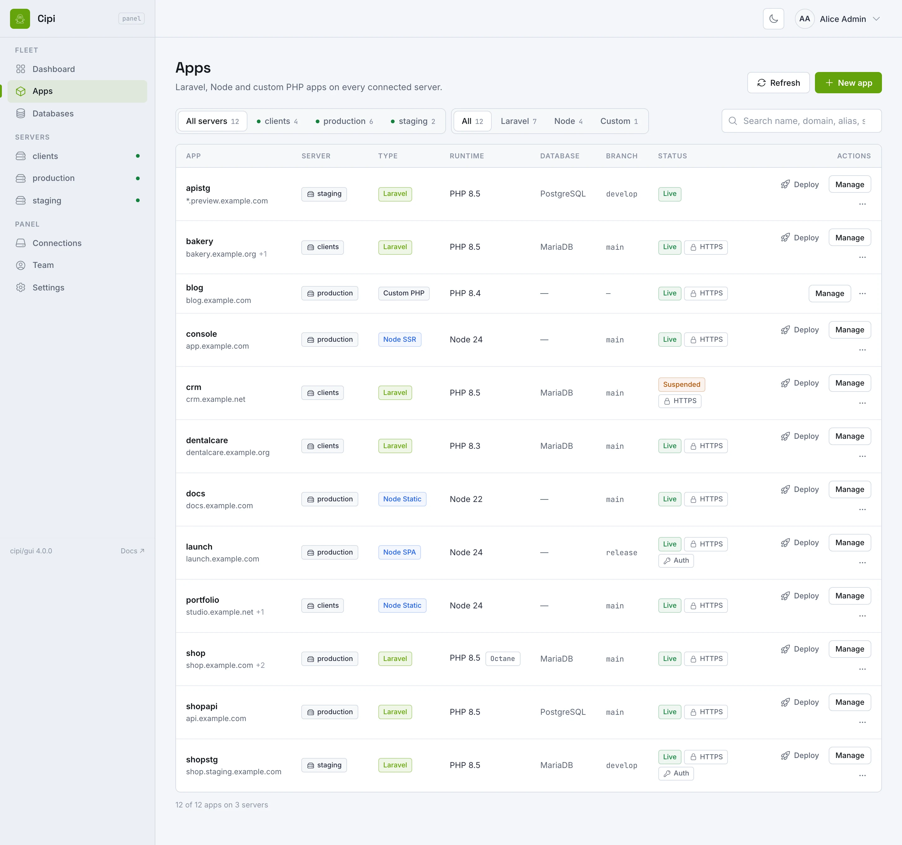

</div>
</figure>

Creating an app starts with its type. Node presets (Next.js, Nuxt, SvelteKit, Astro, Remix, Vite) fill the same defaults as `cipi app create --node`.

<div class="gui-shot-grid">
<figure class="gui-shot">
<div class="gui-shot-frame">
<div class="gui-shot-bar" aria-hidden="true"><i></i><i></i><i></i><span class="gui-shot-url">panel.example.com</span></div>

</div>
<figcaption>Create a Node SSR app with the Nuxt preset — with several servers connected, pick where it goes.</figcaption>
</figure>
<figure class="gui-shot">
<div class="gui-shot-frame">
<div class="gui-shot-bar" aria-hidden="true"><i></i><i></i><i></i><span class="gui-shot-url">panel.example.com</span></div>

</div>
<figcaption>Credentials returned by the job, with reveal and copy.</figcaption>
</figure>
</div>

### App detail

A header with status, type, runtime, the server and its IP, and actions, then one tab per area. Tabs live in the URL (`?tab=deploy`), so they can be bookmarked.

The Overview's details say where to connect and as whom: the app's Linux **user** — the one that signs in over [SSH and SFTP](/docs/app-ssh), named after the app — the **server's IP** and the `ssh shop@203.0.113.24` command made of the two. A click copies each. The IP is the one the panel keeps for the server, typed on Connections or read from its status, so this works with any Cipi version; the command uses the default SSH port.

<figure class="gui-shot">
<div class="gui-shot-frame">
<div class="gui-shot-bar" aria-hidden="true"><i></i><i></i><i></i><span class="gui-shot-url">panel.example.com</span></div>
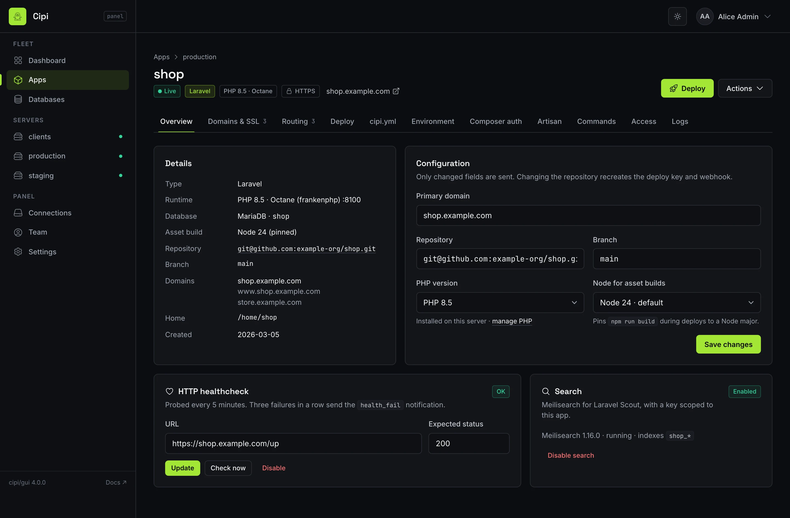
</div>
<figcaption>Overview: details (user, server IP and SSH command included), configuration (PHP, Node pin, repository, branch, domain), HTTP healthcheck and Meilisearch.</figcaption>
</figure>

<figure class="gui-shot">
<div class="gui-shot-frame">
<div class="gui-shot-bar" aria-hidden="true"><i></i><i></i><i></i><span class="gui-shot-url">panel.example.com</span></div>
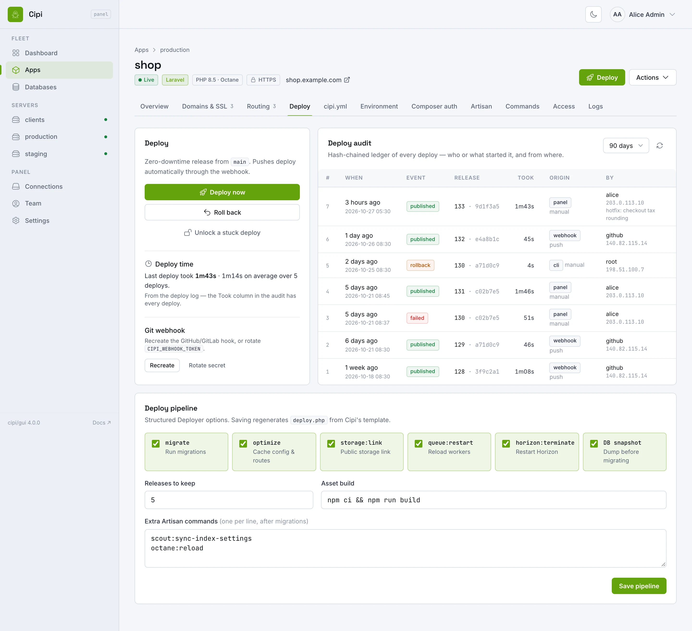

</div>
<figcaption>Deploy: actions, Git webhook, how long the last deploys took, the hash-chained deploy audit with a Took column, and the structured deploy.php pipeline.</figcaption>
</figure>

<div class="gui-shot-grid">
<figure class="gui-shot">
<div class="gui-shot-frame">
<div class="gui-shot-bar" aria-hidden="true"><i></i><i></i><i></i><span class="gui-shot-url">panel.example.com</span></div>

</div>
<figcaption>Routing: whole-app and path redirects, prefix proxies.</figcaption>
</figure>
<figure class="gui-shot">
<div class="gui-shot-frame">
<div class="gui-shot-bar" aria-hidden="true"><i></i><i></i><i></i><span class="gui-shot-url">panel.example.com</span></div>

</div>
<figcaption>Domains, Let&rsquo;s Encrypt and www &harr; apex.</figcaption>
</figure>
<figure class="gui-shot">
<div class="gui-shot-frame">
<div class="gui-shot-bar" aria-hidden="true"><i></i><i></i><i></i><span class="gui-shot-url">panel.example.com</span></div>
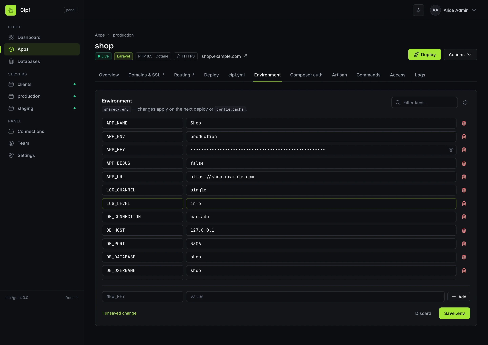
</div>
<figcaption>.env editing with masked secrets, change tracking and drag-and-drop ordering.</figcaption>
</figure>
<figure class="gui-shot">
<div class="gui-shot-frame">
<div class="gui-shot-bar" aria-hidden="true"><i></i><i></i><i></i><span class="gui-shot-url">panel.example.com</span></div>

</div>
<figcaption>Logs by type, paginated, with live refresh.</figcaption>
</figure>
</div>

### Jobs

Deploys, SSL and database operations run as async jobs. The overlay polls `GET /api/jobs/{id}`, shows elapsed time and colour-codes the output; closing it leaves the job running.

A job that fails says why in one line above its output, and a failed deploy adds what to check. A deploy stopped because a step ran out of time — the front-end build has [30 minutes, every other step 5](/docs/deploying#time-limits) — names the step and how long it ran. The panel follows a deploy for as long as it runs: the API gives one two hours.

<figure class="gui-shot">
<div class="gui-shot-frame">
<div class="gui-shot-bar" aria-hidden="true"><i></i><i></i><i></i><span class="gui-shot-url">panel.example.com</span></div>

</div>
</figure>

### Databases and server

<div class="gui-shot-grid">
<figure class="gui-shot">
<div class="gui-shot-frame">
<div class="gui-shot-bar" aria-hidden="true"><i></i><i></i><i></i><span class="gui-shot-url">panel.example.com</span></div>
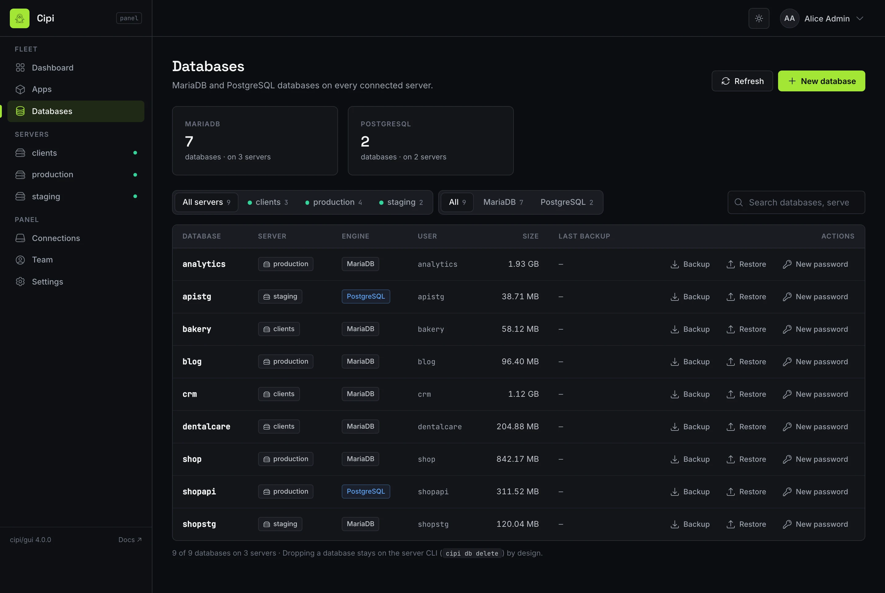
</div>
<figcaption>Databases: create, back up, restore, rotate passwords.</figcaption>
</figure>
<figure class="gui-shot">
<div class="gui-shot-frame">
<div class="gui-shot-bar" aria-hidden="true"><i></i><i></i><i></i><span class="gui-shot-url">panel.example.com</span></div>

</div>
<figcaption>Monitor checks with thresholds and last alert.</figcaption>
</figure>
</div>

<figure class="gui-shot">
<div class="gui-shot-frame">
<div class="gui-shot-bar" aria-hidden="true"><i></i><i></i><i></i><span class="gui-shot-url">panel.example.com</span></div>


</div>
<figcaption>Server overview: system, resources, monitor and healthcheck alerts, services with restart, PHP-FPM pools.</figcaption>
</figure>

### Backups, transfers and updates

**Backups**: what each profile takes, against every app and database; the destinations — the server's disk, S3 buckets and SFTP servers. *Add an SFTP server* makes the key on the server and shows its public half with the command that installs it on the remote — `ssh-copy-id -s` for a Hetzner Storage Box, whose preset fills in port 23 — then *Test* writes a file there and removes it. See [SFTP destinations](/docs/backups#sftp).

<figure class="gui-shot">
<div class="gui-shot-frame">
<div class="gui-shot-bar" aria-hidden="true"><i></i><i></i><i></i><span class="gui-shot-url">panel.example.com</span></div>
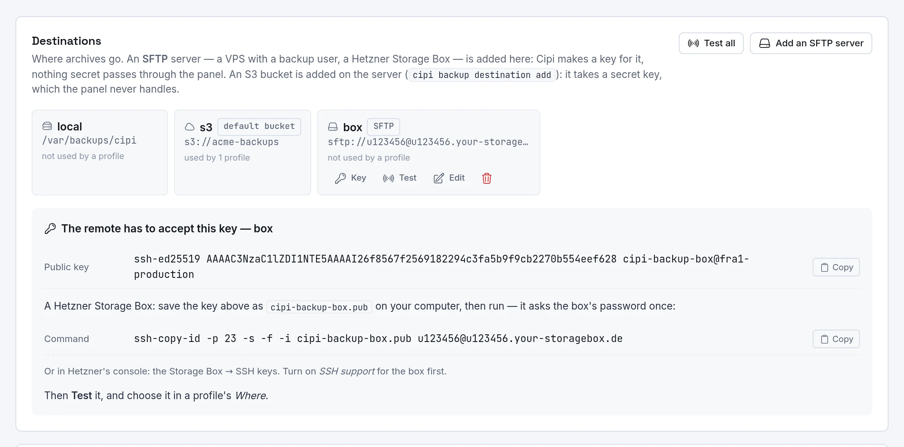
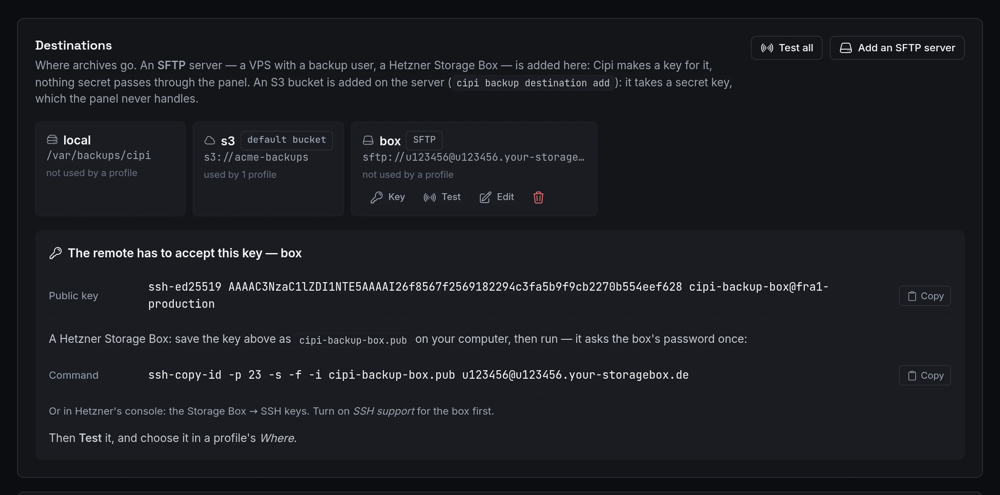
</div>
<figcaption>An SFTP destination on a Storage Box, right after it was added: the key to install, then <em>Test</em>.</figcaption>
</figure>

**Transfer** sends the apps of the server to another one — [server sync](/docs/sync#panel) as a wizard, the connection checked before anything moves, the archive encrypted with a passphrase the servers make and keep to themselves.

<figure class="gui-shot">
<div class="gui-shot-frame">
<div class="gui-shot-bar" aria-hidden="true"><i></i><i></i><i></i><span class="gui-shot-url">panel.example.com</span></div>
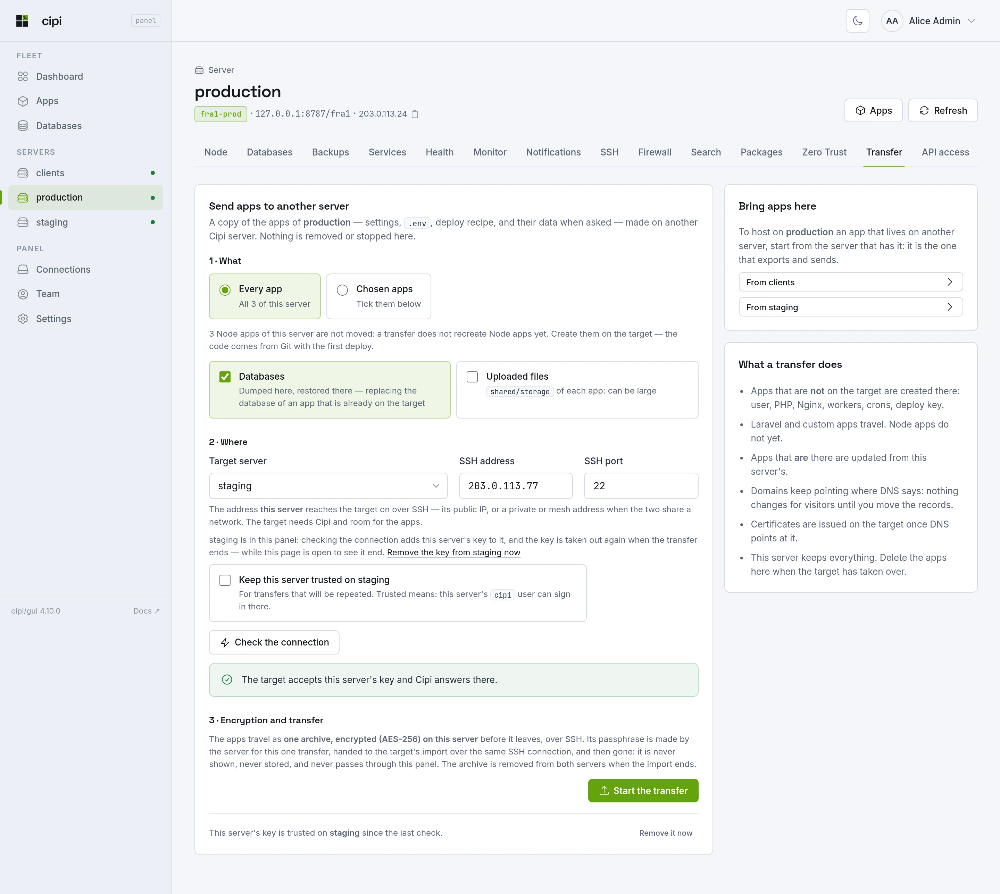
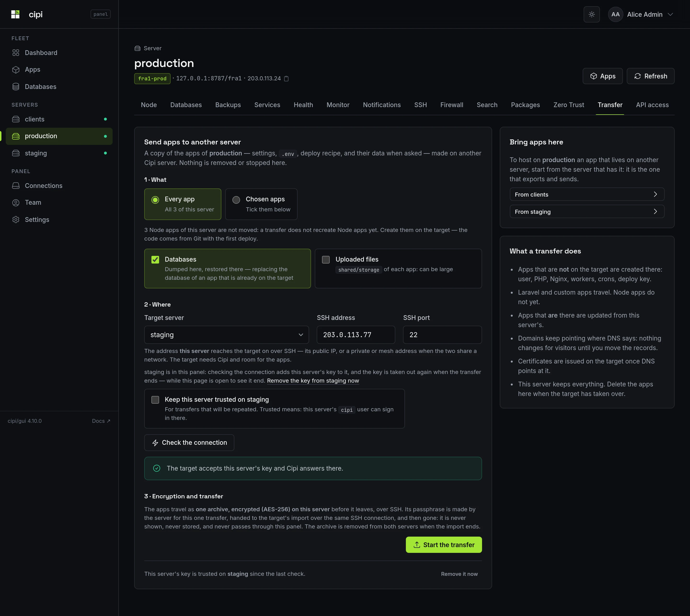
</div>
<figcaption>Transfer: production's apps to staging, the connection checked.</figcaption>
</figure>

**Updates** has the two optional safeguards of [self-update](/docs/self-update#panel): only signed releases, and a delay — here 12 hours, with a release waiting for it.

<figure class="gui-shot">
<div class="gui-shot-frame">
<div class="gui-shot-bar" aria-hidden="true"><i></i><i></i><i></i><span class="gui-shot-url">panel.example.com</span></div>

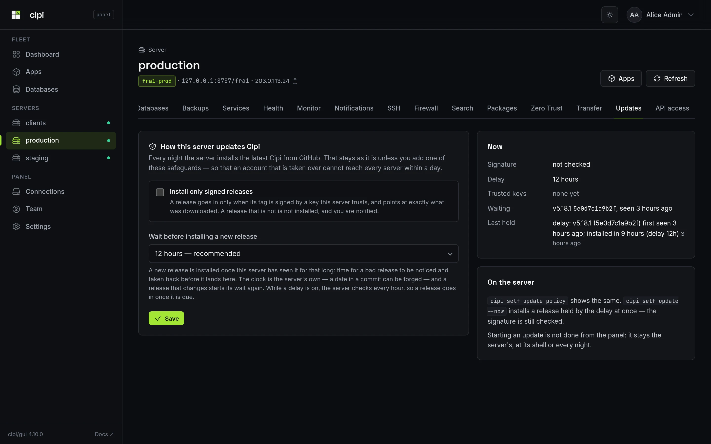
</div>
<figcaption>Updates: a 12-hour delay, and the release it is holding.</figcaption>
</figure>

### Metrics

The Metrics tab of a server and of each app: charts from 1 hour to 30 days with releases and incidents marked, uptime per day and the events timeline, refreshed every 30 seconds while open. See [metrics](/docs/metrics).

<figure class="gui-shot">
<div class="gui-shot-frame">
<div class="gui-shot-bar" aria-hidden="true"><i></i><i></i><i></i><span class="gui-shot-url">panel.example.com</span></div>
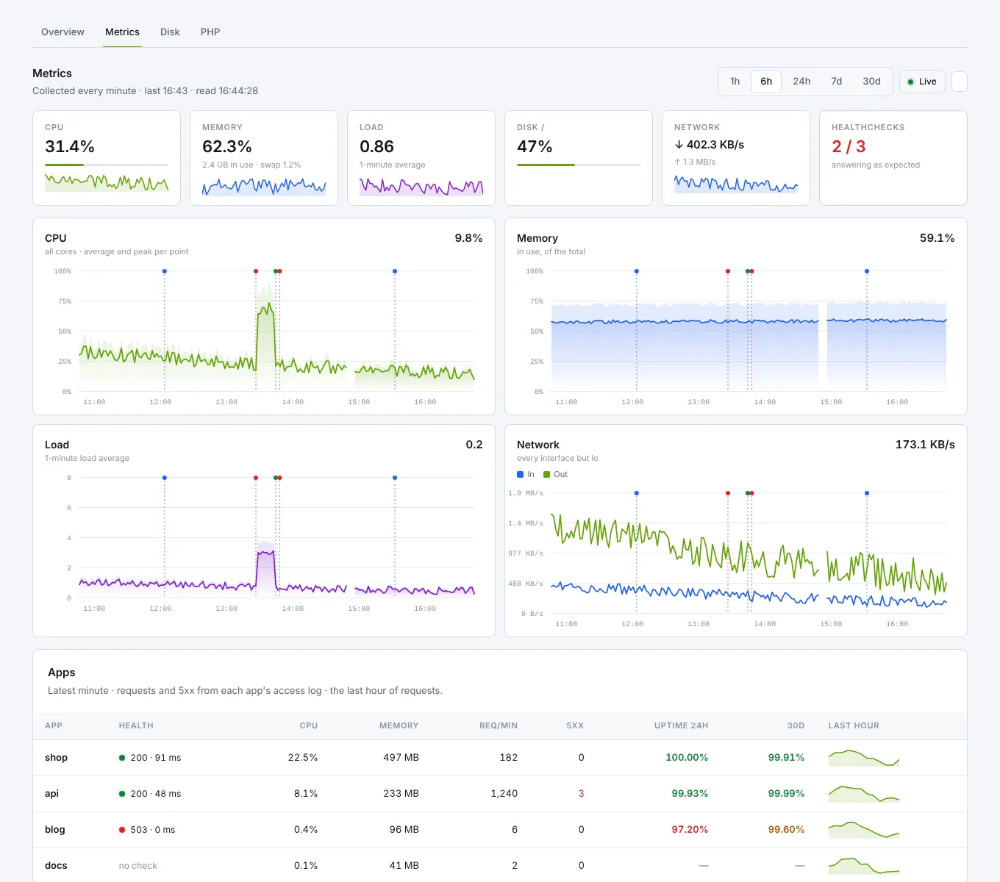
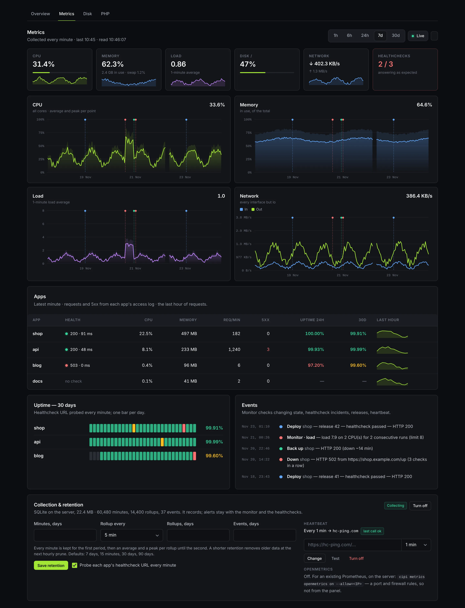
</div>
<figcaption>Server metrics, with every app's health, requests and uptime below the charts.</figcaption>
</figure>

<figure class="gui-shot">
<div class="gui-shot-frame">
<div class="gui-shot-bar" aria-hidden="true"><i></i><i></i><i></i><span class="gui-shot-url">panel.example.com</span></div>
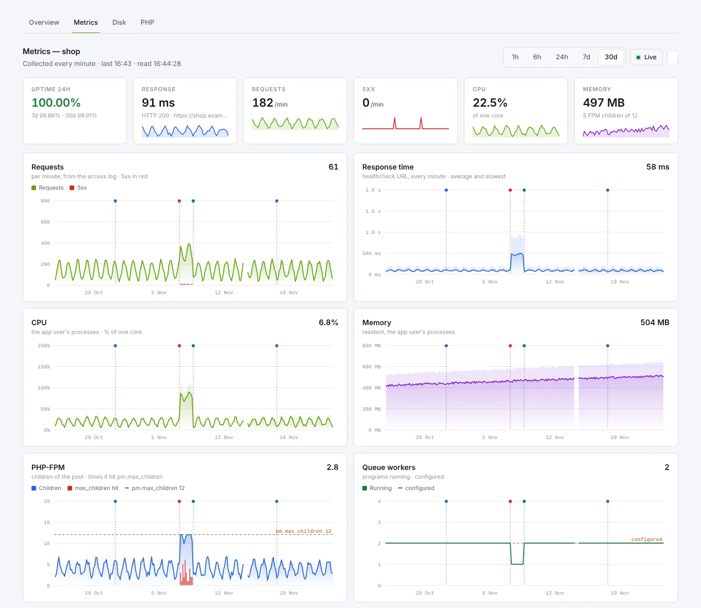
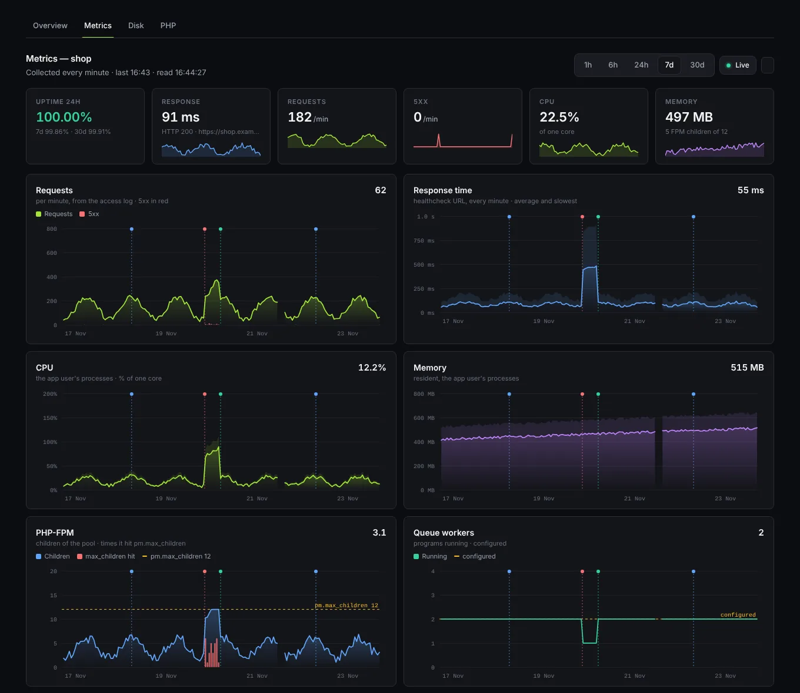
</div>
<figcaption>App metrics: requests and 5xx, response time, PHP-FPM against max_children, queue workers.</figcaption>
</figure>

<figure class="gui-shot">
<div class="gui-shot-frame">
<div class="gui-shot-bar" aria-hidden="true"><i></i><i></i><i></i><span class="gui-shot-url">panel.example.com</span></div>


</div>
<figcaption>Hover any point for its time, average and peak.</figcaption>
</figure>

### Notifications

Every channel of the server and which events reach it. Secrets never come back to the panel; an empty secret field keeps the stored one. See [notifications](/docs/notifications#panel).

<figure class="gui-shot">
<div class="gui-shot-frame">
<div class="gui-shot-bar" aria-hidden="true"><i></i><i></i><i></i><span class="gui-shot-url">panel.example.com</span></div>


</div>
<figcaption>Channels with the last test result; triggers switched by category and saved together.</figcaption>
</figure>

<figure class="gui-shot">
<div class="gui-shot-frame">
<div class="gui-shot-bar" aria-hidden="true"><i></i><i></i><i></i><span class="gui-shot-url">panel.example.com</span></div>

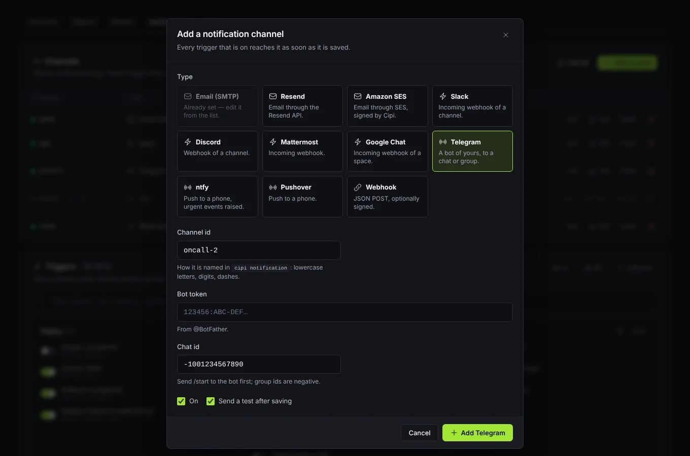
</div>
<figcaption>Adding a channel shows only the fields of its type.</figcaption>
</figure>

### Firewall

UFW, Fail2ban and CrowdSec of the server on one tab: the rules in UFW's order with *Kept open* on SSH, 80 and 443 and the Cipi feature that owns each one, blocked addresses, everything banned right now with *Unban*, the SSH login threshold and CrowdSec with its allowlist. Viewing needs a level on the server, changing needs Manage. See [firewall](/docs/firewall#panel).

### Zero Trust

Both sides of Zero Trust on one tab. On top, the server's Cloudflare Tunnel as the CLI set it up: healthy, degraded or down, every connector with its addresses, the locks, and each hostname with who may open it — read-only, every change to the tunnel stays on `cipi zt`. See [Cloudflare Zero Trust](/docs/zero-trust#panel).

Under it, the **mesh network** — Tailscale or NetBird — is managed from the page: join a network with its key, see the server's address on it and the last SSH login that came over it, close SSH and 80/443 to the world, turn Tailscale SSH on, leave. A button the server would refuse — nobody has signed in over the mesh yet, the panel would lose the server — is greyed out, with the server's reason beside it. See [Tailscale & NetBird](/docs/mesh-network#panel).

<figure class="gui-shot">
<div class="gui-shot-frame">
<div class="gui-shot-bar" aria-hidden="true"><i></i><i></i><i></i><span class="gui-shot-url">panel.example.com</span></div>


</div>
<figcaption>Zero Trust: the sites through a Cloudflare tunnel — Access on <code>/admin</code> and <code>/horizon</code> only, a preview of a branch, the API for service tokens only, MySQL for one person — and, beside it, a tailnet: SSH closed to the world, each lock with its button.</figcaption>
</figure>

### Infrastructure

The providers around your servers, from the same panel: [28 connectors](/docs/gui-connectors), with any number of accounts each. Every address that is a server of the panel says which one; a DNS record takes a server's name and is saved with its IP.

<div class="gui-shot-grid">
<figure class="gui-shot">
<div class="gui-shot-frame">
<div class="gui-shot-bar" aria-hidden="true"><i></i><i></i><i></i><span class="gui-shot-url">panel.example.com</span></div>

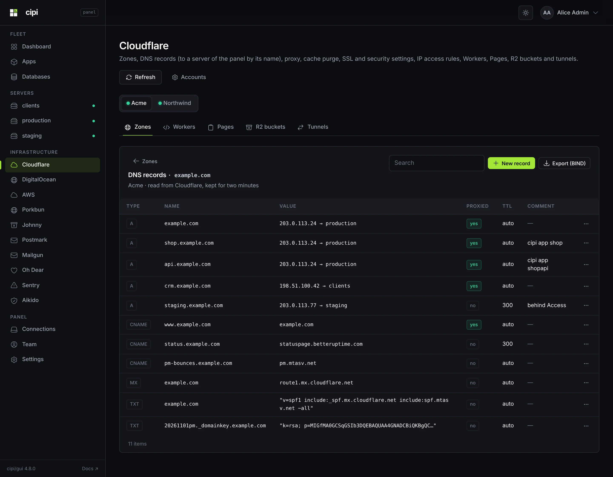
</div>
<figcaption>Cloudflare: a zone&rsquo;s records, <code>203.0.113.24 → production</code>.</figcaption>
</figure>
<figure class="gui-shot">
<div class="gui-shot-frame">
<div class="gui-shot-bar" aria-hidden="true"><i></i><i></i><i></i><span class="gui-shot-url">panel.example.com</span></div>
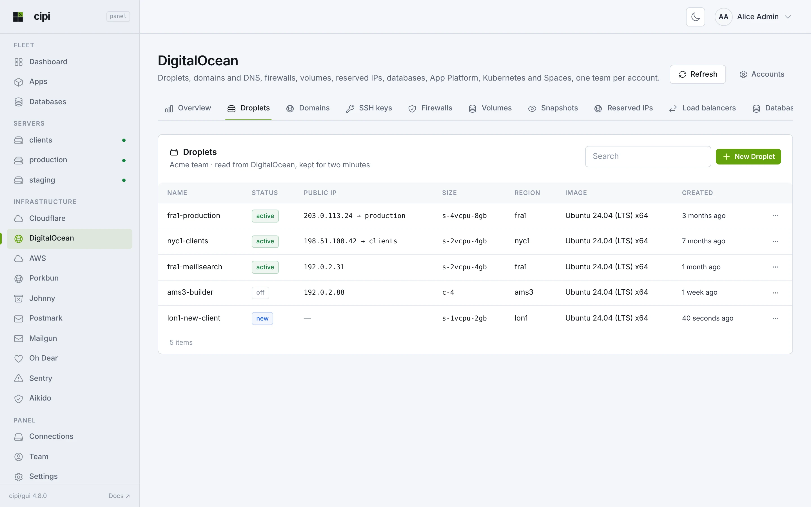

</div>
<figcaption>DigitalOcean: Droplets, power, snapshots, resize, a new one.</figcaption>
</figure>
<figure class="gui-shot">
<div class="gui-shot-frame">
<div class="gui-shot-bar" aria-hidden="true"><i></i><i></i><i></i><span class="gui-shot-url">panel.example.com</span></div>


</div>
<figcaption>AWS: EC2 by region, and Lightsail, RDS, S3, Route 53, SES, CloudWatch.</figcaption>
</figure>
<figure class="gui-shot">
<div class="gui-shot-frame">
<div class="gui-shot-bar" aria-hidden="true"><i></i><i></i><i></i><span class="gui-shot-url">panel.example.com</span></div>


</div>
<figcaption>Sentry: issues to resolve, ignore or reopen.</figcaption>
</figure>
</div>

### Connections and security

<div class="gui-shot-grid">
<figure class="gui-shot">
<div class="gui-shot-frame">
<div class="gui-shot-bar" aria-hidden="true"><i></i><i></i><i></i><span class="gui-shot-url">panel.example.com</span></div>
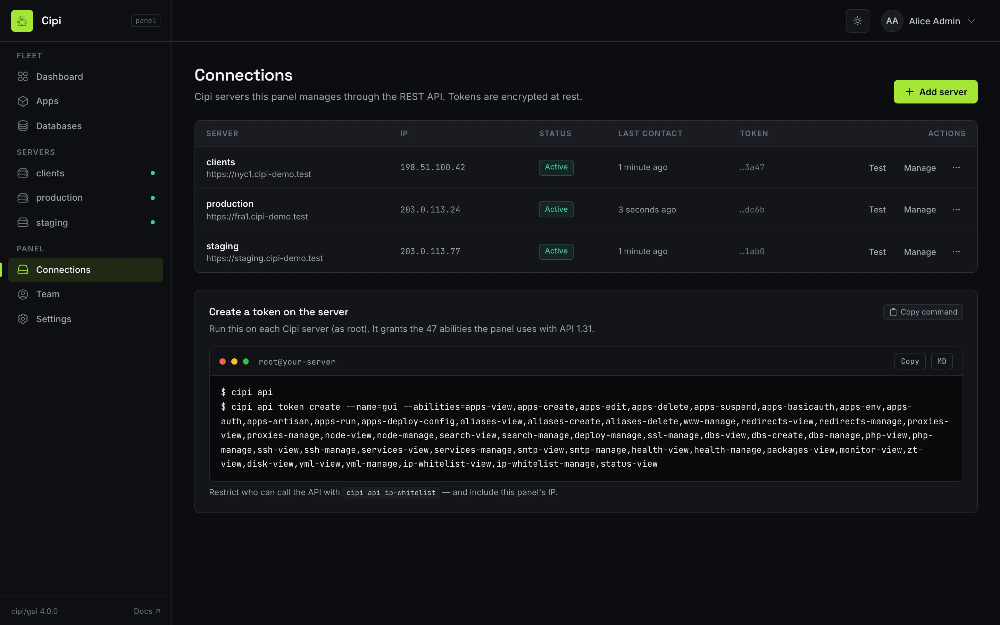
</div>
<figcaption>Connections (admins) — IPs copy on click — and token rotation.</figcaption>
</figure>
<figure class="gui-shot">
<div class="gui-shot-frame">
<div class="gui-shot-bar" aria-hidden="true"><i></i><i></i><i></i><span class="gui-shot-url">panel.example.com</span></div>

</div>
<figcaption>Panel settings (admins), profile with its time zone, password and TOTP two-factor setup.</figcaption>
</figure>
<figure class="gui-shot">
<div class="gui-shot-frame">
<div class="gui-shot-bar" aria-hidden="true"><i></i><i></i><i></i><span class="gui-shot-url">panel.example.com</span></div>
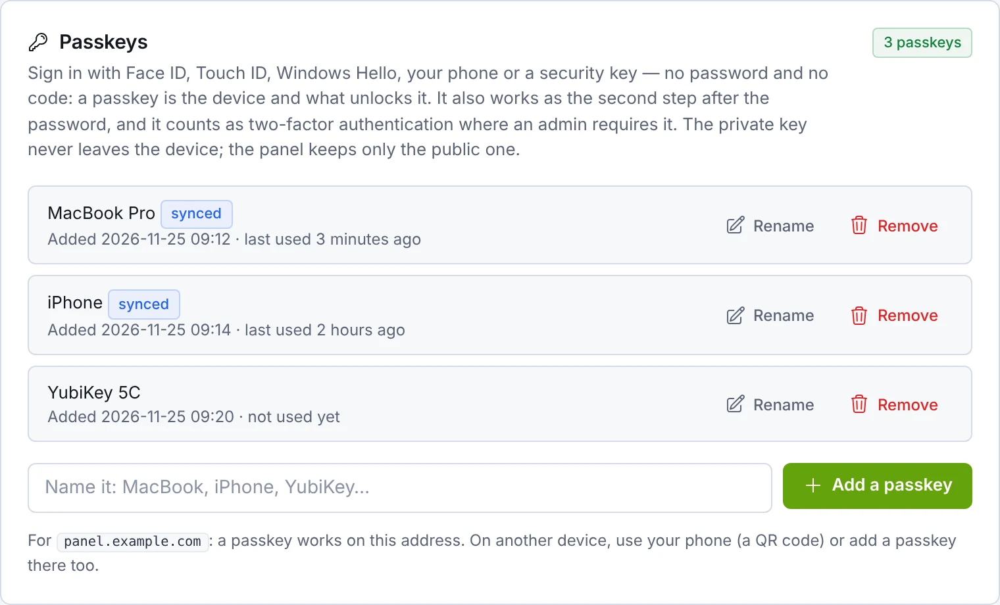

</div>
<figcaption>Passkeys: added, renamed, removed; synced ones say so.</figcaption>
</figure>
<figure class="gui-shot">
<div class="gui-shot-frame">
<div class="gui-shot-bar" aria-hidden="true"><i></i><i></i><i></i><span class="gui-shot-url">panel.example.com</span></div>
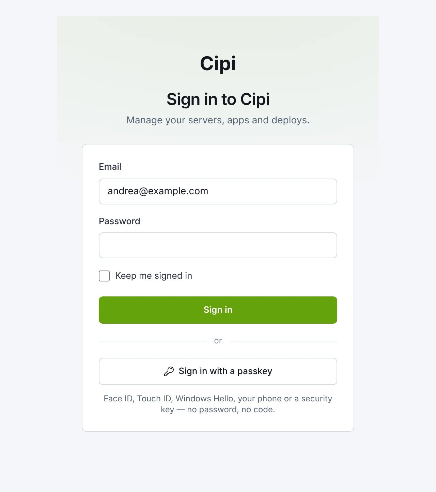

</div>
<figcaption>The login page: a passkey alone, no password and no code.</figcaption>
</figure>
</div>

### Team and roles

Admins see and do everything. A user gets what an admin grants and is invited with a copyable link that works once and expires after seven days. An admin can [require two-factor authentication](/docs/gui-install#two-factor-required) for every account: the list then shows who still has to set it up.

<div class="gui-shot-grid">
<figure class="gui-shot">
<div class="gui-shot-frame">
<div class="gui-shot-bar" aria-hidden="true"><i></i><i></i><i></i><span class="gui-shot-url">panel.example.com</span></div>

</div>
<figcaption>Team: accounts, roles, access and pending invite links.</figcaption>
</figure>
<figure class="gui-shot">
<div class="gui-shot-frame">
<div class="gui-shot-bar" aria-hidden="true"><i></i><i></i><i></i><span class="gui-shot-url">panel.example.com</span></div>
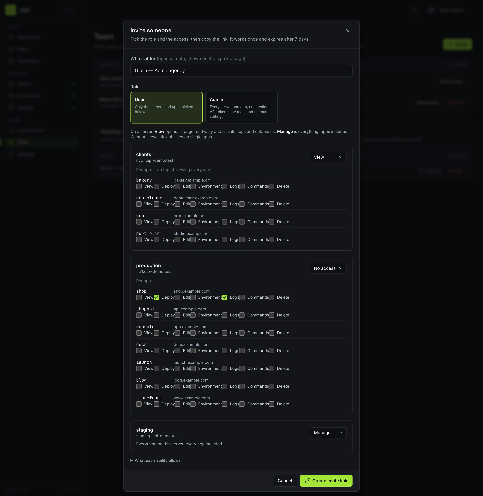
</div>
<figcaption>Inviting a user: a level per server, abilities per app, then a link to copy.</figcaption>
</figure>
</div>
