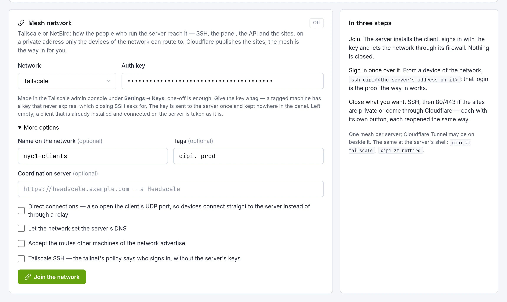
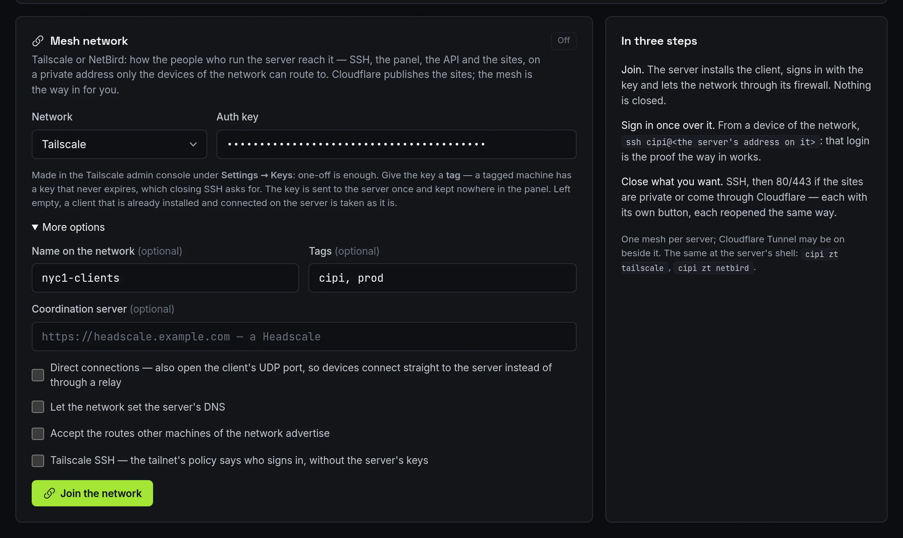
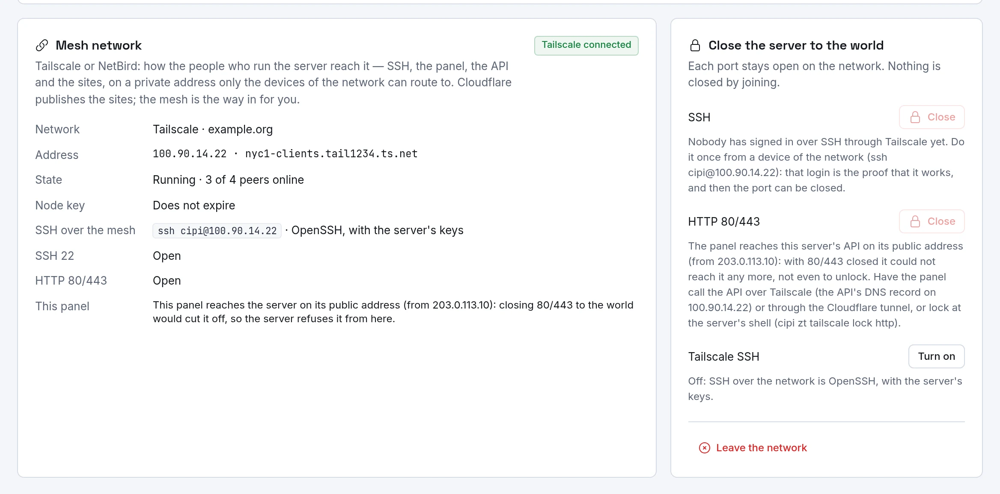
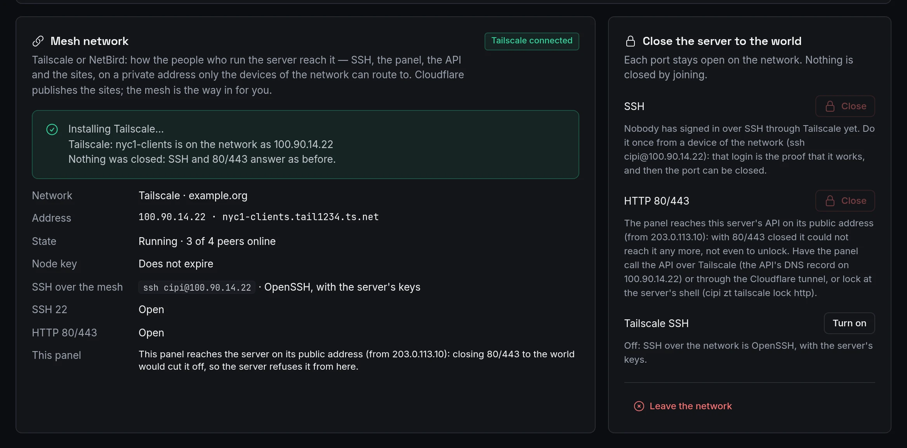

@section cli-zt-mesh

Put the server on a private network — **Tailscale** or **NetBird** — and reach SSH, the panel, the API and the sites on an address only your own devices can route to. Then, if you like, close port 22 and 80/443 to the rest of the world. From the CLI, the [web panel](#panel), the [API](#api), `cipi-cli` and the PHP SDK. Off until you join a network.

It is the other half of Zero Trust. [Cloudflare Tunnel](/docs/zero-trust) publishes the sites to visitors; the mesh is the way in for the people who run the server. Use either, both, or neither.

```flow
Join | client installed, firewall opened to the mesh
> `cipi zt tailscale enable --auth-key=…` (or `netbird`) installs the client, signs in and lets the mesh interface through UFW. Nothing is closed.
Sign in | once, over the mesh
> From a device of the network: `ssh cipi@<the server's address on it>`. That login is the proof that the way in works.
Lock SSH | port 22 from the network only
> `cipi zt tailscale lock ssh`. Refused until the step before has been done.
Lock HTTP | 80/443 from the network only
> Optional: `lock http`, when the sites are private or come through the Cloudflare tunnel.
```

```bash
$ cipi zt tailscale enable --auth-key=tskey-auth-… --tags=cipi
$ cipi zt tailscale status                 # address, peers, node key, locks
$ ssh cipi@100.101.102.103                 # from your laptop, on the tailnet
$ cipi zt tailscale lock ssh               # from that session
$ cipi zt tailscale lock http              # optional
```

NetBird is the same with its own name and key: `cipi zt netbird enable --setup-key=…`. `ts` and `nb` work as short names.

## Which one {#which}

| | Tailscale | NetBird |
| --- | --- | --- |
| Run by | Tailscale (the coordination server); the traffic goes device to device | NetBird, or **you**: the whole of it is open source and self-hostable |
| Self-hosted | With [Headscale](https://headscale.net) as the coordination server: `--login-server=` | The management server on your own machine: `--management-url=` |
| The key you join with | An **auth key** (admin console → Settings → Keys), or an OAuth client secret with tags | A **setup key** (Setup Keys) |
| Who reaches what | The tailnet's ACL | Groups and policies |
| Node key expiry | Yes, 180 days by default — **not** for a tagged machine | No |
| SSH without the server's keys | Tailscale SSH (`cipi zt tailscale ssh enable`) | Not turned on by Cipi: SSH is OpenSSH |
| Interface, UDP port | `tailscale0`, 41641 | `wt0`, 51820 |

Both are WireGuard underneath. A server is on **one mesh at a time**: both hand out addresses in `100.64.0.0/10`, and Tailscale's Linux client drops that range when it arrives on any other interface. `enable` of the second says so and stops. Cloudflare Tunnel sits beside either one.

Other tools — ZeroTier, Nebula, plain WireGuard, Twingate — are not managed by Cipi. Plain WireGuard works with what is already there: bring the interface up yourself and `cipi firewall allow 22 --from=10.8.0.0/24`.

## Join a network {#join}

```bash
$ cipi zt tailscale enable                                   # asks for the key
$ cipi zt tailscale enable --auth-key=tskey-auth-…
$ cipi zt tailscale enable --key-file=/root/ts.key           # the key from a file: not in the shell's history
$ cipi zt tailscale enable --auth-key=… --hostname=web1 --tags=cipi,prod
$ cipi zt tailscale enable --auth-key=… --login-server=https://headscale.example.com
$ cipi zt netbird enable --setup-key=XXXXXXXX-XXXX-XXXX-XXXX-XXXXXXXXXXXX
$ cipi zt netbird enable --setup-key=… --management-url=https://netbird.example.com
```

`enable`:

1. installs the client from its vendor's apt repository (`pkgs.tailscale.com`, `pkgs.netbird.io`), with the vendor's signing key;
2. signs the server in — the key is handed to the client in a root-only file, deleted right after, and is not kept by Cipi;
3. lets the mesh interface through UFW (`allow in on tailscale0`), so every port that listens on the server answers the devices of the network;
4. writes what it did to the vault and to `cipi.log`.

**It closes nothing.** Port 22 and 80/443 answer the world exactly as before, until you lock them.

| Flag | Does |
| --- | --- |
| `--auth-key=` / `--setup-key=` | The key (`--key=` works for both). `--key-file=` reads it from a file, so it stays out of the shell's history. Left out on a terminal: asked for |
| `--adopt` | No key: a client that is already installed and connected on the server is taken as it is (it happens by itself when one is found; the flag says so and never asks for a key) |
| `--hostname=` | The machine's name on the network. Default: the server's hostname |
| `--tags=cipi,prod` | Tailscale: tags of the machine (the key must be allowed to give them). A tagged machine's node key never expires |
| `--login-server=` / `--management-url=` | The coordination server when it is not the vendor's: Headscale, a self-hosted NetBird |
| `--direct` | Also opens the client's UDP port (41641, 51820) to the world, so devices connect straight to the server instead of through a relay |
| `--accept-dns` | Lets the network set the server's DNS. Off by default: a server resolves as it always did |
| `--accept-routes` | Accepts the subnet routes other machines advertise. Off by default |
| `--ssh` | Tailscale: turn [Tailscale SSH](#tailscale-ssh) on right away |
| `--reauth` | Tailscale, with a key: sign in again a machine that is already registered (an expired node key) |

> [!tip] **Tailscale: give the key a tag.** In the admin console, create the key with a tag (`tag:cipi`) or join with `--tags=cipi`. A tagged machine belongs to the tailnet instead of to a person, and its node key does not expire. An untagged one leaves the network after 180 days unless you disable key expiry for it in the console — and Cipi will not close port 22 behind a key that can expire.

What the devices of the network may reach on the server is the network's own policy, not Cipi's: allow TCP 22, 80 and 443 to the server in the tailnet ACL or in NetBird's policies.

## What you reach, and how {#reach}

```bash
$ cipi zt tailscale status
```

```text
  tailscaled       running
  State            connected (Running)
  Address          100.101.102.103   fra1-prod.tail1234.ts.net
  Network          example.com
  Interface        tailscale0
  Peers            4/6 online
  Node key         does not expire
  Tags             tag:cipi
  Tailscale SSH    off (OpenSSH, your keys)
  SSH over it      last login 2026-11-27T09:14:02 from 100.88.12.7
  lock ssh         true
  lock http        false
  Direct port      41641/udp closed (peers reach it through relays or hole punching)

  SSH over the mesh: ssh cipi@100.101.102.103
```

| You want | Do |
| --- | --- |
| SSH | `ssh cipi@100.101.102.103`, or the MagicDNS / NetBird name. Same user, same keys as before |
| The panel, the API | Point their DNS record at the mesh address (an `A` record on `100.101.102.103` is fine in public DNS: nobody outside the network can route to it). The certificate needs [DNS-01](/docs/ssl#validation), since Let's Encrypt can't reach the server over HTTP once 80 is closed |
| A site that stays private | The same: its record on the mesh address, a DNS-01 certificate |
| A database from your laptop | An SSH tunnel over the mesh — TablePlus, DBeaver and Sequel Ace call it *over SSH* — to `127.0.0.1:3306`. Nothing to open |
| Deploys | Unchanged. A push still reaches the webhook over 443 unless you lock HTTP; then deploy [from your pipeline over SSH](/docs/ci-pipelines) with the runner on the network, or publish the app through [Cloudflare](/docs/zero-trust) |

`cipi zt status` shows the mesh under Cloudflare's lines, and `cipi zt status --json` has it whole under `mesh`.

## Close the server to the world {#lock}

```bash
$ cipi zt tailscale lock ssh       # port 22 answers on the mesh only
$ cipi zt tailscale lock http      # 80 and 443 too
$ cipi zt tailscale unlock ssh
$ cipi zt tailscale unlock http
```

A lock removes the rule that opens the port to everyone; the rule that lets the mesh interface through stays. `unlock` puts the first one back.

**`lock ssh` checks that you will still get in**, and stops with the reason when you would not:

| It wants | Why |
| --- | --- |
| The mesh connected, with an address | Nothing would reach the server over it |
| UFW active | There is nothing to close the port with |
| sshd listening on the mesh address | A `ListenAddress` limited to the public IP would answer nobody |
| **The session you type in to have come over the mesh** | The proof that SSH works that way. `ssh cipi@<mesh address>` first, then lock from there |
| Tailscale: a node key that does not expire | The day it expires the server leaves the network, and with 22 closed only the provider's console gets you back in |

**`lock http`** stops while an app renews its certificate over HTTP-01 (move it to [DNS-01](/docs/ssl#validation) first: `cipi ssl install <app> --dns=cloudflare`), and tells you which apps those are. Everything served on 80/443 goes with it: every site, the panel, the API and the deploy webhook answer on the mesh only. For a server whose sites are public, keep HTTP open, or publish them through the [Cloudflare tunnel](/docs/zero-trust) and lock here too.

`--force` skips the checks at the server's shell, when you know why. `--yes` skips the question.

> [!warning] Keep your provider's web console at hand the first time. If the server ever falls off the network with port 22 closed, that console is the way in: `cipi zt tailscale unlock ssh` from there.

### With Cloudflare's locks {#with-cloudflare}

The two sides know each other. A port stays closed while either holds it: `cipi zt tailscale unlock ssh` with Cloudflare's own `lock ssh` still on tells you the port stays closed and which command reopens it. `cipi firewall allow 22` (or 80, 443) to everyone is refused while a lock holds the port, and the message names the lock. `cipi firewall status` says who holds each one.

## Tailscale SSH {#tailscale-ssh}

```bash
$ cipi zt tailscale ssh enable
$ cipi zt tailscale ssh disable
```

With Tailscale SSH on, `tailscaled` answers port 22 **of the tailnet address** itself: who signs in, and as which Linux user, is decided by the `ssh` section of the tailnet's policy, and the keys in `authorized_keys` are not asked for. OpenSSH keeps answering everywhere else. It is a different trust model — the tailnet admin decides who is `cipi` on the server — so it is off unless you turn it on.

NetBird has an SSH server of its own too; Cipi does not turn it on. Over NetBird, SSH is OpenSSH with the server's keys.

## Leave the network {#leave}

```bash
$ cipi zt tailscale disable        # or: cipi zt netbird disable
```

In this order: what its locks closed is reopened to the world, its firewall rules go, and last the server leaves the network and the client, its apt source and its signing key are removed. A session that came over the mesh ends at that last step — the removal ignores the hangup and runs to its end. A client that was on the server before Cipi (adopted) is left installed and connected.

The machine stays listed in the provider's console until you delete it there.

## From the panel {#panel}

The server page of the [web panel](/docs/gui-overview) has a **Zero Trust** tab. Under Cloudflare's card, the **Mesh network** card does all of the above.

<figure class="gui-shot">
<div class="gui-shot-frame">
<div class="gui-shot-bar" aria-hidden="true"><i></i><i></i><i></i><span class="gui-shot-url">panel.example.com</span></div>


</div>
<figcaption>A server on no mesh: choose the network, paste the key, <strong>Join the network</strong>. The options of <code>enable</code> are under <em>More options</em>.</figcaption>
</figure>

| On the card | What it does |
| --- | --- |
| **Join the network** | `enable`: Tailscale or NetBird, the key (typed as a secret, sent to the server once, cleared from the form whatever the answer), and under *More options* the name, tags, coordination server, direct connections, DNS, routes, Tailscale SSH. The page waits while the server installs the client — a minute or two |
| The status | Network, connected or not and the client's own word for it, address and name, peers online, the node key's expiry, the command to SSH in, **the last SSH login the server saw come over the mesh**, both locks, the server's warnings, and **how this panel reaches the server** |
| **SSH — Close / Reopen** | `lock ssh` / `unlock ssh` |
| **HTTP 80/443 — Close / Reopen** | `lock http` / `unlock http` |
| **Tailscale SSH — Turn on / off** | `ssh enable` / `ssh disable` (Tailscale only) |
| **Leave the network** | `disable` |

Every change asks first, saying what stops answering and for whom. Reading needs a level on the server; changing needs **Manage**.

### What a click cannot do {#panel-guards}

At the shell, `lock ssh` looks at your own session. A browser has no session to look at, so from the panel the server asks for something it can check by itself — and **ignores `--force`**, whatever the panel sends:

| Button | Refused while | What to do |
| --- | --- | --- |
| SSH — Close | sshd's log has no accepted login that came over the mesh | `ssh cipi@<mesh address>` once, from a device of the network |
| SSH — Close | The Tailscale node key can expire | Disable key expiry for the machine, or join again with a tagged key |
| SSH — Close | Tailscale SSH is on (its sessions are not in sshd's log) | Lock at the server's shell, from a session over the network |
| HTTP — Close | An app renews its certificate over HTTP-01 | Move it to DNS-01 |
| HTTP — Close | **The panel reaches this server's API on the public address** the lock would close — it could not reach it again, not even to unlock | Have the panel call the API over the mesh (the API's DNS record on the mesh address) or through the Cloudflare tunnel |
| HTTP — Close | The panel runs **on this server** and you are looking at it on its public address — the page would close itself | Open the panel on its mesh address, or through the tunnel, and click there |
| Leave the network | The panel reaches the server over the mesh | Do it at the server's shell |

The button is greyed out and the server's reason is written next to it, before you click. The page decides nothing: an action sent anyway gets the same refusal back.

<figure class="gui-shot">
<div class="gui-shot-frame">
<div class="gui-shot-bar" aria-hidden="true"><i></i><i></i><i></i><span class="gui-shot-url">panel.example.com</span></div>


</div>
<figcaption>Right after joining: nobody has signed in over the mesh yet, and this panel calls the server on its public address — so neither port can be closed from here yet, and the card says why.</figcaption>
</figure>

The server's API token needs `zt-view` to show the card and **`zt-manage`** to change anything. A token made from a list of abilities before this feature does not have it: create it again with the command on the panel's Connections page (a `--full-access` token has every ability). On an older server the card says what to update: `cipi self-update`, then `cipi api update`.

> [!security] `zt-manage` is as strong as `ssh-manage`: whoever holds a token with it can put the server on a network of their own. Give it to the panel, and to nothing that does not need it. The join key never rests anywhere — not in the panel's database, not in a job, not in a log.

Cloudflare's card on the same tab stays read-only: the tunnel is changed with [`cipi zt`](/docs/zero-trust) at the server.

## API, cipi-cli and the SDK {#api}

The same five changes, synchronous, each answering with Zero Trust as it is afterwards:

| Route | Does | Body |
| --- | --- | --- |
| `GET /api/zt` | Both sides of Zero Trust; the mesh under `details.mesh` | — |
| `POST /api/zt/mesh` | Join | `provider` (`tailscale`, `netbird`), `key`, `hostname`, `control_url`, `tags`, `direct`, `accept_dns`, `accept_routes`, `ssh`, `reauth` |
| `DELETE /api/zt/mesh` | Leave | — |
| `POST /api/zt/mesh/lock` | Close `ssh` or `http` | `port` |
| `DELETE /api/zt/mesh/lock` | Reopen it | `port` |
| `PUT /api/zt/mesh/ssh` | Tailscale SSH | `enabled` |

A refusal is a `422` with the reason in `error`. `GET /api/zt` says it beforehand: `details.mesh.panel.blocked` has `lock_ssh`, `lock_http` and `disable`, each `null` or the reason, and `details.mesh.panel.via` says how your call reached the server — `mesh`, `local`, `tunnel`, `public`. More in the [API reference](/docs/api#endpoints-zt).

```bash
$ cipi-cli zt join tailscale --tags cipi      # asks for the key
$ cipi-cli zt                                 # status, and what the server would refuse from here
$ cipi-cli zt lock ssh
$ cipi-cli zt leave
```

```php
$cipi->zeroTrust()->joinMesh('netbird', $setupKey, ['hostname' => 'web1']);
$cipi->zeroTrust()->lockMesh('ssh');
$cipi->zeroTrust()->mesh();                   // details.mesh, or null
```

See [cipi-cli](/docs/cli-client#zt) and the [PHP SDK](/docs/php-sdk#zero-trust).

## In the monitor {#monitor}

The [server monitor](/docs/monitor) has a `mesh` check, on only while the server is on a network:

| State | When |
| --- | --- |
| Critical | The client is stopped, or the server is off the network — a node key that expired, a machine removed in the console. With port 22 closed, the alert says what that means: the provider's console is the way in |
| Warning | The Tailscale node key expires within 14 days (`cipi monitor set mesh --days=30`), or the coordination server cannot be reached |

It notifies as `monitor_mesh`, an urgent [trigger](/docs/notifications#triggers). Joining, leaving and every lock are notified too, with the other Zero Trust events.

## Questions {#questions}

| Question | Answer |
| --- | --- |
| I closed port 22 and the server left the network. | The provider's web console, then `cipi zt tailscale unlock ssh` (or `cipi zt netbird unlock ssh`). Then see why with `cipi zt tailscale status` |
| `lock ssh` says my session did not come over the mesh. | You are connected to the public address. `ssh cipi@<mesh address>` and run it there |
| `lock ssh` says the node key expires. | In the Tailscale console: the machine → *Disable key expiry*. Or `cipi zt tailscale enable --auth-key=<a tagged key> --reauth` |
| Do visitors need the mesh to see my sites? | Only if you `lock http`. Keep HTTP open for public sites, or publish them through the [Cloudflare tunnel](/docs/zero-trust) |
| Can I use both Tailscale and NetBird? | Not on the same server: one mesh at a time. Different servers can be on different networks |
| Tailscale and Cloudflare Tunnel together? | Yes, and it is a good pair: sites to visitors through Cloudflare, SSH and the panel to you over the mesh, no inbound port left open |
| Does the mesh slow the sites down? | Sites served on the public address are untouched. Over the mesh, traffic is WireGuard between your device and the server, direct when it can be (`--direct` helps behind strict NAT) |
| Where is the key stored? | Nowhere in Cipi. The client keeps its own node identity in `/var/lib/tailscale` or `/var/lib/netbird` |
| The panel is on the same server. Can I still close 80/443? | Yes — from a browser that reaches the panel over the mesh. The server refuses it while you look at the panel on its public address |
| Certificates once 80 is closed? | [DNS-01](/docs/ssl#validation). Cipi tells you which apps still use HTTP-01 before it closes anything |
