@section cli-metrics

[`cipi monitor`](/docs/monitor) and [health checks](/docs/health-checks) tell you *that* something broke. Metrics tell you *when it started* and *what else changed*: every minute the server records itself and each app into a small SQLite file, keeps the minutes for a week and 15-minute summaries for a month, and the [web panel](/docs/gui-overview) draws them. Nothing listens on a port, nothing leaves the server.

<cipi-term name="metrics"></cipi-term>

```bash
$ cipi metrics                             # now, last hour, uptime
$ cipi metrics show --app=shop --range=7d  # min/avg/max + trend
$ cipi metrics uptime --range=30d          # uptime per app and day
$ cipi metrics events --source=deploy      # what changed, when
$ cipi metrics status                      # collector, size, retention
```

Every command takes `--json`. What each number means and how to read them together to find a cause: [Cipi metrics explained](/guides/cipi-metrics-server-app-uptime).

## What is recorded {#collected}

| Scope | Every minute |
| --- | --- |
| Server | CPU %, load (1 min), memory % and MB, swap %, disk % of `/`, network in and out (bytes/s) |
| Each app | CPU (% of one core) and memory of the app user's processes, PHP-FPM children and `pm.max_children`, how many times the pool **hit `max_children`**, requests and **5xx per minute** from its access log, queue workers running and configured |
| Each healthcheck | Status code, expected or not, and response time of the URL set with [`cipi health set`](/docs/health-checks) |
| Events | Monitor checks changing state, healthcheck incidents (opened at the 3rd failure in a row, closed at the first success), every release put live with its post-deploy verdict, heartbeat failures |

The collector is one cron job (`/etc/cron.d/cipi-metrics`) that reads `/proc`, one `ps`, the new lines of each access log, `supervisorctl status` and writes one SQLite transaction: about 0.2 s of CPU a minute. It records; alerts stay with the [monitor](/docs/monitor) and the [health checks](/docs/health-checks).

## Retention {#retention}

| Data | Kept by default | Change with |
| --- | --- | --- |
| Every minute | 7 days | `--raw=1d…90d` |
| Average and peak per 15 minutes | 30 days | `--rollup=…400d` (never shorter than raw), `--resolution=5m\|10m\|15m\|30m\|60m` |
| Events | 90 days | `--events=7d…730d` |

```bash
$ cipi metrics retention                                   # show
$ cipi metrics retention --raw=14d --rollup=90d --resolution=30m
$ cipi metrics prune                                       # apply it now (otherwise hourly)
```

The database is `/var/lib/cipi-metrics/metrics.db` (root, 0600): one row per app per minute, about 2 MB per app per week of minutes and a third of that per month of rollups — 20–30 MB for ten apps on the defaults. Charts ask for about 240 points whatever the range: the minutes inside the raw window, the rollups beyond it.

## Heartbeat {#heartbeat}

A server that is down cannot say so. The heartbeat calls a URL of yours every N minutes; when the calls stop, the service on the other end alerts you.

```bash
$ cipi metrics heartbeat set https://hc-ping.com/<uuid> --every=1
$ cipi metrics heartbeat test
$ cipi metrics heartbeat off
```

Works with [Healthchecks.io](https://healthchecks.io), Uptime Kuma (push monitor), Better Stack heartbeats, Cronitor or your own endpoint. Set the receiver's period to the interval plus a grace of a few minutes. A failed call is recorded as an event; `status --json`, the API and the panel show the URL only by its host.

## OpenMetrics for Prometheus {#openmetrics}

Off by default. If you already run Prometheus or Grafana, the latest values are served on their own port, behind an IP allowlist and a bearer token:

```bash
$ cipi metrics openmetrics on --allow=203.0.113.50 --port=9273
$ cipi metrics openmetrics token --show       # or: token (rotates it)
$ cipi metrics openmetrics off                # closes the port, revokes the token
```

```yaml
- job_name: cipi-production
  scrape_interval: 60s
  authorization: { credentials: <token> }
  static_configs: [{ targets: ['203.0.113.10:9273'] }]
```

Names carry their unit: `cipi_host_cpu_percent`, `cipi_app_requests_per_minute{app="shop"}`, `cipi_app_http_5xx_per_minute`, `cipi_app_healthcheck_up`, `cipi_app_fpm_max_children_reached`… UFW opens the port to the listed addresses only; `0.0.0.0/0` is refused.

> [!warning] The endpoint is plain HTTP: the token is as private as the network between the two hosts. Prefer a private network or a tunnel (WireGuard, Tailscale). The panel API cannot turn it on: it opens a port.

## In the web panel {#in-the-panel}

The **Metrics** tab of each server and of each app: charts over 1 hour to 30 days with every deploy and incident marked on them, a tooltip on hover, 30-day uptime bars per app, the events timeline, and — for server managers — retention, probe and heartbeat. While the tab is open it refreshes every 30 seconds.

<cipi-clips name="metrics"></cipi-clips>

<figure class="gui-shot">
<div class="gui-shot-frame">
<div class="gui-shot-bar" aria-hidden="true"><i></i><i></i><i></i><span class="gui-shot-url">panel.example.com</span></div>
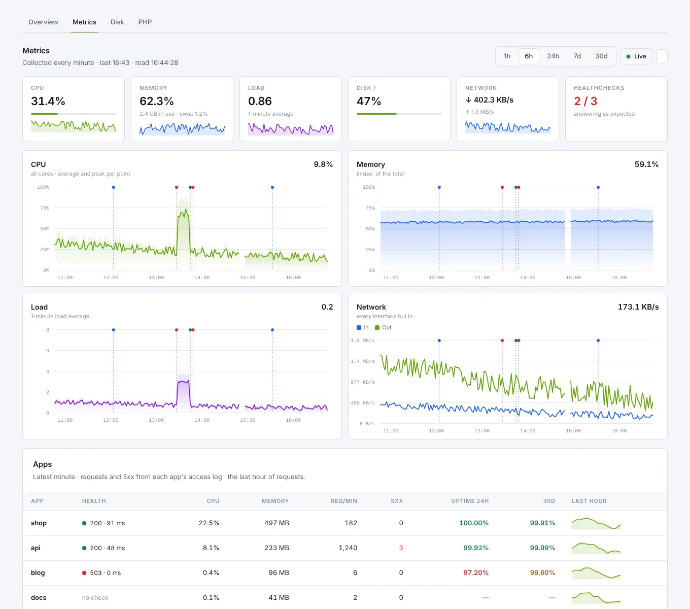
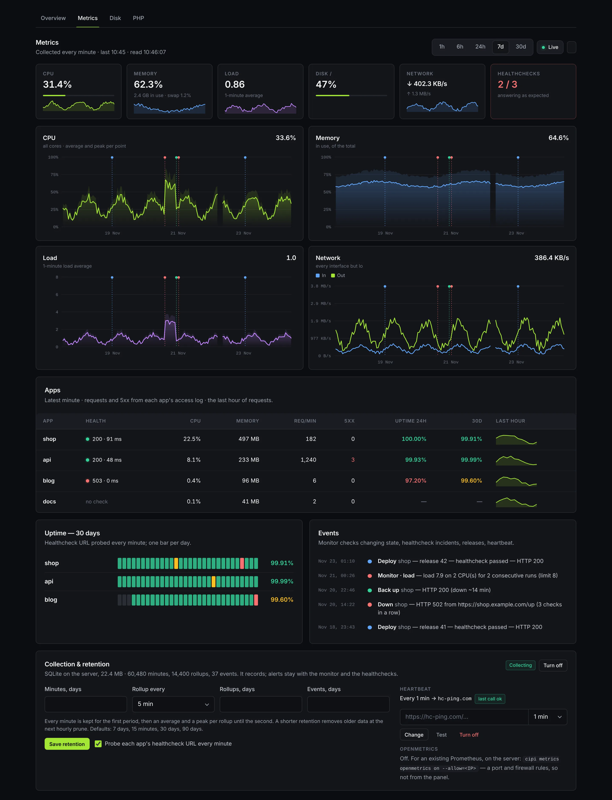
</div>
<figcaption>The server's Metrics tab: blue markers are releases, red an incident, green the recovery.</figcaption>
</figure>

<figure class="gui-shot">
<div class="gui-shot-frame">
<div class="gui-shot-bar" aria-hidden="true"><i></i><i></i><i></i><span class="gui-shot-url">panel.example.com</span></div>
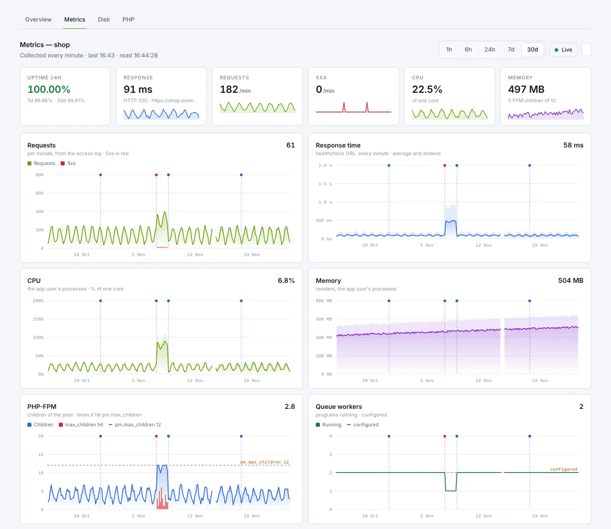
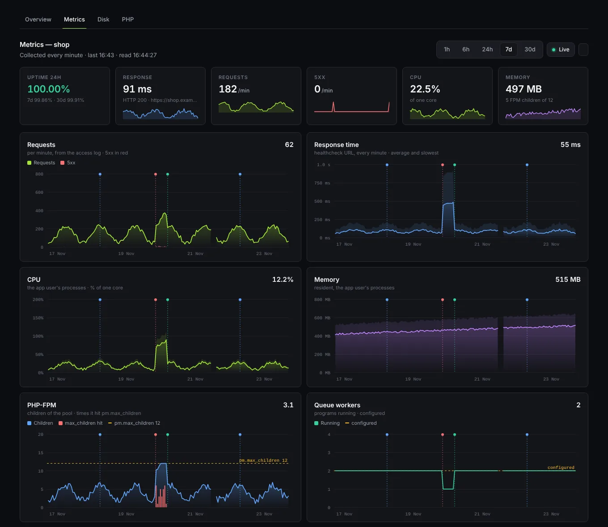
</div>
<figcaption>An app's Metrics tab: PHP-FPM children against pm.max_children, and the minutes the pool hit it.</figcaption>
</figure>

### Reading a chart {#chart}

Each chart draws the average of every point and, shaded behind it, the peak. Hover a point for the exact time, value and peak; the dotted vertical lines are events, coloured like the timeline below the charts. A gap means the collector did not run in those minutes (server off, `cipi metrics disable`).

<figure class="gui-shot">
<div class="gui-shot-frame">
<div class="gui-shot-bar" aria-hidden="true"><i></i><i></i><i></i><span class="gui-shot-url">panel.example.com</span></div>
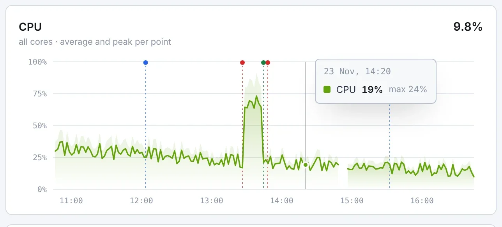
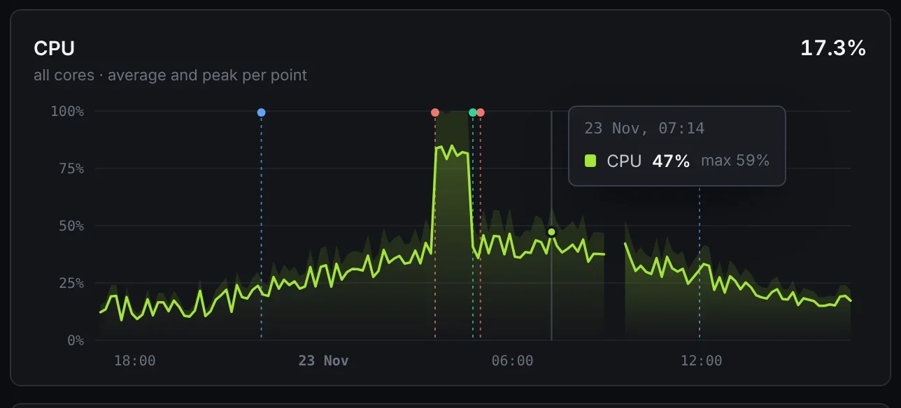
</div>
<figcaption>Hover: time, average and peak of the point. A gap is time with no data.</figcaption>
</figure>

### Uptime and events {#uptime-events}

One bar per day per app: green all checks passed, yellow a few failed, red an incident, grey no data yet. The percentage is the share of successful per-minute probes over 30 days. The timeline lists monitor state changes, healthcheck incidents, releases and heartbeat failures, newest first.

<figure class="gui-shot">
<div class="gui-shot-frame">
<div class="gui-shot-bar" aria-hidden="true"><i></i><i></i><i></i><span class="gui-shot-url">panel.example.com</span></div>
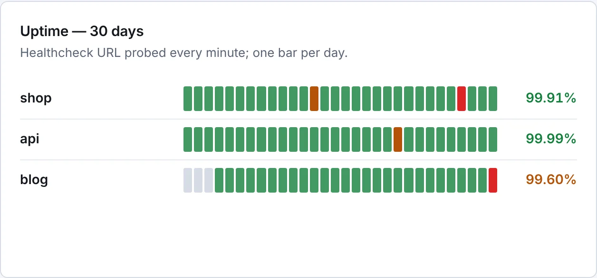
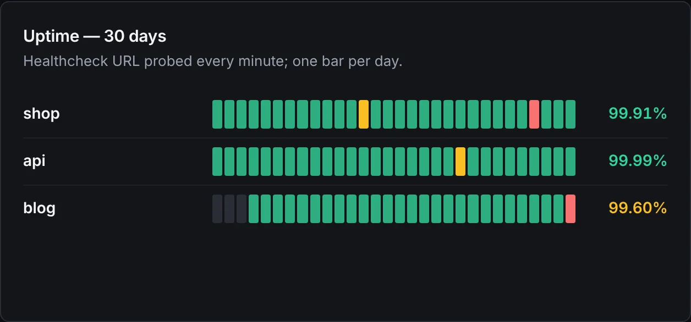
</div>
<figcaption>30 days of uptime per app.</figcaption>
</figure>

<figure class="gui-shot">
<div class="gui-shot-frame">
<div class="gui-shot-bar" aria-hidden="true"><i></i><i></i><i></i><span class="gui-shot-url">panel.example.com</span></div>
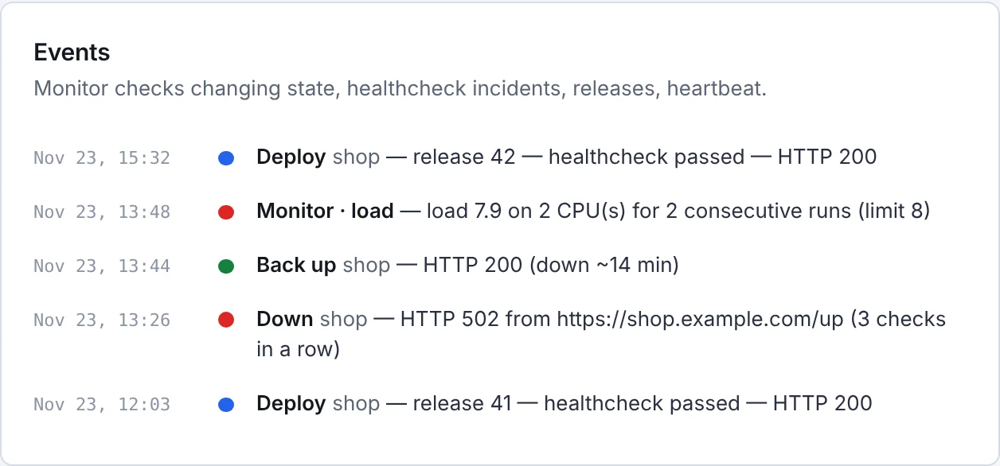
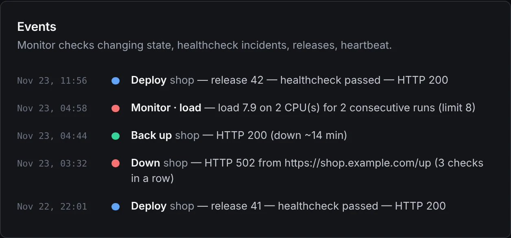
</div>
<figcaption>Releases, monitor alerts and incidents in one timeline.</figcaption>
</figure>

### Collection and retention {#settings}

Server managers see the settings card at the bottom of the server tab: how big the database is, the retention of minutes, rollups and events, the per-minute probe and the heartbeat — its URL and interval on the line of the retention fields, where it calls and how the last call went under them. Saving calls the same `cipi metrics retention` as the CLI. OpenMetrics stays CLI-only, because it opens a port.

<figure class="gui-shot">
<div class="gui-shot-frame">
<div class="gui-shot-bar" aria-hidden="true"><i></i><i></i><i></i><span class="gui-shot-url">panel.example.com</span></div>
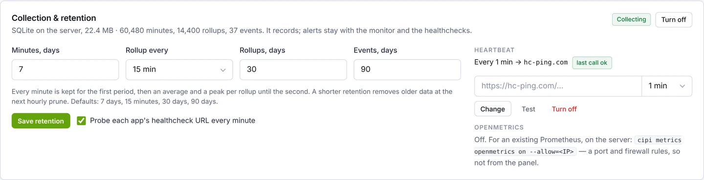
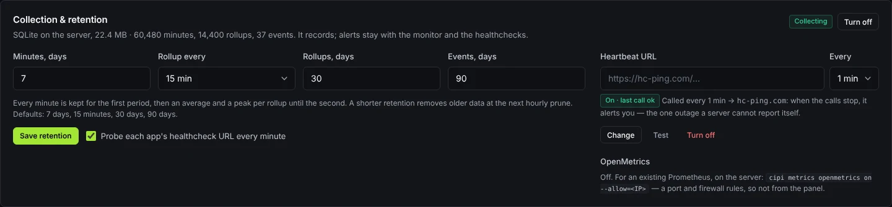
</div>
<figcaption>The settings card, with the defaults.</figcaption>
</figure>

| Server tab | App tab |
| --- | --- |
| CPU, memory, load, network; every app's health, CPU, memory, requests, 5xx and uptime | Requests and 5xx, response time, CPU, memory, PHP-FPM children against `max_children`, queue workers; uptime per day and incidents |

## API, MCP, SDK, cipi-cli {#api}

| Interface | What |
| --- | --- |
| [REST API](/docs/api) | `GET /api/metrics`, `/api/metrics/series`, `/api/apps/{name}/metrics`, `/api/metrics/uptime`, `/api/metrics/events`, `GET\|PUT /api/metrics/settings`, `PUT\|DELETE /api/metrics/heartbeat` — abilities `metrics-view`, `metrics-manage` |
| [MCP](/docs/mcp) | `MetricsOverview`, `MetricsSeries`, `MetricsUptime`, `MetricsEvents`, `MetricsSettingsShow`, `MetricsSettingsUpdate` — ask an assistant "when did the 5xx on shop start?" |
| [PHP SDK](/docs/php-sdk) 1.8 | `$cipi->metrics()->series('shop', ['req', 'http_5xx'], '7d')` |
| [cipi-cli](/docs/cli-client) | `cipi-cli metrics`, `metrics show --app shop`, `metrics uptime`, `metrics heartbeat set …` |

## Turning it off {#off}

```bash
$ cipi metrics probe off      # no per-minute probe (the 5-minute check stays)
$ cipi metrics disable        # stop collecting, keep the history
$ cipi metrics reset --yes    # delete the history
```

## Questions {#questions}

| Question | Answer |
| --- | --- |
| Why not Prometheus on every server? | A Prometheus with exporters takes hundreds of MB of RAM and opens ports; most Cipi servers are small VPSs. This is one cron job and one SQLite file. If you have Prometheus, [scrape it](#openmetrics). |
| Is "CPU of an app" exact? | It is the CPU time of the app user's processes between two minutes, tracked per process. PHP-FPM masters run as root and are not counted; Octane and Node processes are. |
| Is "memory of an app" exact? | It is the sum of the resident memory of its processes; pages PHP-FPM children share count once per child, so it is an upper bound. Watch the trend. |
| Where do requests and 5xx come from? | The app's Nginx access log, read from where the previous minute stopped, so log rotation is followed. |
| My app is behind basic auth and the health check fails | The healthcheck URL gets 401 like any visitor. The [cipi/agent routes](/docs/basic-auth#agent) stay public; for the health check use a URL outside the protected app or turn the per-minute probe off. |
| The Metrics tab says *sudo: I'm sorry www-data. I'm afraid I can't do that* | The panel API runs `cipi` through a sudo whitelist (`/etc/sudoers.d/cipi-api`) that does not contain the metrics commands: it was written by an old Cipi release. On Ubuntu 26.04, whose `sudo` is sudo-rs, a single rule with more than about 127 commands is refused as a whole, which is how a list could fail to be written there. Run `sudo cipi self-update`: the list is split into rules of 40 and checked with `visudo` before it replaces the old one. Check with `sudo -l -U www-data \| grep -c 'cipi metrics'` (more than 0). |
| Does it need anything installed? | The `sqlite3` CLI, which Cipi installs by itself (`apt-get install -y sqlite3` if apt could not). |
