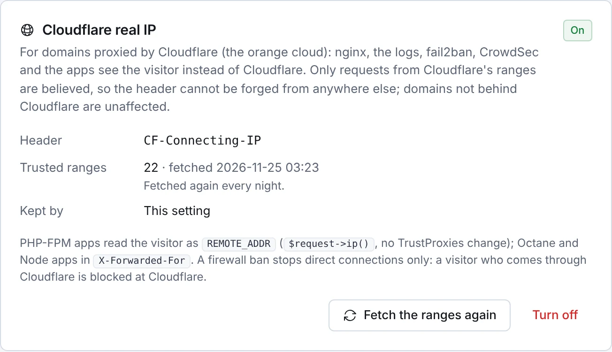
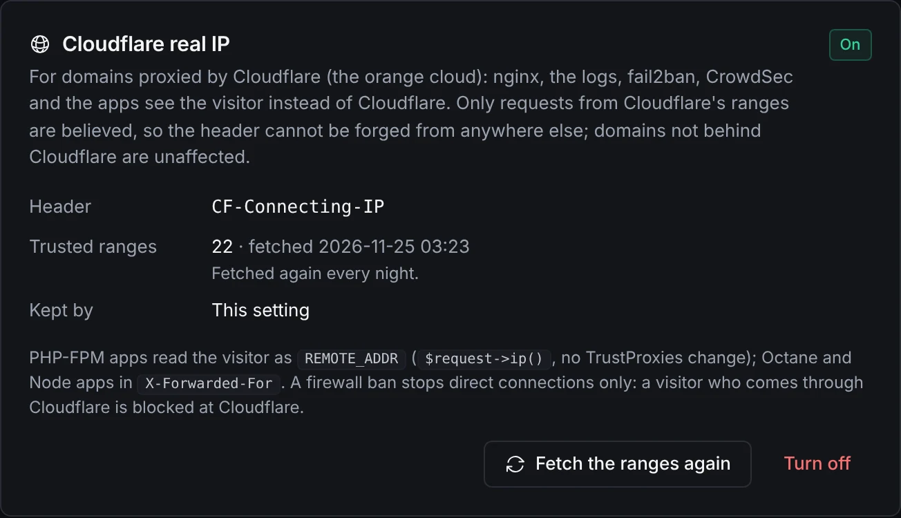

@section cli-nginx

Cipi runs Nginx from nginx.org's mainline repository, hardened and kept patched. This page covers the security report, upgrades, the default server, the visitor's address behind Cloudflare and an app's own directives. The cache of whole pages — Nginx answering without running PHP — has [a page of its own](/docs/page-cache).

<cipi-term name="nginx-security"></cipi-term>

## Security report {#nginx-security}

```bash
$ cipi nginx security
```

| Reports | Why it matters |
| --- | --- |
| Installed version vs. the oldest with every known fix | Are you exposed to a published CVE? |
| Whether the running binary is the one on disk | An upgrade isn't real until the old workers are gone |
| Every config file that turns HTTP/2 on | Most recent HTTP/2 CVEs need it |

Cipi's vhosts use `listen 443 ssl;` and never enable HTTP/2, which removes a whole class of vulnerabilities from a standard Cipi server. [How Cipi handled the nginx 1.31.9 CVEs](/guides/php-nginx-cve-patching) walks through a real case.

## Upgrades {#upgrade}

Nginx is excluded from unattended upgrades so it never restarts unexpectedly. Patch it on your terms:

```bash
$ cipi nginx upgrade [--yes]      # now
$ cipi autoupdate on nginx        # or nightly, automatically
```

```flow
apt upgrade nginx | your nginx.conf kept
> Nginx is upgraded with apt; your `nginx.conf` and every vhost are kept.
nginx -t | must pass
> `nginx -t` must pass with the new binary before anything reloads. If it fails, the old Nginx keeps running.
Reload | graceful
> A graceful reload: new workers start, old ones finish their requests. No connection is dropped.
Check binary | restart if old workers linger
> Cipi checks that the running binary is the new one, and restarts if old workers linger, so the fix is really active.
```

If a long-lived connection (a WebSocket) keeps an old worker on the replaced binary, Cipi restarts Nginx instead of reloading (well under a second of interruption). A server found on Ubuntu's archive Nginx is moved to nginx.org mainline in one simulated-first transaction: if anything can't be done, nothing changes.

## Default server {#default-server}

```bash
$ cipi nginx default-server status|on|off
```

On by default: requests for unknown hostnames, on HTTP and HTTPS, get an empty reply (444) instead of reaching one of your apps or a tenant resolver.

## Behind Cloudflare: the visitor's real IP {#real-ip}

A domain proxied by Cloudflare (the orange cloud) reaches Nginx from Cloudflare's addresses: the access log, Fail2ban, CrowdSec and your app all see Cloudflare instead of the visitor. One command fixes it for the whole server, or one button in the [panel](#real-ip-panel):

```bash
$ cipi nginx real-ip cloudflare     # on
$ cipi nginx real-ip status         # --json for scripts
$ cipi nginx real-ip off            # back to the address of each connection
```

| | |
| --- | --- |
| **What it does** | Gives Nginx Cloudflare's IPv4 and IPv6 ranges and `CF-Connecting-IP`: a request from one of the ranges gets the visitor's address |
| **Why it can't be forged** | A request from anywhere else keeps the address of its connection, so sending the header straight to your server does nothing. Domains not behind Cloudflare are unaffected |
| **In the app** | With PHP-FPM the visitor's address is `REMOTE_ADDR`: `$request->ip()`, rate limiting and login throttling work with no change in Laravel. Octane and Node apps get it in `X-Forwarded-For`, as they already do for a direct visitor |
| **Fail2ban and CrowdSec** | Never ban Cloudflare's ranges (that would take every proxied site down), and `cipi crowdsec enable` no longer needs `--force` behind the proxy |
| **Kept current** | The ranges are Cloudflare's public list — no token — fetched again every night; if the fetch fails, the previous ones stay |

`nginx -t` runs before the reload: if Nginx refuses (another `real_ip_header` in your `nginx.conf`, say), the file is taken back and you get Nginx's reason. A `real_ip` configuration Cipi didn't write is left alone.

> [!info] A firewall ban stops direct connections only. A visitor who comes through Cloudflare is blocked at Cloudflare (WAF rules), not on the server. With a [Zero Trust tunnel](/docs/zero-trust), `cipi zt enable` already sets the same thing and the two share one file.

### From the panel {#real-ip-panel}

The server's [Firewall tab](/docs/firewall#panel) has a **Cloudflare real IP** card: **Turn on**, **Fetch the ranges again** and **Turn off**, with the ranges trusted, when they were fetched and who keeps it on. It takes **Manage** on the server.

<figure class="gui-shot">
<div class="gui-shot-frame">
<div class="gui-shot-bar" aria-hidden="true"><i></i><i></i><i></i><span class="gui-shot-url">panel.example.com</span></div>


</div>
<figcaption>The Firewall tab's Cloudflare real IP card, on.</figcaption>
</figure>

| | |
| --- | --- |
| **Turning it off** | Only when this setting alone keeps it on: with [Zero Trust](/docs/zero-trust) the card says it stays on until the tunnel is disabled. With Fail2ban or CrowdSec running the panel asks first, saying why: a domain still proxied would turn every visitor into one of Cloudflare's addresses, and a ban would hit Cloudflare and the sites behind it |
| **Never through Cloudflare** | The API refuses to turn it off (`409`) when the panel reaches the server's API through Cloudflare: from then on the API would see Cloudflare instead of the panel, outside its [IP allowlist](/docs/api#cipi-api-ip-whitelist). Turn it off at the server |
| **API** | `real_ip` in `GET /api/firewall`; `PUT` and `DELETE /api/firewall/real-ip`, `POST /api/firewall/real-ip/refresh` ([endpoints](/docs/api#endpoints-firewall)) |

@section nginx-config

## Your own directives {#custom}

Cipi generates each vhost (`/etc/nginx/sites-available/myapp`) and writes it again whenever aliases, PHP, SSL, basic auth, redirects or proxies change — so an edit of that file never lasts. What lasts is a text of your own per app: Cipi keeps it and includes it in the app's server block.

```bash
$ cipi nginx edit myapp                    # in $EDITOR; tested and live when you save
$ cipi nginx show myapp                    # --json for scripts
$ cipi nginx set myapp --file=myapp.conf   # the same from a file (- for stdin)
$ cipi nginx reset myapp                   # remove them
```

```nginx
client_max_body_size 512M;

location ^~ /downloads/ {
    add_header Cache-Control "public, max-age=31536000, immutable";
    access_log off;
}

location ~* \.(?:woff2?|ttf)$ {
    add_header Access-Control-Allow-Origin "*";
    expires 1y;
}
```

| | |
| --- | --- |
| **Where it lives** | In the app's settings, so it follows [`cipi sync`](/docs/sync), and in `/etc/nginx/cipi-custom/myapp.conf`, included before `location /` in every kind of vhost: Laravel, Octane, custom, Node |
| **What it's for** | Headers, browser caching, upload size, timeouts, rewrites, `location` blocks of your own. For caching whole pages in Nginx use [`cipi cache`](/docs/page-cache), which writes and maintains it |
| **What it can't do** | Redefine a location Cipi already defines (`/`, `\.php$`, the ACME path): Nginx says *duplicate location* and nothing changes. For reverse proxies and redirects use [`cipi proxy` and `cipi redirect`](/docs/redirects-proxies) |
| **Limits** | 32 KB per app. A suspended app keeps its text; it's back in the vhost when you unsuspend |

```flow
Save | your text
> The text is saved with the app's settings and its vhost is written again with the `include`.
nginx -t | must pass
> Nginx tests the whole configuration. If it's already broken before your change, Cipi stops and touches nothing.
Reload | graceful
> Passed: a graceful reload, no connection dropped.
Refused | everything back
> Failed: the settings and the vhost go back to what they were and you get Nginx's reason by line (`line 3: unknown directive "foo"`). `cipi nginx edit` offers the editor again on your text.
```

### From the panel, the API, the SDK and cipi-cli {#custom-api}

The same text can be read and replaced from the [web panel](/docs/gui-overview) — the app's **Routing** tab, *Nginx directives*, for whoever has Manage on the server — through the [API](/docs/api#endpoints-nginx) (`GET`, `PUT`, `DELETE /api/apps/{name}/nginx`), the [PHP SDK](/docs/php-sdk#domains) (`$cipi->nginx()`) and [cipi-cli](/docs/cli-client#nginx) from your laptop (`cipi-cli nginx edit myapp` opens your own editor). In the panel a refused text is listed with its reasons and stays in the form to fix.

> [!security] Through the API — so from the panel, the SDK and cipi-cli too — **a subset of Nginx's language** is accepted, and the server decides, not the client. With the whole language a token would be root: Nginx opens an `access_log` or `error_log` path and reads an `include` as root, `server_name` takes another app's domain, `listen` opens a port, a `*_pass` reaches another app's PHP socket or a database on the loopback.

| From the API | |
| --- | --- |
| **Accepted** | `location`, `if`, `return`, `rewrite`, `set`, `try_files`, `error_page`, `add_header`, `expires`, `gzip*`, `client_max_body_size` and the timeouts, `allow` / `deny`, `autoindex`, `types`, `sub_filter`, the `fastcgi_*` and `proxy_*` buffers and timeouts, `access_log off`, `auth_basic off`, `root` and `alias` under `/home/myapp/` |
| **Refused** | A log path, `include`, `listen`, `server_name`, every `*_pass`, certificates, `auth_basic_user_file`, a path outside the app's home, and anything not on the list — by name, with its line |
| **The whole language** | `cipi nginx edit myapp` at the server, as root |

`cipi nginx set myapp --file=… --strict` applies the API's check at the terminal, to try a text before sending it from a script.
