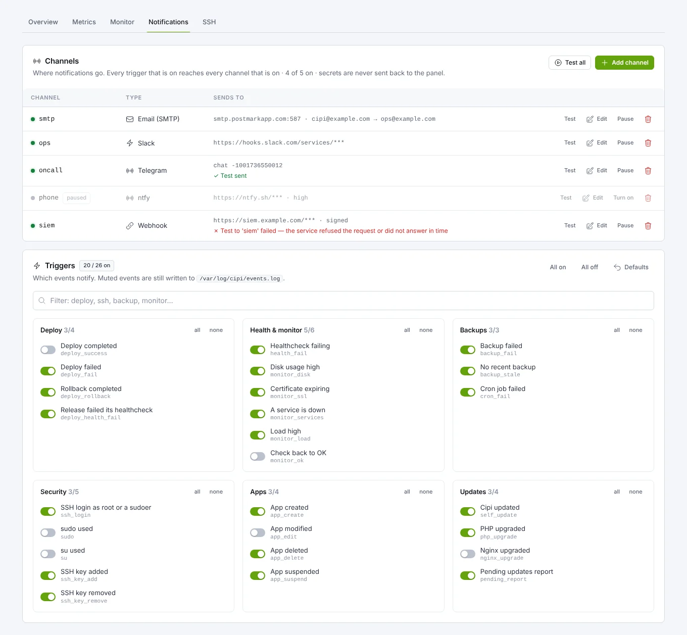
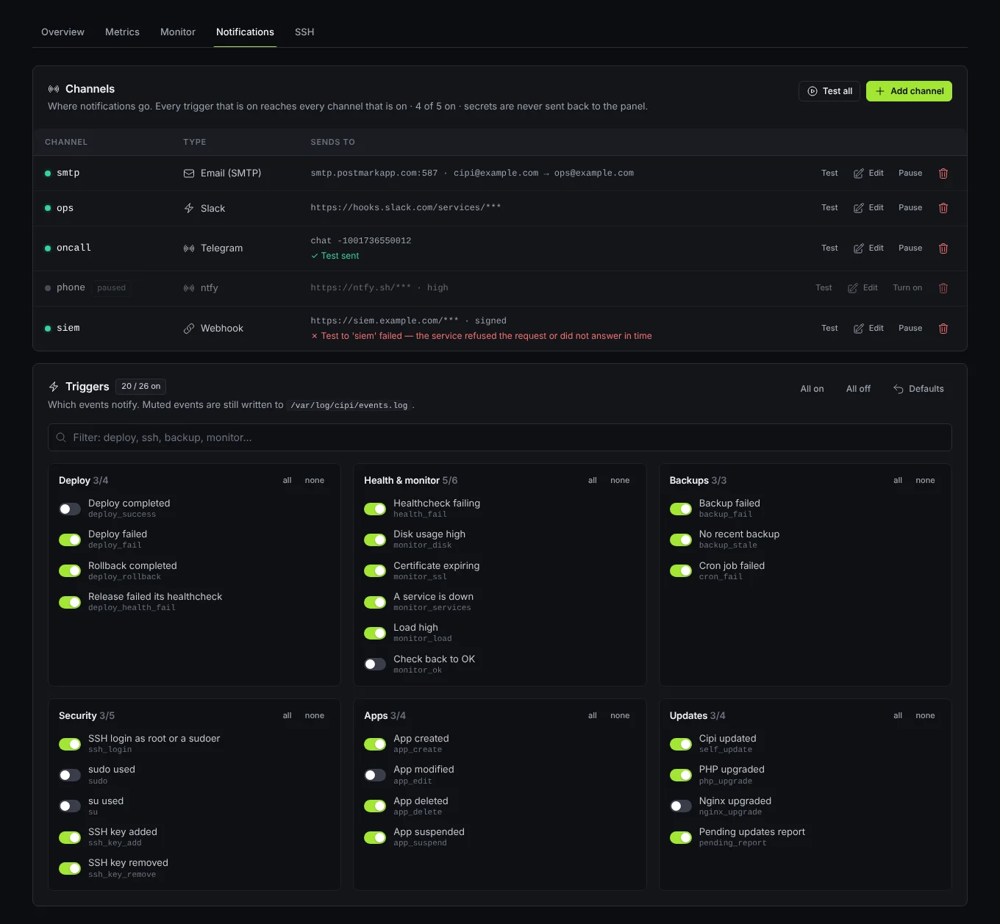
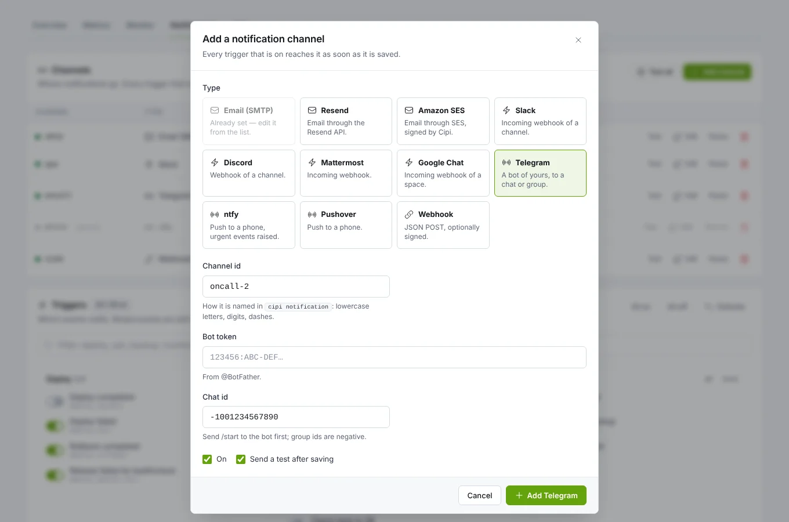
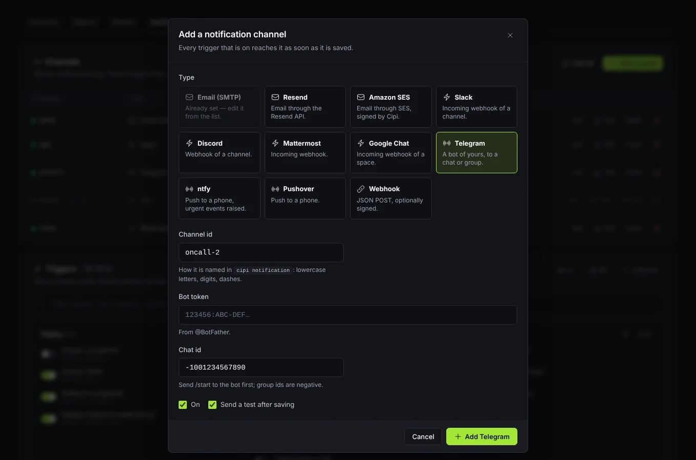
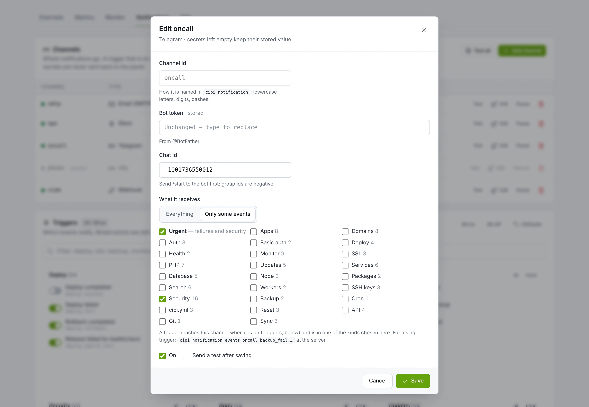
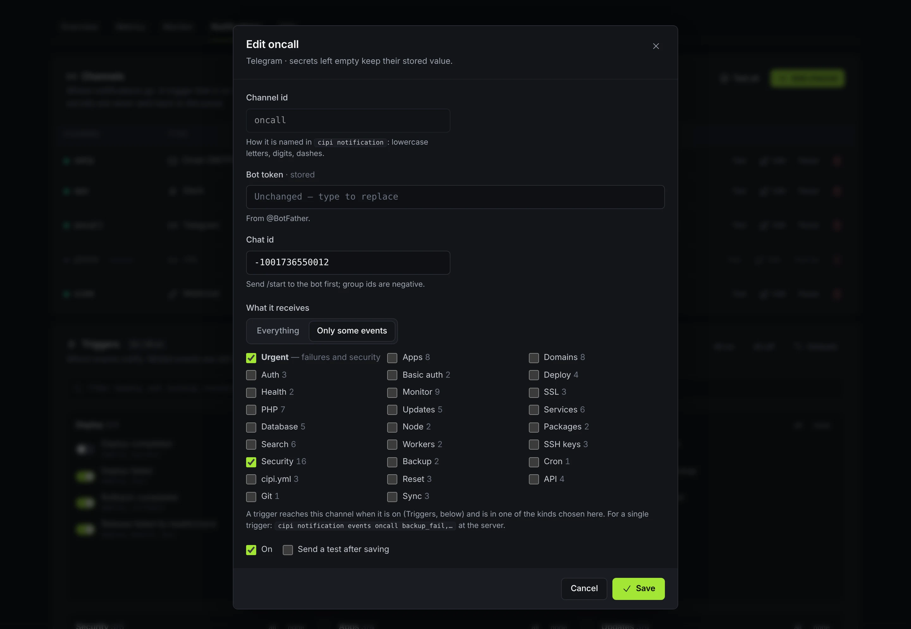

@section cipi-smtp

Cipi tells you when something happens that you should know about: failed deploys and backups, health and monitor alerts, security events (SSH logins, sudo, key changes), patches applied. One command manages where messages go: an enabled trigger reaches every enabled channel — or only the channels that take it ([what each channel receives](#events)): every notification to one, the alarms alone to another, the deploys to a third.

<cipi-term name="notifications"></cipi-term>

```bash
$ cipi notification                     # channels and active triggers (no secrets shown)
$ cipi notification add slack ops --url=https://hooks.slack.com/services/…
$ cipi notification test all
$ cipi notification triggers            # which events notify
$ cipi notification triggers disable monitor_load
$ cipi notification update ops --url=https://hooks.slack.com/services/…
$ cipi notification events oncall urgent       # only failures and security events to oncall
```

@section cipi-alert-channels

## Channels {#channels}

| Type | Options | Delivers |
| --- | --- | --- |
| `smtp` | `--host --port --user --password --from --to --tls` | Email via any SMTP server |
| `resend` | `--api-key --from --to` | Email via the Resend API |
| `ses` | `--region --access-key --secret-key --from --to` | Email via Amazon SES (signed by Cipi, no AWS CLI) |
| `slack`, `mattermost`, `googlechat` | `--url` (incoming webhook) | A chat message |
| `discord` | `--url` | A chat message (2 000-char cap) |
| `telegram` | `--token --chat-id` | Plain-text bot message |
| `ntfy` | `--url [--priority]` | Push notification; urgent events raised to high |
| `pushover` | `--token --user` | Push notification |
| `webhook` | `--url [--secret]` | JSON, optionally signed (`X-Cipi-Signature`) |

```bash
$ cipi notification add smtp --host=smtp.example.com --port=587 --user=… --password=… \
    --from=alerts@example.com --to=ops@example.com --tls=on
$ cipi notification add telegram oncall --token=<bot> --chat-id=<id>
$ cipi notification add webhook pager --url=https://example.com/hooks/cipi --secret=…
$ cipi notification disable ops | enable ops | remove ops
$ cipi notification update oncall --chat-id=-1009999     # what is left out, secrets too, is kept
$ cipi notification update siem --clear-secret           # stop signing a webhook
```

Secrets omitted from the command line are asked for without echo, stored encrypted, and never printed back. Delivery is **best-effort with a 5-second timeout**: a dead webhook can never stall a deploy or a cron job.

```php
// verify a signed webhook (body: server, trigger, subject, body, ts)
$expected = 'sha256='.hash_hmac('sha256', file_get_contents('php://input'), $secret);
if (! hash_equals($expected, $_SERVER['HTTP_X_CIPI_SIGNATURE'] ?? '')) { http_response_code(401); exit; }
```

## Triggers {#triggers}

All on by default; every event is also written to `/var/log/cipi/events.log` (kept a year) whatever you mute.

| Category | Triggers |
| --- | --- |
| Deploy | `deploy_success`, `deploy_fail`, `deploy_rollback`, `deploy_snapshot_fail`, `deploy_health_fail` |
| Health & monitor | `health_fail`, `monitor_disk`, `monitor_app_disk`, `monitor_ssl`, `monitor_services`, `monitor_workers`, `monitor_http_5xx`, `monitor_fs`, `monitor_load`, `monitor_tunnel`, `monitor_mesh`, `monitor_ok` |
| Backups & cron | `backup_fail`, `backup_stale`, `cron_fail` |
| Security | `ssh_login`, `sudo`, `su`, `ssh_key_add`, `ssh_key_remove`, `ssh_key_rename`, `credentials_show`, `backup_config` (where backups go, or their key, changed — [backups](/docs/backups#panel)), `zt_*` |
| Apps & domains | `app_create`, `app_edit`, `app_delete`, `app_suspend`, `alias_*`, `www_*`, `redirect_change`, `proxy_change`, `basicauth_*` |
| Updates | `self_update`, `php_upgrade`, `nginx_upgrade`, `mariadb_upgrade`, `pgsql_upgrade`, `valkey_upgrade`, `node_upgrade`, `composer_upgrade`, `frankenphp_upgrade`, `pending_report` |
| Config | `ini_set`, `app_jit`, `yml_apply`, `yml_fail`, `yml_post_fail`, `node_default` |
| Other | SSL, PHP, database (`db_switch` when [MariaDB and MySQL](/docs/databases#mysql) are swapped), workers, services, search, packages, sync, API and password-reset events |

`cipi notification triggers` prints the live list with on/off state; `enable-all`, `disable-all` and `reset` work as expected. `triggers --json` prints it as JSON and `triggers set --on=a,b --off=c,d` changes many in one write.

`cipi notification test <id>` exits 1, with the reason, when the channel refuses the request; a disabled channel can be tested before it is turned on.

## What each channel receives {#events}

A channel takes **everything** — the default — or only the events you give it:

```bash
$ cipi notification events                   # what each channel takes (--json)
$ cipi notification events oncall urgent     # failures and security only
$ cipi notification events team deploy       # deploys only
$ cipi notification events smtp deploy,backup,security
$ cipi notification events siem security,ssh_login
$ cipi notification events team all          # back to everything
$ cipi notification add slack team --url=… --events=deploy
```

| Selector | Lets through |
| --- | --- |
| `all` | Everything (the same as no list) |
| `urgent` | Failures and security events: a failed deploy, backup, cron job or `cipi.yml`, a health check down, a service or a worker stopped, the disk or an app's limit filling up, 5xx spikes, a read-only filesystem, the Cloudflare Tunnel down, an SSH login, `sudo`, `su`, malware or drift found, the CrowdSec rescue — the triggers ntfy and Pushover also raise in priority |
| A category | Every trigger of it, as an id: `apps`, `domains`, `deploy`, `health`, `monitor`, `ssl`, `php`, `updates`, `services`, `database`, `security`, `backup`, `cron`, `cipi-yml`, `basic-auth`, `ssh-keys`… (`cipi notification events --json` lists them with how many triggers each holds) |
| A trigger | That one: `backup_fail`, `deploy_success`, `ssh_login`… — mixed with categories as you like (`security,ssh_login`) |

`add` and `update` take the same list as `--events=`, with the rest of the channel.

- The [triggers](#triggers) come first: a trigger that is off reaches no channel, whatever the channels take.
- Every selector is checked before anything is saved: a typo is named and changes nothing.
- SMTP is a channel like the others (`events smtp …`), and reconfiguring SMTP or editing a channel keeps what it takes.
- `cipi notification test <id>` and `cipi monitor test` reach a channel whatever it takes: they have no trigger.
- `cipi notification --json` gives each channel its `events` (`null` for everything) and lists the `categories`.

The alerts that don't come from a `cipi` command — SSH logins, `sudo` and `su` (through PAM), [your own cron jobs](#security) and deploys through the Git webhook — reach every channel that takes them too, not e-mail alone.

## The server's name and the time zone {#written}

Every notification names the server and the time. By default that is the machine's hostname (`vmi12334`) and the server's own time zone — UTC on most servers. Both are yours to set:

```bash
$ cipi notification timezone                # what it is now
$ cipi notification timezone Europe/Rome    # the Time line of every notification
$ cipi notification timezone server         # back to the server's own
$ cipi notification server-name production  # "production (vmi12334)" instead of "vmi12334"
$ cipi notification server-name --clear     # back to the hostname
```

```text
Server: production (vmi12334)
App: shop
Branch: main
Time: 2026-11-26 16:04:05 CET
```

| | |
| --- | --- |
| **Time zone** | An IANA name (`Europe/Rome`, `America/New_York`, `UTC`; `timedatectl list-timezones` has them all). For notifications **only**: the server's clock, cron and logs don't change. Every message — deploys, backups, SSH logins, your own cron jobs — follows it |
| **Server name** | Letters, digits, spaces, dots, dashes and underscores, 40 at most. The subject carries the name, the body `name (hostname)`: the machine is still there to grep for |
| **Webhook channel** | The JSON keeps `server` (the hostname) and gains `server_name` — `null` when none is set |
| **Why not change the server's time zone?** | You can (`timedatectl set-timezone`), but cron schedules, logs and every app's default follow it. This setting touches only how Cipi writes its messages |

In the [panel](#panel) it is the **Written as** card of the Notifications tab: the server name — with one click to use the name the server has in the panel, so a notification and the panel say the same — and the time zone, with how the next notification reads. Over the API: `GET|PUT /api/notifications/settings` ([endpoint](/docs/api#endpoints-notification-settings)); `$cipi->notifications()->setTimezone('Europe/Rome')`; `cipi-cli notifications timezone Europe/Rome`.

## In the web panel {#panel}

The **Notifications** tab of each server manages all of the above: add a channel with a type picker that shows only its fields, edit it — secrets are never sent back to the panel, and an empty secret keeps the stored one — pause, test (a refused test shows the channel's reason on its row) or remove it. The list says what each channel **receives**, and the channel's form chooses it — *Everything* or *Only some events*: **Urgent** and the categories of the server. Below, every trigger by category with a switch, a filter, *all* / *none* per category, and one **Save** for every change.

<cipi-clips name="notifications"></cipi-clips>

<figure class="gui-shot">
<div class="gui-shot-frame">
<div class="gui-shot-bar" aria-hidden="true"><i></i><i></i><i></i><span class="gui-shot-url">panel.example.com</span></div>


</div>
<figcaption>Channels with where they send, what they receive and the last test; triggers by category, saved together.</figcaption>
</figure>

<figure class="gui-shot">
<div class="gui-shot-frame">
<div class="gui-shot-bar" aria-hidden="true"><i></i><i></i><i></i><span class="gui-shot-url">panel.example.com</span></div>


</div>
<figcaption>Adding a channel: the fields of the type, a suggested id, what it receives, a test after saving.</figcaption>
</figure>

<figure class="gui-shot">
<div class="gui-shot-frame">
<div class="gui-shot-bar" aria-hidden="true"><i></i><i></i><i></i><span class="gui-shot-url">panel.example.com</span></div>


</div>
<figcaption>What a channel receives: everything, or Urgent and the categories you tick. A single trigger set at the server is shown and kept.</figcaption>
</figure>

Over the API: `GET /api/notifications`, `POST|PUT|DELETE /api/notifications/channels[/{id}]`, `POST …/{id}/enable|disable|test`, `GET|PUT /api/notifications/triggers` ([REST API](/docs/api#endpoints-server)); from code, `$cipi->notifications()` ([PHP SDK](/docs/php-sdk)) and `cipi-cli notifications` ([cipi-cli](/docs/cli-client#notifications)); for an assistant, the MCP tools `NotificationsShow`, `NotificationChannelSave`, `NotificationChannelTest`, `NotificationChannelRemove`, `NotificationTriggersUpdate`.

## Security alerts {#security}

| Event | Includes |
| --- | --- |
| SSH login as root or a sudoer | Source IP, key fingerprint and comment |
| `sudo` / `su` | Who, target user, TTY, key, IP |
| SSH key added, removed, renamed | Fingerprint, comment, remaining keys |

They run in the background through PAM, so they never slow a login, and they reach every channel that takes them. Wrap your own cron jobs with `cipi-cron-notify` to be alerted when they exit non-zero.

## Common problems {#problems}

| Problem | Fix |
| --- | --- |
| Telegram silent | Send `/start` to the bot first; group ids are negative |
| E-mail never arrives | Use an SMTP service on port 587; port 25 is blocked by most providers |

## Questions {#questions}

| Question | Answer |
| --- | --- |
| Which channels? | E-mail, Slack, Mattermost, Google Chat, Discord, Telegram, ntfy, Pushover, signed webhooks. |
| Can one channel get only the alarms? | Yes: `cipi notification events <id> urgent`, or *Only some events* → *Urgent* in the panel. Deploys alone to a team chat: `events <id> deploy` ([what each channel receives](#events)). |
| The time in a notification is UTC | That's the server's time zone. `cipi notification timezone Europe/Rome` writes notifications in yours and leaves the server alone ([details](#written)). |
| A notification says `vmi12334`: which server is it? | The machine's hostname. `cipi notification server-name production` gives it a name of yours; the panel shows each server's hostname next to its name and sets it in one click ([details](#written)). |
| Can I manage them from the panel? | Yes, every channel and trigger ([In the web panel](#panel)). |
| The panel says "sudo: I'm sorry www-data" on Notifications | The panel's sudo whitelist was written by an old Cipi release: `sudo cipi self-update` rewrites it. |
| Step by step? | [Notifications and alerts guide](/guides/notifications-alerts). |
