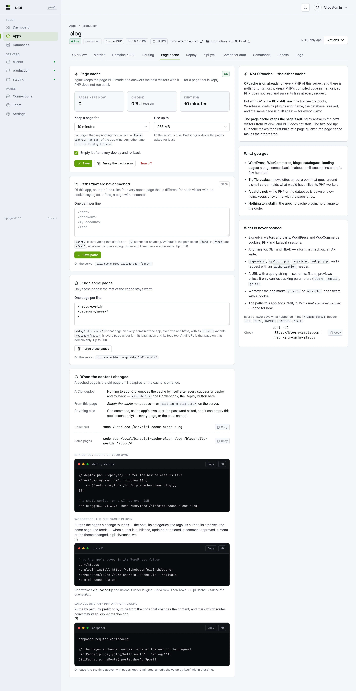
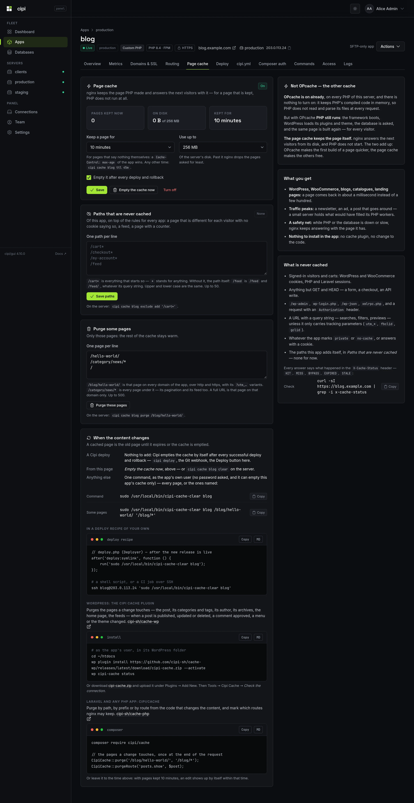

@section page-cache

The page cache is Nginx's: it keeps the page PHP made and answers the next visitors with it, **without running PHP at all**. One command turns it on for an app. It's built for WordPress and for any site whose pages are the same for everyone who isn't signed in.

<cipi-term name="page-cache"></cipi-term>

```bash
$ sudo cipi cache blog on            # pages kept 10 minutes, up to 256 MB on disk
$ sudo cipi cache blog on --ttl=1h --size=1g
$ sudo cipi cache blog ttl 30m       # how long a page is kept
$ sudo cipi cache blog clear         # delete the cached pages now
$ sudo cipi cache blog purge /hello-world/ '/category/news/*'  # only those pages
$ sudo cipi cache blog exclude add '/feed'  # a path of your own that is never cached
$ sudo cipi cache blog off           # every request runs PHP again
$ sudo cipi cache blog               # on or off, pages and bytes now   (--json)
$ sudo cipi cache                    # every app
```

## OPcache is already on. This is the other cache {#opcache}

Every PHP on a Cipi server runs with **OPcache** on, and there is nothing to enable: OPcache keeps PHP's *compiled code* in memory, so PHP doesn't read and parse its files at every request.

But with OPcache **PHP still runs**. For every visitor the framework boots, WordPress loads its plugins and theme, the database answers its queries and the same page is built again. That work is what takes the time.

The page cache keeps **the page itself**. Nginx answers from its disk and PHP never starts. The two add up: OPcache makes building a page quicker, the page cache makes every visit after the first one free.

| | OPcache | Page cache |
| --- | --- | --- |
| **Keeps** | PHP's compiled code, in memory | The finished HTML page, on disk |
| **PHP runs** | At every request | Only when a page isn't kept (or has expired) |
| **The database is asked** | At every request | Only then, too |
| **On a Cipi server** | Always on | Off until `sudo cipi cache <app> on` |
| **Who it helps** | Every PHP app | Pages that are the same for every visitor |
| **Needs emptying** | No: a deploy reloads it | Yes, when the content changes — [Cipi does it after a deploy](#clear) |

## What you get {#benefits}

| | |
| --- | --- |
| **WordPress, WooCommerce, blogs, catalogues, landing pages** | A page comes back in about a millisecond instead of a few hundred |
| **Traffic peaks** | A newsletter, an ad campaign, a post that goes around: a small server holds what would have filled its PHP workers, because most visitors never reach PHP |
| **A safety net** | While PHP or the database is slow or down, Nginx keeps answering with the page it has (stale pages are served on errors and timeouts) |
| **Nothing to install in the app** | No cache plugin, no change to the code; turning it off is one command |

It does nothing for pages that differ per visitor — a dashboard, an account page — and it isn't asked to: those are [never cached](#never).

## What is never cached {#never}

Every rule fails towards *not cached* — a page that is slower, never a private page shown to someone else.

| Never cached | Why |
| --- | --- |
| Anything but `GET` and `HEAD` | A form, a checkout, an API write must reach PHP |
| A visitor with a session or login cookie | WordPress and WooCommerce (`wordpress_logged_in_`, the cart, a password-protected post), PHP's `PHPSESSID`, Laravel's `<app>_session` and `remember_web_` |
| A request with an `Authorization` header | API tokens, basic auth |
| `/wp-admin`, `wp-login.php`, `wp-cron.php`, `xmlrpc.php`, `/wp-json` | Back offices and what must run every time |
| A URL with a query string | Searches, filters, previews. Tracking parameters alone (`utm_*`, `fbclid`, `gclid`…) don't count: the link a newsletter sends to everybody is cached |
| A response that sets a cookie, or says `Cache-Control: private`, `no-cache` or `no-store` | The app's own headers are respected: what it marks private stays private |
| The paths the app adds itself | What none of the rules above can see — [paths of your own](#exclude) |

The time you set is for pages that say nothing themselves: a response with its own `Cache-Control: max-age` is kept that long instead. A page that isn't there (404) is kept for a minute at most.

> [!note] **Laravel chooses its pages.** Laravel marks every response `no-cache, private`, and a route of the `web` group starts a session — so nothing is cached until a route says so. Give the pages that are the same for everyone a route without session and cookies, and mark it public: `->middleware('cache.headers:public;max_age=600')`. WordPress needs nothing: its public pages carry no such header.

### Paths of your own {#exclude}

The rules above read cookies and headers. A page they can't tell from a public one is a path you add: a page that differs per visitor with no cookie or header saying so (a wishlist kept in the browser, a price by country), a feed that must always be fresh, a page with a counter.

```bash
$ sudo cipi cache shop exclude add '/wishlist*' '/feed'
$ sudo cipi cache shop exclude                  # the list: Cipi's own rules and the app's   (--json)
$ sudo cipi cache shop exclude remove '/feed'   # --all for none of its own
$ sudo cipi cache shop exclude set '/wishlist*,/feed,/sitemap*.xml'  # exactly these
$ sudo cipi cache shop on --exclude='/wishlist*,/feed'  # with the rest, when turning it on
```

| Path | What it keeps out |
| --- | --- |
| `/cart*` | Everything that starts so — `/cart`, `/cart/`, `/cart/items`. `*` stands for anything, slashes included |
| `/feed` | The path itself, with or without its last slash and whatever its query string — not `/feed/atom` |
| `/shop/*/reviews` | A `*` in the middle |
| `/sitemap*.xml` | `/sitemap.xml`, `/sitemap_index.xml` |

Upper and lower case are the same. A path is made of letters, digits, `. _ ~ % - /` and `*` — a path with other characters is written as the browser sends it (`/caff%C3%A8`) — and an app has 50 at most. `/*` is refused: every page is `sudo cipi cache <app> off`. Quote a path with a `*`, or the shell expands it. With the cache off the list is kept, and applies when it is turned on. An excluded page answers `X-Cache-Status: BYPASS`.

> [!tip] WooCommerce's cart, checkout and account stay out already, whatever their address: by their cookies and by the `no-cache` headers WooCommerce sends on those pages. Adding their paths as well costs nothing, and no longer depends on a plugin or a theme leaving those headers alone — with your shop's own addresses if they are translated: `sudo cipi cache shop exclude add '/cart*' '/checkout*' '/my-account*'`.

### Check a page {#check}

Every response says what happened in the `X-Cache-Status` header:

```bash
$ curl -sI https://blog.example.com/ | grep -i x-cache-status
X-Cache-Status: HIT
```

| Value | Meaning |
| --- | --- |
| `MISS` | Not kept yet: PHP made it, and it is kept now |
| `HIT` | Answered from the cache; PHP didn't run |
| `BYPASS` | One of the rules above: a cookie, a query string, an admin path, a [path of your own](#exclude) |
| `EXPIRED` | Its time was up: PHP made it again |
| `STALE`, `UPDATING` | The old page was served while a new one is made, or because PHP didn't answer |

## When the content changes {#clear}

A cached page is the old page until it expires or the cache is emptied.

| Situation | What to do |
| --- | --- |
| **A deploy run by Cipi** — `sudo cipi deploy`, the Git webhook, the panel's Deploy button, a rollback | **Nothing.** Cipi empties the cache after every successful deploy and rollback, and the notification says how many pages went |
| **By hand** | `sudo cipi cache blog clear`, or **Empty the cache now** in the [panel](#panel) |
| **One post, one product, one page changed** | [Purge only those pages](#purge): `sudo cipi cache blog purge /hello-world/ '/category/news/*'` — the rest of the cache stays warm |
| **WordPress** | The [Cipi Cache plugin](#wordpress) purges the pages each change touches, by itself |
| **Laravel or any PHP app** | The [`cipi/cache` package](#php): purge by path, by prefix or by route from the code that changes the content |
| **A deploy recipe of your own, a CI job, a cron** | One command, as the app's own user — [below](#recipe) |
| **Nothing at all** | With pages kept 10 minutes, an edit shows up by itself within 10 minutes |

### Purge some pages, not all {#purge}

Emptying the cache makes every page slow once more: the next visit to each runs PHP again. When one post changed, purge the pages that show it and keep the others.

```bash
$ sudo cipi cache blog purge /hello-world/
$ sudo cipi cache blog purge /hello-world/ '/category/news/*' /  # several at once
$ sudo cipi cache blog purge https://blog.example.com/hello-world/  # that host only
$ sudo cipi cache blog purge /hello-world/ --json
{"app":"blog","enabled":true,"purged":4,"targets":["/hello-world/"]}
```

| A page | What goes |
| --- | --- |
| `/hello-world/` | That page on **every domain and alias of the app**, over http and https, `GET` and `HEAD`, with every query string it was kept with (`?utm_source=…`) |
| `/category/news/*` | Every page whose path starts so: `/category/news/`, `/category/news/page/2/`, `/category/news/feed/`. A `*` only at the end |
| `https://www.example.com/x/` | That page on that host only. The host must be a domain or an alias of the app — another site's pages are refused |

`purged` counts the cached files that went: a page kept for two domains and with a tracking variant is three files. Up to 500 pages per call, every one checked before anything is deleted: if one isn't a page of the app — no leading `/`, a domain of another app — nothing is purged and the reason is given. With the cache off there is nothing to purge and it says so. A page that wasn't cached is not an error: it simply counts 0.

How it works: Nginx names each cached file after the request it answers — scheme, method, host and address — and writes that name at the top of the file. Cipi finds the files whose name matches and deletes them as Nginx's own user, under the app's cache folder only. There is no `ngx_cache_purge` module to install and nothing to change in the vhost.

> [!note] `/hello-world/` and `/hello-world` are two addresses: write the one your site uses (WordPress ends its addresses with a slash). The home page is `/`, and `/*` is every page — the same as `sudo cipi cache blog clear`.


### In a deploy recipe or a script {#recipe}

The cached files belong to Nginx, so the app's user can't delete them. It may ask root for exactly one thing — no password, and only for its own app: emptying its cache, all of it or the pages it names.

```bash
$ sudo /usr/local/bin/cipi-cache-clear blog
Page cache of 'blog' emptied — 128 page(s)
$ sudo /usr/local/bin/cipi-cache-clear blog /hello-world/ '/category/news/*'
```

The pages are written as for [`sudo cipi cache <app> purge`](#purge). The rule is in `/etc/sudoers.d/cipi-<app>`, added when the app is created and, for older apps, by `sudo cipi self-update`; the helper takes the app's name and pages, nothing else, and refuses another app's user.

In a Deployer recipe of your own ([customize the pipeline](/docs/deploy-script)), after the new release is live:

```php
// deploy.php
after('deploy:symlink', function () {
    run('sudo /usr/local/bin/cipi-cache-clear blog');
});
```

From a CI job or a script over SSH:

```bash
$ ssh blog@your-server 'sudo /usr/local/bin/cipi-cache-clear blog'
```

In the app's own code, for the pages it just changed — or use the [plugin](#wordpress) and the [package](#php) below, which do it for you:

```php
exec('sudo -n /usr/local/bin/cipi-cache-clear blog '.escapeshellarg('/hello-world/'));
```

> [!tip] You don't need this with Cipi's own deploys: adding it to a recipe Cipi runs only empties the cache twice. To keep the cache across deploys instead — a site whose deploys never change its pages — `sudo cipi cache blog on --no-deploy-clear`.

## WordPress: the Cipi Cache plugin {#wordpress}

[**Cipi Cache**](https://github.com/cipi-sh/cache-wp) is a WordPress plugin that purges the pages a change touches — and only those — through the command above. Nothing to configure: it finds the app by the user PHP runs as.

| Change in WordPress | Pages purged |
| --- | --- |
| A post published, updated or unpublished | The post (its comment pages, its feed, its AMP page), its categories, tags and other public terms with their parents, its author, its year, the archive of its type, the home page and its pagination, the blog page, the feeds, the sitemaps |
| Its slug or its parent changed | The old address too |
| A post trashed or deleted | The same, as it was before it went |
| A comment approved, edited, removed | The post and the comments feed |
| A category, tag or other term edited or deleted | The term, its parents, the listings |
| WooCommerce: the stock of a product or a variation | The product, its categories, the shop |
| A menu, widgets, the theme, the Customizer, block templates or global styles, the site's title, permalinks or reading settings, an update of WordPress, a plugin or a theme | Every page: they are on every page |
| A draft, a revision, an autosave, a type that isn't public | Nothing |

Everything a request changes is gathered and sent to Cipi **once, at its end**: saving a post with ten categories is one call.

### Install it {#wordpress-install}

The page cache is on first (`sudo cipi cache blog on`, or the app's **Page cache** tab). Then, as the app's user — `ssh blog@your-server`:

```bash
$ cd ~/htdocs
$ wp plugin install https://github.com/cipi-sh/cache-wp/releases/latest/download/cipi-cache.zip --activate
$ wp cipi-cache status
```

Without WP-CLI: download [`cipi-cache.zip`](https://github.com/cipi-sh/cache-wp/releases/latest/download/cipi-cache.zip), upload it under **Plugins → Add New → Upload Plugin** and activate it. With Composer (Bedrock): `composer require cipi-sh/cache-wp`. **Tools → Cipi Cache → Check the connection** says whether the site reaches Cipi. The panel's **Page cache** tab shows the same commands with the app's name in them.

| In WordPress | |
| --- | --- |
| **Tools → Cipi Cache** | Purge on changes (on by default); the pages a change touches, or every page on any change; pages to purge every time (a landing page with the latest posts: `/`, `/events/*`); the last purges with what Cipi answered |
| **Toolbar** | *Purge this page*, *Purge every page* |
| **Posts and pages** | *Purge from cache* on each row |
| **WP-CLI** | `wp cipi-cache purge /hello-world/ '/category/news/*'`, `--post=123`, `--all`, `wp cipi-cache status` |
| **In a theme or a plugin** | `cipi_cache_purge(['/landing/', '/events/*'])`, `cipi_cache_purge(true)` for every page; the `cipi_cache_post_pages` and `cipi_cache_term_pages` filters add pages for a post or a term |

On a multisite each site's pages are sent as whole URLs, so a change on one site leaves the others' cache alone; every site's domain must be a domain or an alias of the app. If the app runs as another user than its name, define `CIPI_CACHE_APP` in `wp-config.php`.

> [!tip] With the plugin, pages can be kept much longer — `sudo cipi cache blog ttl 8h` — since an edit no longer waits for them to expire.

## Laravel and any PHP app: cipi/cache {#php}

[**cipi/cache**](https://github.com/cipi-sh/cache-php) is a Composer package — plain PHP, with a Laravel integration — for the same purge from the code that changes the content, and for saying which responses Nginx may keep.

```bash
$ composer require cipi/cache
```

```php
use Cipi\Cache\PageCache;

$cache = PageCache::forThisApp();
$cache->purge('/blog/hello-world/', '/blog/*', '/');
$cache->clear();                                   // every page

PageCache::cacheFor(600);                          // this response may be kept 10 minutes
PageCache::neverCache();                           // this one never
PageCache::warm(['https://example.com/']);         // ask for it again: cached before a visitor comes
```

In Laravel the facade and the middleware are there once installed:

```php
use Cipi\Cache\Laravel\Facades\CipiCache;

CipiCache::purgeRoute('posts.show', $post);        // the page of a named route
CipiCache::purgeRouteUnder('posts.index');         // that page and everything under it

Route::get('/blog/{post:slug}', ShowPost::class)
    ->name('posts.show')
    ->middleware('cipi.cache:3600');               // cacheable for visitors without cookies, an hour
Route::get('/account', Account::class)->middleware('cipi.nocache');
```

| | |
| --- | --- |
| **A model that purges its own pages** | The `PurgesPageCache` trait and a `cachedPages()` method: saved or deleted, its pages go — the old ones too after a change of slug |
| **Artisan** | `php artisan cipi:cache:purge /blog/hello/ '/blog/*'`, `--route=posts.index`, `--all`; `php artisan cipi:cache:check` |
| **One call per request** | Purges are gathered and sent once, when the request, the job or the command ends |
| **Off the server** | The `api` driver purges through the [API](/docs/api#endpoints-cache) — `POST /api/apps/{name}/cache/purge` with an `nginx-manage` token — from a worker on another machine or a CI job |
| **Local and tests** | Off outside `production` by default; `FakeRunner` records what would be purged |

> [!warning] `cipi.cache` makes a page the same for every visitor without cookies. Use it on public pages only, and not on a page with a form: a cached CSRF token is someone else's.

## How it's set up {#setup}

| | |
| --- | --- |
| **PHP-FPM apps** (Laravel, WordPress, any PHP app) | `fastcgi_cache` in the app's vhost |
| **Octane apps** | `proxy_cache`, in front of Octane |
| **Node apps** | Not available: their pages come from their own server |
| **Where the pages are** | `/var/cache/nginx/cipi/<app>`, one zone per app — no app reads another's |
| **Size** | `--size` (16m to 100g, default 256m): past it Nginx drops the pages asked for least |
| **Time** | `--ttl` or `sudo cipi cache <app> ttl` — `30s`, `10m`, `1h`, `7d`, thirty days at most |
| **Paths of its own** | A `map` per app next to its zone, named in both `*_cache_bypass` and `*_no_cache`: an excluded page is neither read from the cache nor written to it |
| **Concurrency** | One request builds a missing page; the others wait for it instead of all hitting PHP |

`nginx -t` runs before the reload: if Nginx refuses, the vhost goes back to what it was and you get its reason. The setting lives with the app, so it follows [`sudo cipi sync`](/docs/sync); a suspended app keeps it and gets it back when unsuspended. Turning the cache on or off notifies `app_cache`.

## From the panel, the API, the SDK and cipi-cli {#panel}

The app's **Page cache** tab in the [web panel](/docs/gui-overview) turns it on and off, sets the time and the size, shows the pages kept now and has **Empty the cache now**. **Purge some pages** takes the pages to purge, one per line, and says why when Cipi refuses one — nothing is purged then. **When the content changes** has the commands for a recipe of your own, and the install of the [WordPress plugin](#wordpress) and the [PHP package](#php), with the app's name in them. **Paths that are never cached** takes the [paths of your own](#exclude), one per line, checked before they are saved. It also says what this page says — what OPcache already does, what the page cache adds, what is never cached — and shows the command for a recipe of your own with the app's name in it, ready to copy. Turning it on or off takes *Edit* on the app; emptying it comes with *Deploy* too.

<figure class="gui-shot">
<div class="gui-shot-frame">
<div class="gui-shot-bar" aria-hidden="true"><i></i><i></i><i></i><span class="gui-shot-url">panel.example.com</span></div>


</div>
</figure>

| | |
| --- | --- |
| **API** | `GET` and `PUT /api/apps/{name}/cache`, `PUT /api/apps/{name}/cache/exclude`, `POST /api/apps/{name}/cache/clear`, `POST /api/apps/{name}/cache/purge` (`{"paths": ["/hello-world/", "/blog/*"]}`), `GET /api/cache` — abilities `nginx-view`, `nginx-manage` ([endpoints](/docs/api#endpoints-cache)) |
| **PHP SDK** | `$cipi->cache()->enable('blog', ttl: '1h')`, `->exclude('blog', ['/feed'])`, `->purge('blog', ['/hello-world/'])`, `->clear('blog')`, `->disable('blog')` |
| **cipi-cli** | `cipi-cli cache on blog --ttl 1h`, `cipi-cli cache exclude blog add '/feed'`, `cipi-cli cache purge blog /hello-world/ '/blog/*'`, `cipi-cli cache clear blog` |
| **MCP** | `PageCacheShow`, `PageCacheUpdate`, `PageCachePurge`, `PageCacheClear` |

## Questions {#questions}

| Question | Answer |
| --- | --- |
| Is it the cache of RunCloud Hub, RunCache or a WordPress cache plugin? | The same engine — Nginx's FastCGI cache. Those keep a page for hours and rely on a WordPress plugin to delete it when its post changes. Cipi keeps a page 10 minutes by default and needs nothing inside WordPress: an edit shows up by itself. For the first way, install the [Cipi Cache plugin](#wordpress) and give pages a long time (`sudo cipi cache blog ttl 8h`): it purges the pages each change touches, not the whole cache. |
| Do I need the `ngx_cache_purge` module? | No. [Purging a page](#purge) finds its files by the request name Nginx writes in them; the Nginx Ubuntu ships is enough. |
| Do I still need a WordPress cache plugin? | Not for page caching: Nginx does it before PHP starts, which a plugin can't. An object cache (queries, in [Valkey](/docs/valkey)) is a different thing and still helps the pages that do reach PHP. |
| A visitor signs in: does he see a cached page? | No. A session or login cookie bypasses the cache, in both directions: nothing is read from it and nothing is stored. |
| Is it safe with WooCommerce? | The cart, the checkout and the account are never cached (cookies and `POST`). Catalogue pages are, for visitors with an empty cart. |
| I changed a page and still see the old one | Wait for its time, or `sudo cipi cache <app> clear`. Check with `X-Cache-Status`. |
| Does it work behind Cloudflare? | Yes: they are two caches in a row, and Cloudflare's is emptied on its side — `sudo cipi zt purge <app> --on-deploy=on` does it after every deploy ([Cloudflare's cache](/docs/zero-trust#purge)). |
| Does it replace Octane? | No. Octane makes PHP answer faster for every request; the page cache skips PHP for the pages that can be kept. An Octane app can have both. |
