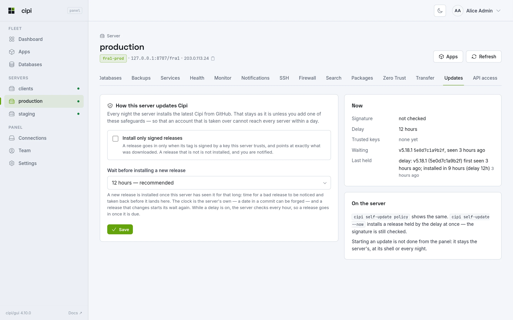
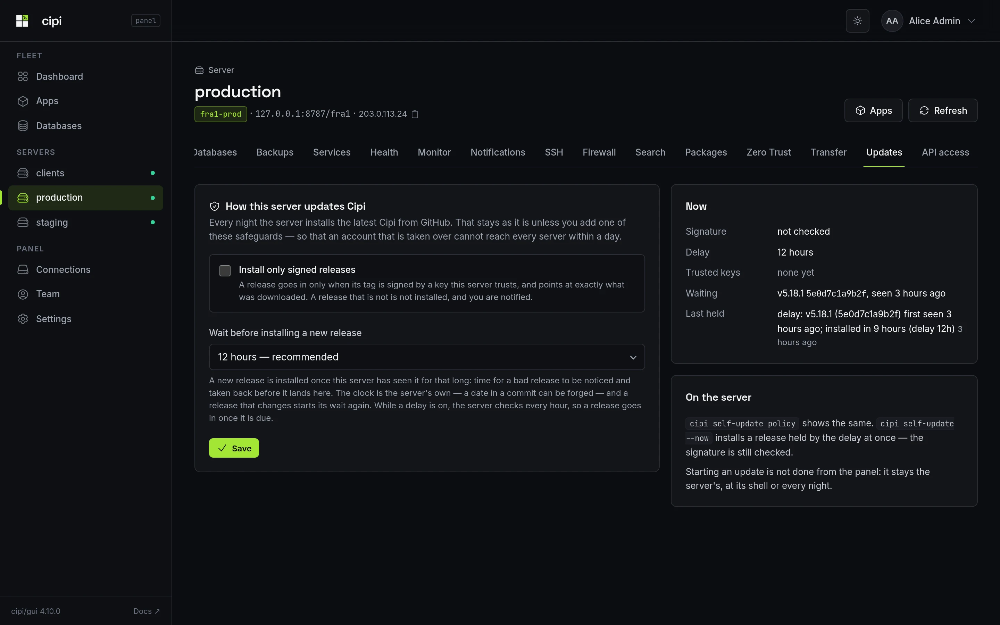

@section self-update-policy

Every night, at 03:50, each Cipi server installs the latest Cipi from GitHub ([Updating Cipi](/docs/server-commands#self-update)). That is how fixes reach every server without anyone logging in — and it means a server trusts what is published on GitHub. Two safeguards narrow that trust. Both are **off unless you turn them on**, alone or together:

| | What it does | Against |
| --- | --- | --- |
| **[Signed releases only](#verify)** — *not available at the moment* | A release is installed only when its tag is signed by a key the server already trusts | A taken-over GitHub account, a tampered download: pushing code is not enough, it has to be signed with a key that is not on GitHub |
| **[A delay](#delay)** | A new release is installed once the server has seen it for a while — 12 hours, suggested | A bad release, signed or not: time for it to be noticed and reverted before it lands on your servers |

```bash
$ cipi self-update policy                                 # how this server updates Cipi   (--json)
$ cipi self-update policy --delay=12h                     # wait 12 hours before a new release
$ cipi self-update policy --verify=on --fingerprint=SHA256:…   # signed releases only — not available at the moment
$ cipi self-update policy --delay=off --verify=off        # back to the default
```

Nothing else changes: the nightly update, `cipi self-update` at the shell, the backup of the installation before it and the migrations after it work as before. From the [panel](#panel), the API, `cipi-cli` and the PHP SDK too.

## Signed releases only {#verify}

> [!warning] **Signed releases are not available at the moment.** Cipi releases are not signed yet, so there is no key to trust: `--verify=on` is refused (*No signer to trust*) and nothing changes on the server. Until they are, the [delay](#delay) is the safeguard to use. The signing key will be listed [below](#signers) when signed releases are available.

With `--verify=on`, the server installs a release only when:

- its tag `v<version>` (the version in the downloaded `version.md`) exists,
- is signed with an SSH key listed in **`/etc/cipi/release-signers`** on this server,
- and points at the very commit that was downloaded.

Anything else — no tag, a tag signed by an unknown key, a tag on another commit, or a signed release **older** than the one installed (a branch pointed back at an old release with a known flaw) — is **refused**: nothing is installed, the server stays on the version it has, and you get a notification with the reason. The next night it tries again.

```bash
$ sudo cipi self-update
  Update refused: the signature of v5.19.0 is not one of a trusted key: …
```

The keys the server trusts are the ones already on it. A release can't vouch for itself: it may bring a new list of signers, and that list replaces the old one only after the release has been verified with the old one. The check is `git verify-tag` with `gpg.format=ssh` — Git's own SSH signatures, nothing to install.

### The first time: compare the fingerprint {#first-trust}

The first time the check is turned on, `/etc/cipi/release-signers` is empty: the server takes the keys shipped with the installed Cipi (`/opt/cipi/release-signers`), **once you say you compared them** with the ones published below.

```bash
$ cipi self-update policy --verify=on
  Releases will be checked against these keys:
    SHA256:…  releases@cipi.sh
  Compare them with the ones published at https://cipi.sh/docs/self-update#signers
  They are the same — trust them? [y/N]
```

From a script, the panel or the API, there is no question to answer: pass the fingerprint you compared, and the server takes the keys only when it is one of them.

```bash
$ cipi self-update policy --verify=on --fingerprint=SHA256:…
```

> [!note] With the check on, an unsigned release is never installed: a server whose check refuses every release stays on its version — and misses its security fixes too.

### Release signers {#signers}

The keys Cipi releases are signed with. Compare the fingerprint with the one your server shows before trusting it — on this page, served over HTTPS from cipi.sh, not from GitHub:

| Fingerprint | Principal | Since |
| --- | --- | --- |
| *Signed releases are not available at the moment* | | |

No key is listed yet: releases are not signed, and the [delay](#delay) is the safeguard to use.

## A delay {#delay}

With `--delay=12h`, a new release is installed once **this server has seen it for 12 hours**. The clock is the server's own — the date of a commit can be written by whoever makes it.

```bash
$ cipi self-update policy --delay=12h      # 0 (off) to 168 hours: 6h, 12h, 24h, 2d, 7d
$ cipi self-update policy
  Delay       12h — a new commit is installed once this server has seen it for that long
  Waiting     v5.19.0 (5e0d7c1a9b2f), seen 2026-11-28 03:50 CET
```

| | |
| --- | --- |
| **When a release is seen** | At the nightly update, and at an hourly check (`/etc/cron.d/cipi-selfupdate-delay`, at minute 17) that only asks GitHub which commit is the latest — nothing is downloaded until one is due |
| **When it is installed** | At the first hourly check after its delay has passed: not only at night |
| **A newer release meanwhile** | Its own delay starts when it is seen: a release replaced within the delay is never installed |
| **The version already running** | Not held: right after turning the delay on, the commit of the version installed is recorded as installed, not waited for |
| **Install it now** | `cipi self-update --now` — skips the delay, never the signature check |
| **Suggested** | 12 hours: a bad release is usually noticed within a few. Longer for servers that matter most; a mix is fine — a staging server with no delay sees a release first |

## Both together {#both}

The signature is checked first, on what was downloaded; the delay is counted after. A release that is not signed is refused whatever the delay; a signed one still waits for it.

## What it doesn't do {#limits}

| | |
| --- | --- |
| **Let an update around it** | `cipi self-update` at the shell follows the same policy; `--now` skips only the delay. Only root — or the panel, with a token that has `updates-manage` — changes the policy |
| **Check what isn't Cipi** | Ubuntu's packages, PHP, Node and the rest come from their own signed repositories (`unattended-upgrades`) |
| **Replace the signing key's safety** | A signature is as safe as the key that makes it. Cipi's is kept off GitHub; a server trusts only the keys it was given |
| **Start an update from the panel** | Neither the panel nor the API can start a self-update: they read and set the policy only |

## From the panel, the API, cipi-cli and the SDK {#panel}

The server's **Updates** tab in the [web panel](/docs/gui-overview) has both switches: *Only releases signed by a trusted key* — the first time with the fingerprint to paste, after comparing it with this page — and the delay, from none to a week. It shows the keys the server trusts, the release waiting for its delay and why the last update wasn't installed.

<figure class="gui-shot">
<div class="gui-shot-frame">
<div class="gui-shot-bar" aria-hidden="true"><i></i><i></i><i></i><span class="gui-shot-url">panel.example.com</span></div>


</div>
</figure>

| | |
| --- | --- |
| **API** | `GET /api/self-update/policy`, `PUT /api/self-update/policy` (`{"verify": true, "delay_hours": 12, "fingerprint": "SHA256:…"}`) — abilities `updates-view`, `updates-manage` ([endpoints](/docs/api#endpoints-self-update)) |
| **cipi-cli** | `cipi-cli updates`, `cipi-cli updates --delay 12h`, `cipi-cli updates --verify on --fingerprint SHA256:…` |
| **PHP SDK** | `$cipi->updates()->policy()`, `->setPolicy(verify: true, delayHours: 12, fingerprint: 'SHA256:…')` |

## For maintainers: signing a release {#signing}

A release is signed after it is merged into `latest`, from a checkout of that commit, with the key whose public half is in the repository's `release-signers`:

```bash
$ git checkout latest && git pull
$ scripts/sign-release.sh ~/.ssh/cipi_release_signing.pub
Signed and pushed v5.19.0 (5e0d7c1)
```

The script makes the annotated tag `v<version>` signed with `gpg.format=ssh`, checks it against `release-signers` and pushes it. Keep the private key off GitHub and off any CI — a hardware key (`ssh-keygen -t ed25519-sk`) is best: an account that is taken over can push, but cannot sign. A new key goes into `release-signers` in a release signed with the old one, and its fingerprint on this page.

## Questions {#questions}

| Question | Answer |
| --- | --- |
| Is my server less safe if I change nothing? | It is as it always was: it trusts GitHub, and installs a release the night it is published. The safeguards are for those who want a narrower trust. |
| Can I turn off the nightly update instead? | Remove its line (`cipi self-update`, at 03:50) from root's crontab and update by hand — but then security fixes wait for you. A delay is usually the better trade. |
| An update was refused: what now? | `cipi self-update policy` says why (*Last held*). A release the maintainers haven't signed yet is installed once its tag is signed. A signature that doesn't match is worth an issue on GitHub. |
| Does the delay hold back a fix I need now? | `cipi self-update --now` installs it at once — after the signature check, if it is on. |
