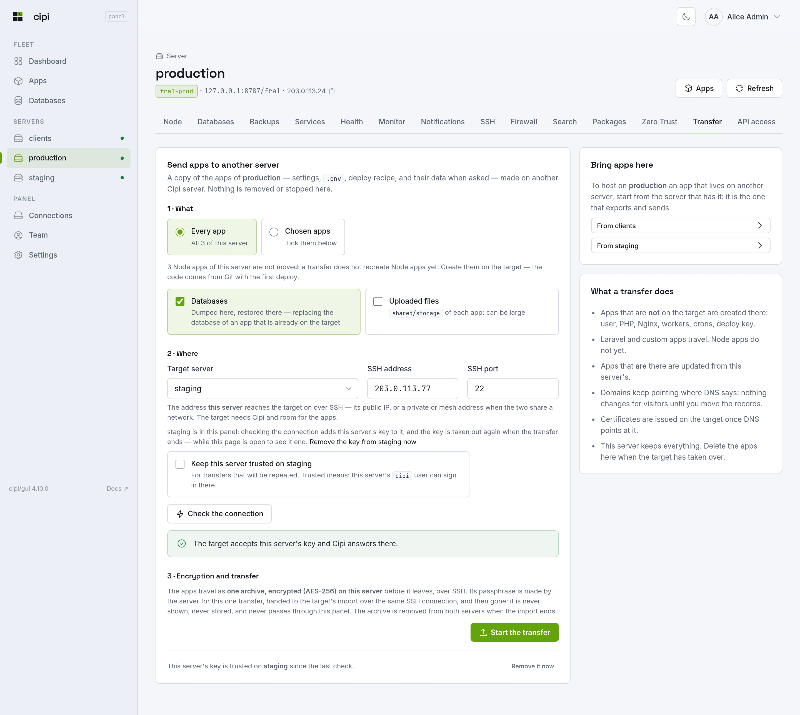
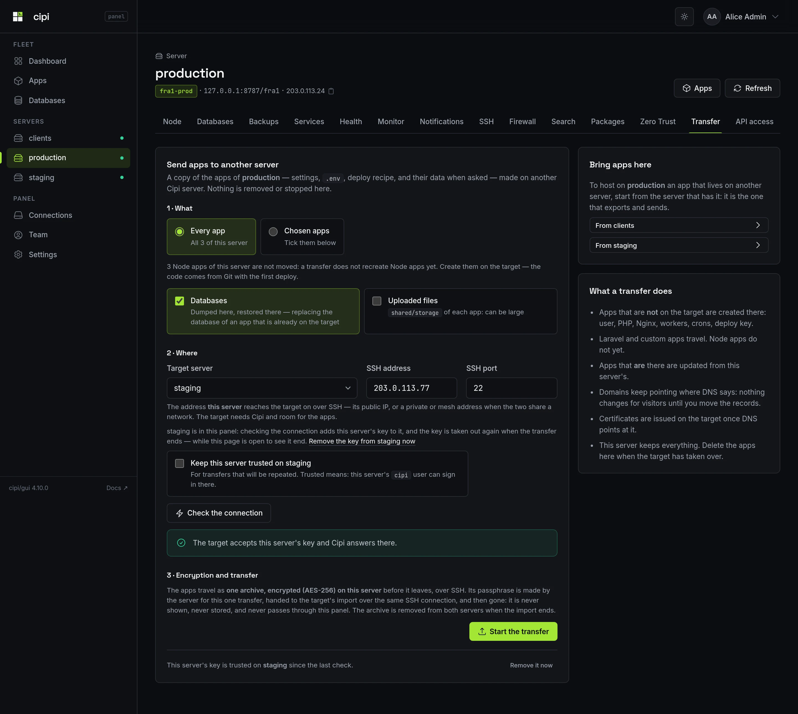

@section cipi-sync

Move, copy or replicate whole apps between Cipi servers: configuration, deploy keys, workers, crontab, and optionally database and storage. Archives are **encrypted with AES-256** and a passphrase, so credentials are safe at rest and in transit. Migrating providers becomes one command.

<cipi-term name="sync"></cipi-term>

```flow
Export | encrypted archive
> On the old server, the apps (settings, keys, workers, optionally database and storage) are packed into an archive encrypted with your passphrase.
Transfer | rsync over SSH
> The archive is copied to the new server with rsync over SSH, between servers that trust each other.
Import | apps created or updated
> On the new server, the apps are created (or updated if they exist), with the same users, PHP versions and workers.
DNS + SSL | switch when ready
> When you're ready, point DNS at the new server and issue certificates there.
```

## Commands {#commands}

| Command | Does |
| --- | --- |
| `cipi sync push [apps] --host=IP [--port=22] [--with-db] [--with-storage] [--import]` | Export + transfer + import in one go |
| `cipi sync check --host=IP [--port=22] [--json]` | Can this server push there: its key accepted, Cipi answering. Nothing is sent |
| `cipi sync pubkey [--raw]` | This server's sync key (`--raw`: the key and nothing else) |
| `cipi sync trust [--key="ssh-ed25519 …"]` | On the target: let that key push here |
| `cipi sync untrust --key="ssh-ed25519 …"` | On the target: take it back out |
| `cipi sync export [apps] [--with-db] [--with-storage] [--output=PATH]` | Write an encrypted archive |
| `cipi sync import <archive> [apps] [--update] [--deploy] [--yes]` | Create (or update) apps from it |
| `cipi sync list <archive>` | Inspect an archive without importing |

No app named means every app of the server.

## Trust between two servers {#trust}

A push signs in to the target over SSH as its `cipi` user, with the source's own key (`/home/cipi/.ssh/id_ed25519`, made when Cipi was installed). The target has to know that key first:

```bash
# on the source
$ cipi sync pubkey
# on the target: paste it, or pass it
$ cipi sync trust
$ cipi sync trust --key="ssh-ed25519 AAAA… cipi@old-server"
# back on the source: is the way open?
$ cipi sync check --host=203.0.113.20
✓ cipi@203.0.113.20:22 accepts this server's sync key — Cipi v5.18.0
```

`trust` takes one public key on one line and refuses anything else. A trusted key is a shell as `cipi` on the target: trust only the key of a server of yours, and take it back when the move is done — `cipi sync untrust --key="…"`.

`check` says what is in the way, in words, and exits non-zero when the way is not open:

| It says | Meaning | Do |
| --- | --- | --- |
| *does not trust this server's sync key yet* | SSH answers, the key is refused | `cipi sync trust` on the target |
| *does not answer over SSH* | Nothing at that address and port — from the source, not from your laptop | The address, the port, the target's firewall. Two servers on a private or [mesh](/docs/mesh-network) network reach each other on those addresses |
| *The host key … is not the one this server knows* | The target was rebuilt, or it is another machine | If it was rebuilt: `ssh-keygen -R <address>` as root on the source |
| *Cipi does not answer* | SSH works, `cipi` does not | Install Cipi on the target |
| *This server has no sync key* | `/home/cipi/.ssh/id_ed25519` is missing | `sudo -u cipi ssh-keygen -t ed25519 -f /home/cipi/.ssh/id_ed25519 -N ""` |

## The passphrase {#passphrase}

The archive is encrypted with a passphrase before it leaves the source. Three ways to give one:

| How | When |
| --- | --- |
| Asked at the prompt, twice | By hand, at a terminal |
| `--passphrase="$(cat /etc/cipi/.sync_passphrase)"` | A cron job: keep the file `chmod 400`, owned by root |
| `--auto-passphrase` (with `--import`) | A push that also imports: the source makes a passphrase for that one transfer and hands it to the target's import over the same SSH connection. It is never shown, never stored, and in no command line or log. Both servers on a current Cipi |

`--auto-passphrase` is what the [web panel](#panel), the API, cipi-cli and the SDK use: there is nothing to type and nothing to keep. It goes with `--import` only — an archive left on the target for later would be one nobody can open — and if the import fails, the archive is removed from the target and the push fails with it.

`cipi sync import … --passphrase-stdin` reads the passphrase from the first line of standard input, for scripts of your own that pipe it in.

> [!note] Without a terminal — cron, a pipeline, the panel — `push` asks nothing. A missing passphrase, a key that is not trusted, a target that does not answer: each stops the push with a message instead of a prompt nobody would see.

## What travels {#contents}

| Item | Included |
| --- | --- |
| `.env`, `auth.json`, `deploy.php` | Always |
| Deploy key, SSH config, known hosts | Always: the same key keeps working on GitHub |
| Workers, crontab, PHP version, limits, cipi.yml auto-apply | Always |
| Database dump | `--with-db` |
| `shared/storage` | `--with-storage` |
| Certificates | Never: run `cipi ssl install` after the DNS switch |

## Import: new vs existing apps {#import}

| | New app | Existing app (`--update`) |
| --- | --- | --- |
| User, directories, vhost, pool, workers | Created | Regenerated |
| Database credentials | **New** random password, written to `.env` | Target keeps its own |
| Rest of `.env` (`APP_KEY`, mail…) | From the archive | From the archive |
| Database data | Imported | Tables replaced |
| PHP version | As source (must be installed) | Migrated if it changed |

Pre-flight checks block an import that would clash with an existing app or domain. New passwords are printed once at the end. `push --import` imports with `--update`: apps that are already on the target are updated, the others created.

## From the panel, the API, cipi-cli and the SDK {#panel}

The same push without a shell on either server. The server you start from is the **source**.

<figure class="gui-shot">
<div class="gui-shot-frame">
<div class="gui-shot-bar" aria-hidden="true"><i></i><i></i><i></i><span class="gui-shot-url">panel.example.com</span></div>


</div>
<figcaption>Server → <strong>Transfer</strong>: the apps of <code>production</code> to <code>staging</code>, the connection checked, ready to start.</figcaption>
</figure>

**In the [web panel](/docs/gui-overview)**, the server page has a **Transfer** tab — a wizard in three steps:

| Step | What you do |
| --- | --- |
| **1 · What** | Every app of the server or the ones you tick, with **Databases** and **Uploaded files** or without |
| **2 · Where** | A server of the panel, or *A server that is not in this panel* and its address. Then **Check the connection**: the answer of `cipi sync check`, in words |
| **3 · Encryption and transfer** | **Start the transfer**, after a confirmation that says what is sent and what is replaced. It runs as a job, with the command's output live |

| | |
| --- | --- |
| **A target that is in the panel** | Checking the connection adds the source's key to it, and the key is taken out again when the transfer ends — whatever its end. *Keep this server trusted* leaves it, for transfers that repeat. A key that was trusted before the wizard is left where it was |
| **A target that is not** | The page shows the source's key, its fingerprint and the command to run on the target (`cipi sync trust`) |
| **The address** | The one *the source* reaches the target on over SSH. For a server of the panel it is suggested, and stays editable: a private or mesh address is often the right one |
| **Encryption** | `--auto-passphrase`: there is no passphrase field. It never passes through the panel |
| **Bring apps here** | On the server that receives: the other servers of the panel, each a link to *its* Transfer tab with this server chosen as the target |
| **Node apps** | Listed, greyed out: [not moved yet](#limits) |
| **Who may** | **Manage** on the source — and on the target, when it is a server of the panel. The token needs the `sync-manage` ability |

| | |
| --- | --- |
| **API** | `GET /api/sync/key`, `POST /api/sync/check`, `POST` and `DELETE /api/sync/trust`, `POST /api/sync/push` (a job of type `sync-push`) — ability `sync-manage` ([endpoints](/docs/api#endpoints-sync)) |
| **cipi-cli** | `cipi-cli prod sync push --to staging --with-db` — `--to` names the target by its profile and does the trust for you. `sync check`, `sync key`, `sync trust --from prod`, `sync untrust` ([cipi-cli](/docs/cli-client#sync)) |
| **PHP SDK** | `$source->sync()->key()`, `$target->sync()->trust($key)`, `$source->sync()->ready($host)`, `$source->wait($source->sync()->push($host, ['shop'], withDb: true))` ([PHP SDK](/docs/php-sdk#server)) |

A transfer started this way is followed for up to two hours.

> [!security] `sync-manage` is as strong as `ssh-manage`: whoever holds a token with it can have the server send its apps — databases included — to a host of their choosing, and can let another server's key sign in as `cipi`. Tokens made from a list of abilities do not have it until they are created again. Exports to a file (`export`, `import`, `list`) stay at the server's shell: the API cannot ask for an archive at a path it names.

## Recipes {#recipes}

**Migrate a whole server** (e.g. AWS → Hetzner):

```bash
# on the new server: cipi sync trust (paste the key from: cipi sync pubkey on the old one)
$ cipi sync check --host=NEW_IP
$ cipi sync push --host=NEW_IP --with-db --with-storage --import
# on the new server, after pointing DNS:
$ cipi ssl install shop && cipi ssl install blog
```

**Warm standby every 6 hours** (data-loss window = interval):

```bash
0 */6 * * * /usr/local/bin/cipi sync push --host=STANDBY_IP --with-db --with-storage --import --auto-passphrase >> /var/log/cipi/sync.log 2>&1
```

If the primary fails: point DNS at the standby, `cipi ssl install` each app, done.

**Portable nightly archive:**

```bash
0 3 * * * /usr/local/bin/cipi sync export --with-db --with-storage --output=/root/backups/cipi-$(date +\%F).tar.gz.enc --passphrase="$(cat /etc/cipi/.sync_passphrase)"
```

## What sync does not do {#limits}

| | |
| --- | --- |
| **Node apps** | Not moved yet: an export skips them, by name. Create the app on the target — it deploys from Git — and move its database with [`cipi db backup` / `restore`](/docs/databases) |
| **Database** | A full replace on the target, not a merge |
| **Storage** | A full extract: a file deleted on the source since the last sync stays on the target |
| **Certificates** | Issued on the target after DNS points at it |
| **History** | One copy, as of now. For point-in-time history use [Backups](/docs/backups) |
