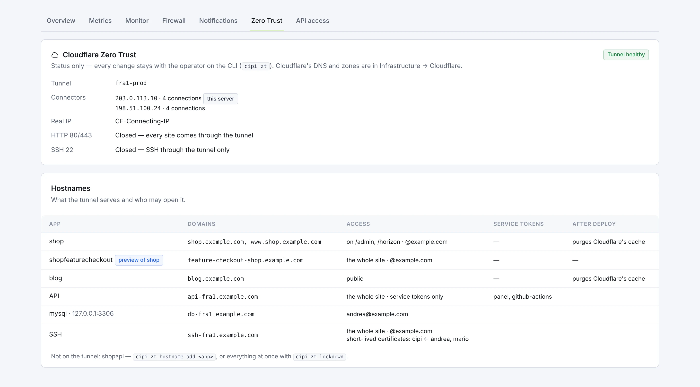
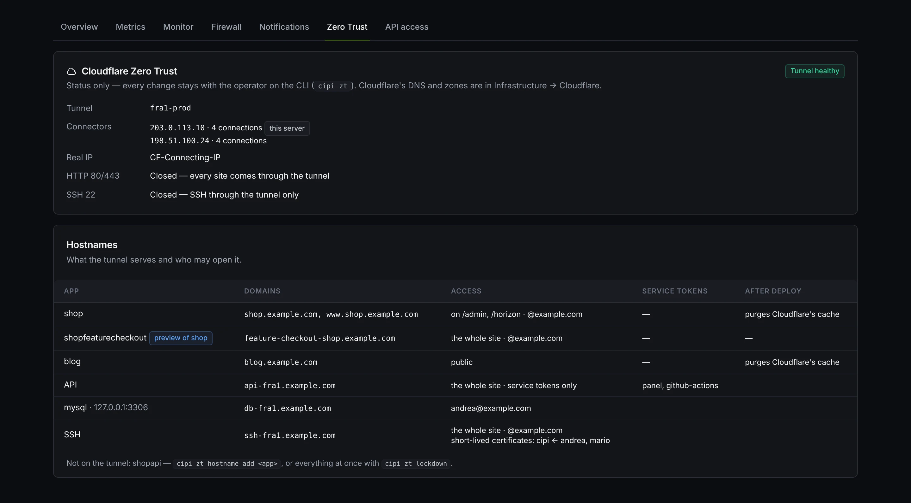

@section cli-zt

Put your server behind Cloudflare: visitors reach apps through a Cloudflare Tunnel (with CDN and WAF), staging sites, admin paths, the panel, the API, databases and SSH sit behind Cloudflare Access, and finally the origin closes its ports — all of them, if you like. Every step that could lock you out is a separate, explicit command. Off until you enable it.

> [!tip] Cloudflare publishes the sites to visitors. For the way in for **you** — SSH, the panel, the API on a private address — see [Tailscale & NetBird](/docs/mesh-network): a mesh network sits beside the tunnel, and the two know each other's locks.

```flow
Token | Tunnel, Access, DNS
> Create a Cloudflare API token with Tunnel, Access and DNS permissions and save it with `cipi zt token set`.
Enable | tunnel + real IP; ports still open
> `cipi zt enable` creates the tunnel and makes apps see visitors' real IPs. Ports stay open for now, so nothing can break yet.
Route | hostnames, Access, SSH
> Route each hostname through the tunnel, add Access where you want a login wall — a whole site, some paths, some people — and SSH through Access.
Test | from your laptop
> From your laptop, check every site and SSH through the tunnel. Don't skip this.
Lock | 80/443 and 22 closed
> `cipi zt lock` closes 80, 443 and 22 to the internet, or `cipi zt lockdown` does all of it at once. Only the tunnel reaches the server now.
```

```bash
$ cipi zt token set --token=CF_API_TOKEN --account=ACCOUNT_ID
$ cipi zt enable
$ cipi zt hostname add myapp                       # public, through CDN/WAF
$ cipi zt access enable staging                    # login required (Cloudflare Access)
$ cipi zt access enable myapp --path=/admin,/horizon --allow=@example.com
$ cipi zt access enable --gui
$ cipi zt ssh enable --hostname=ssh.example.com
$ cipi zt lock http --yes                          # 80/443 closed or Cloudflare-only
$ cipi zt lock ssh --yes                           # port 22 closed
$ cipi zt lockdown                                 # everything on the tunnel, no inbound port
$ cipi zt status                                   # --json for the whole picture
$ cipi zt token show                               # is a token saved? (never the secret)
$ cipi zt refresh                                  # fetch Cloudflare's IP ranges again (done every night too)
```

Token permissions: Account · Cloudflare Tunnel: Edit, Account · Access: Apps and Policies: Edit, Zone · DNS: Edit (plus Zone · SSL and Certificates for Origin CA). For what you use: Account · Access: Service Tokens: Edit ([service tokens](#service-tokens)), Account · Access: SSH Auditing: Edit ([SSH certificates](#ssh-cert)), Zone · Cache Purge: Purge ([purges](#purge)). A token without these keeps working; a command that needs more names the permission it misses. The token is stored root-only, separate from the DNS token used for certificates and from the Cloudflare token of the [web panel's connector](/docs/gui-connectors#cloudflare).

## What each step does {#steps}

| Command | Effect | Reversible with |
| --- | --- | --- |
| `enable` | Installs `cloudflared`, a locally-managed tunnel, Nginx real-IP from Cloudflare's ranges (refreshed daily); Fail2ban/CrowdSec learn the ranges. **No port is closed** | `disable` |
| `hostname add <app\|--gui\|--api>` | DNS CNAME to the tunnel, ingress to Nginx; `--api` for the [REST API](/docs/api) | `hostname remove` |
| `access enable <app\|--gui\|--api>` | Cloudflare Access login in front: the whole site or [some paths, for some people](#access); `/cipi/webhook` bypassed so pushes still deploy | `access disable` |
| `service-token create <name> --for=…` | A [token for machines](#service-tokens): CI, monitors, the panel | `service-token revoke` |
| `tcp add <service> --hostname=…` | A [database or Valkey](#tcp) reachable from your laptop, behind Access | `tcp remove` |
| `ssh enable` | SSH through the tunnel + Access; prints your `~/.ssh/config` | `ssh disable` |
| `ssh cert enable --principals=…` | SSH with [short-lived certificates](#ssh-cert) instead of keys | `ssh cert disable` |
| `lock http` | 80/443 closed when everything is on the tunnel, else allowed from Cloudflare only | `unlock http` |
| `lock ssh` | Port 22 closed (only if the tunnel already carries SSH) | `ssh unlock` |
| `lockdown` | [Every app, the panel and the API on the tunnel](#lockdown), then 80/443 and 22 closed | `unlock http`, `ssh unlock` |
| `preview create <app> --branch=…` | A [preview of a branch](#previews) on its own hostname | `preview remove` |
| `replica export` / `join` | [The same tunnel on another server](#replicas) | `replica leave` |
| `purge <app>` | [Cloudflare's cache](#purge) of the app, now or after every deploy | `purge <app> --on-deploy=off` |

```text
# ~/.ssh/config on your laptop
Host ssh.example.com
  ProxyCommand cloudflared access ssh --hostname %h
  User cipi
  IdentityFile ~/.ssh/id_ed25519
```

> [!warning] Lock SSH only after `ssh ssh.example.com` works through the tunnel from your machine, and keep your provider's web console at hand. Deploys are unaffected (they use `localhost`).

## Access on some paths, for some people {#access}

`access enable` alone asks anyone who signs in with your identity provider. Two options narrow it:

```bash
$ cipi zt access enable shop --path=/admin,/horizon,/pulse      # only these paths; the rest stays public
$ cipi zt access enable shop --allow=me@example.com,@example.com # these emails and domains only
$ cipi zt access enable --api --allow=none                       # service tokens only, no people
$ cipi zt access enable shop --path=                             # back to the whole site
$ cipi zt access enable shop --allow=all                         # back to anyone who signs in
```

`--path=` puts Filament, Horizon, Pulse or Telescope behind single sign-on and leaves the site public. Running `access enable` again updates the same Access application and keeps what you didn't pass. The `/cipi/webhook` Bypass is created only when Access covers that path. `--gui` and `--api` take the same options.

## Service tokens {#service-tokens}

Machines can't sign in with a browser. A service token is a pair of headers Access lets through:

```bash
$ cipi zt service-token create github-actions --for=shop     # or --for=gui, --for=api
$ cipi zt service-token create panel --for=api --duration=8760h --json
$ cipi zt service-token list
$ cipi zt service-token revoke github-actions
```

Cipi creates the token and a Service Auth policy on the target's Access application, and prints `CF-Access-Client-Id` and `CF-Access-Client-Secret` once. Re-creating a target's Access application keeps its tokens' policies.

```bash
$ curl -H "CF-Access-Client-Id: 3f2a….access" -H "CF-Access-Client-Secret: …" https://shop.example.com/health
```

For a server whose API is behind Access (`cipi zt access enable --api --allow=none`), the [web panel](/docs/gui-overview) sends the token with every call: **Connections → the server → Behind Cloudflare Access**, with the id and the secret. The secret is stored encrypted, never shown again, and kept when the field is left empty.

## Databases and Valkey from your laptop {#tcp}

```bash
$ cipi zt tcp add mysql --hostname=db.example.com --allow=me@example.com
$ cipi zt tcp add valkey --hostname=cache.example.com
$ cipi zt tcp list
$ cipi zt tcp remove db.example.com
```

`mysql`, `mariadb`, `pgsql`, `redis`, `valkey` or a port number: a hostname that reaches `127.0.0.1:<port>` on the server, always behind Access — nothing is published if Access can't be created. The port stays closed. On your laptop:

```bash
$ cloudflared access tcp --hostname db.example.com --url 127.0.0.1:13306
```

then TablePlus, DBeaver or `mysql -h 127.0.0.1 -P 13306` on that address, with the database's own user and password.

## SSH with short-lived certificates {#ssh-cert}

Instead of keys to hand out and take back, Cloudflare signs a certificate at every sign-in:

```bash
$ cipi zt ssh cert enable --principals=andrea,mario          # for the cipi user
$ cipi zt ssh cert enable --user=deploy --principals=ci
$ cipi zt ssh cert status
$ cipi zt ssh cert disable
```

sshd trusts the CA of the SSH Access application (`TrustedUserCAKeys`) and accepts, for each Unix user, the principals listed for it (`AuthorizedPrincipalsFile`): the part of the email before the @ — `andrea` for andrea@example.com. `sshd -t` checks the drop-in before the reload; keys in `authorized_keys` keep working. `cipi zt ssh enable` takes `--allow=` too. On your laptop, once:

```bash
$ cloudflared access ssh-config --hostname ssh.example.com --short-lived-cert >> ~/.ssh/config
$ ssh cipi@ssh.example.com          # the browser asks you to sign in, no key needed
```

## No inbound port: lockdown {#lockdown}

```bash
$ cipi zt lockdown            # asks first; --yes to skip, --force to accept an HTTP-01 renewal failing
```

Every app, the panel and the API go on the tunnel, then 80/443 close and, when SSH runs through the tunnel, port 22: the shape of a server behind NAT with no port forwarding. It stops at the first step that fails, and it still refuses to close port 80 while a certificate renews over HTTP-01 (see [certificates](#cli-zt-origin-cert)). At the end it prints the inbound ports still open — none, if SSH was on the tunnel.

## Previews of a branch {#previews}

```bash
$ cipi zt preview create shop --branch=feature/login          # behind Access
$ cipi zt preview create shop --branch=feature/login --public --hostname=login.example.com
$ cipi zt preview list
$ cipi deploy shopfeaturelogin                                # update it
$ cipi zt preview remove shopfeaturelogin
```

An app of its own — the same repository and PHP, its own database and `.env`, environment `preview` — on `feature-login-shop.example.com`, one level below the zone so Cloudflare's Universal certificate covers it, through the tunnel, behind Access (anyone who signs in, or the people of `--allow=`) unless `--public`, and deployed once (`--no-deploy` to skip). `remove` deletes the app, its database and its hostname. See also [preview environments](/docs/preview-environments).

## The same tunnel on more servers {#replicas}

```bash
$ cipi zt replica export                  # on the server with the tunnel: prints a bundle
$ cipi zt replica join cipi-zt1:…         # on another server with the same apps
$ cipi zt replica list                    # connectors, and which one is this server
$ cipi zt replica leave                   # stop the connector here; tunnel, DNS and Access stay
```

The bundle holds the tunnel's credentials and routes: treat it as a password. Cloudflare then sends requests to either server. To move a server without touching DNS (the records point at the tunnel): join the new one, check it, `replica leave` on the old one. `cipi zt disable` refuses on a replica, or while other servers run the tunnel (`--delete-tunnel` deletes it for everyone).

## Cloudflare's cache {#purge}

```bash
$ cipi zt purge shop                     # the app's hostnames
$ cipi zt purge shop --everything        # the whole zone
$ cipi zt purge shop --on-deploy=on      # after every successful deploy
```

Purge by hostname works on every Cloudflare plan. With `--on-deploy=on`, `cipi deploy` and the webhook alike purge after a successful deploy, and the [deploy notification](/docs/deploy-notifications) says how it went.

## The tunnel in the monitor {#monitor}

With Zero Trust on, the [monitor](/docs/monitor) runs a `tunnel` check every 5 minutes: critical when cloudflared stops or Cloudflare sees the tunnel down or inactive, a warning when it is degraded (fewer connections: a network problem, or a replica down). Trigger `monitor_tunnel`, urgent, with recovery and reminders like every check. With 80/443 closed it is the one outage a server can still report: notifications go out, not through the tunnel. Outbound port 7844 (TCP and UDP) must stay open.

## In the web panel {#panel}

The server's **Zero Trust** tab shows what `cipi zt status --json` knows: the tunnel as Cloudflare sees it and every connector — which one is this server, the others its replicas — what is closed, each hostname with its domains, Access paths and people, service tokens, previews and the purge setting, the panel and the API, TCP services, SSH and its certificates, and what is not on the tunnel yet. Cloudflare's card is read-only: every change to the tunnel stays on `cipi zt`. The [API](/docs/api) gives the same as `details` on `GET /api/zt`.

Under it, the **Mesh network** card is where a [Tailscale or NetBird network](/docs/mesh-network#panel) is joined, locked and left from the browser.

<figure class="gui-shot">
<div class="gui-shot-frame">
<div class="gui-shot-bar" aria-hidden="true"><i></i><i></i><i></i><span class="gui-shot-url">panel.example.com</span></div>


</div>
<figcaption>A server with both sides of Zero Trust: the sites through a Cloudflare tunnel — Access on <code>/admin</code> and <code>/horizon</code>, a preview, the API for service tokens only, MySQL for one person — and SSH closed to the world, open on a tailnet.</figcaption>
</figure>

The zones and DNS records of your Cloudflare accounts are in the panel's [Cloudflare connector](/docs/gui-connectors#cloudflare), with a token saved in the panel.

## Certificates {#cli-zt-origin-cert}

`lock http` refuses while an app still renews over HTTP (Let's Encrypt can't reach a closed origin). Move apps first to `cipi ssl install <app> --dns=cloudflare`, or use a 15-year Cloudflare Origin CA certificate:

```bash
$ cipi zt origin-cert myapp
```

Apps on the tunnel skip Cipi's HTTP→HTTPS redirect automatically (the tunnel talks HTTP to the origin and Cloudflare handles HTTPS). `cipi zt disable` reopens 22/80/443 and removes everything Cipi created in your Cloudflare account; Let's Encrypt certificates are left alone.
