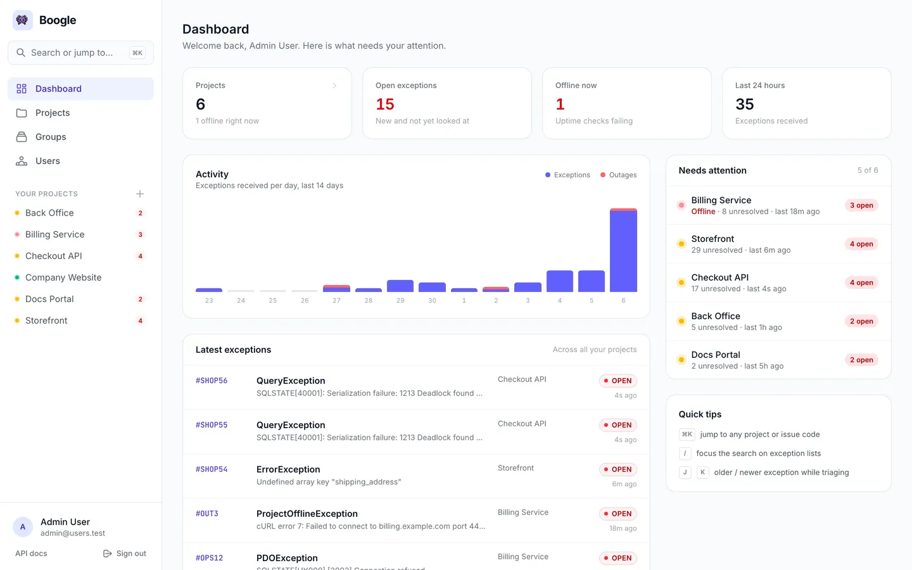
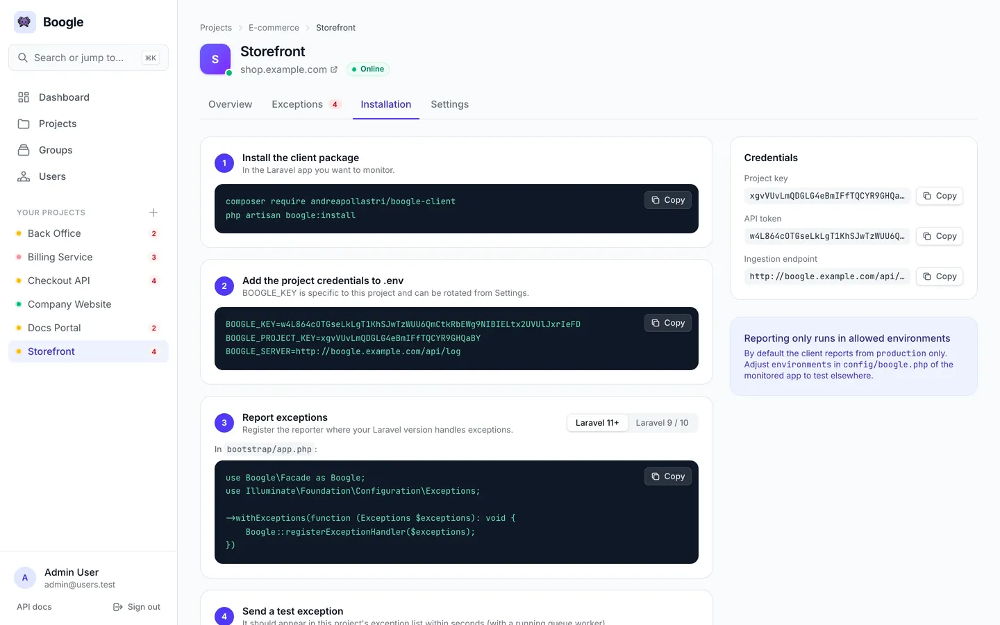
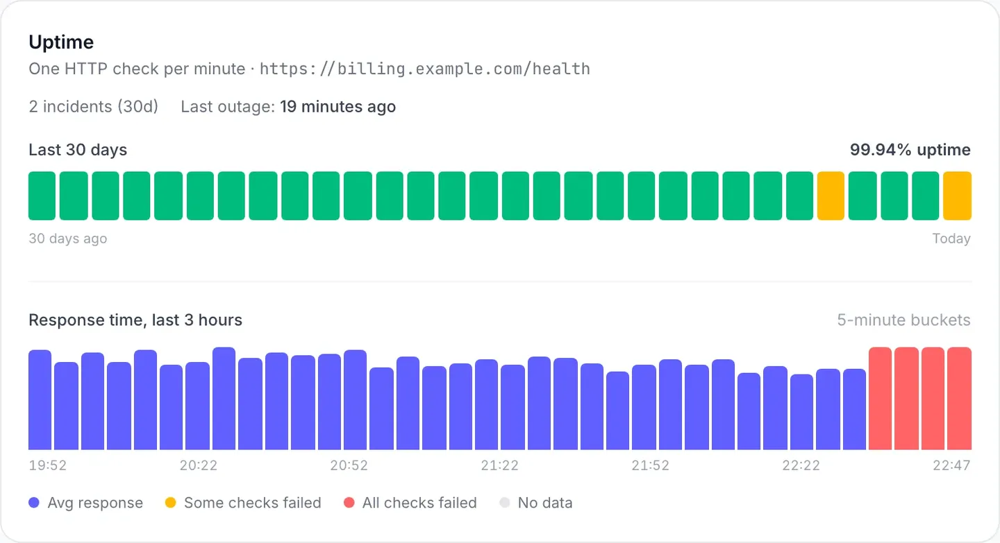
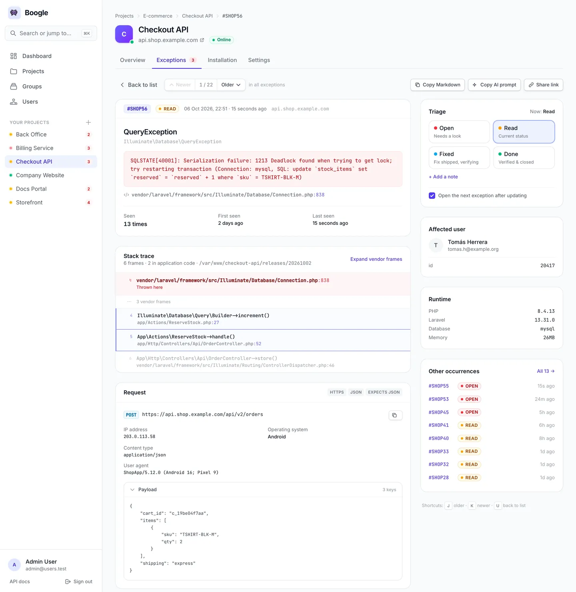

When a Laravel app throws an exception in production, you want to know **before** your users tell you. [Boogle](https://boogle.web.ap.it) is a free, self-hosted exception tracker and uptime monitor for Laravel. This guide installs it as a Cipi app on its own small server, connects your apps, and sets up alerts.

## Key ideas, in plain words {#ideas}

| Term | Meaning |
| --- | --- |
| **Exception** | An error your code didn't handle: a 500 page for the user |
| **Exception tracker** | A service that collects exceptions from your apps, groups them and shows the details |
| **Issue** | A group of identical exceptions, with a code like `#BUG42` |
| **Uptime check** | A request every minute to see if the site answers; failing means an outage (`#OUT`) |
| **Client package** | `boogle-client`, installed in each app you monitor; it sends exceptions to Boogle |

```flow
Exception | in one of your apps
> Something breaks in production. Laravel's exception handler catches it as usual.
Client | boogle-client
> The client package sends the exception, with the stack trace, request and logged-in user, to your Boogle's `/api/log`, authenticated with the project's keys.
Boogle | groups it into an issue
> Boogle stores it and processes it on its queue: identical exceptions become one issue with a code (`#BUG42`).
You | e-mail, triage, fix
> You get it in the digest e-mail, open it in the panel, read the trace with your own code highlighted, and mark it Read, Fixed or Done.
```

<figure class="gui-shot">
<div class="gui-shot-frame">
<div class="gui-shot-bar" aria-hidden="true"><i></i><i></i><i></i><span class="gui-shot-url">boogle.example.com</span></div>

</div>
<figcaption>The dashboard: every project, its open exceptions and whether it's online.</figcaption>
</figure>

## Before you start {#before}

- A **separate** small server for Boogle (1–2 GB RAM is enough), with Cipi installed. A monitor on the same server as the apps can't warn you when that server is down.
- A subdomain such as `boogle.example.com` pointing at it.
- Working e-mail for Boogle (an SMTP service): alerts and digests are e-mails.
- GitHub (or GitLab) account to fork the Boogle repository.

## 1. Fork Boogle {#fork}

Cipi deploys from a Git repository you control, with a read-only deploy key. Open [github.com/andreapollastri/boogle](https://github.com/andreapollastri/boogle) and click **Fork**. Your copy is `git@github.com:YOU/boogle.git`.

## 2. Create the app on Cipi {#create}

```bash
$ ssh cipi@MONITOR_IP
$ sudo cipi app create --user=boogle --domain=boogle.example.com \
    --repository=git@github.com:YOU/boogle.git --branch=main \
    --node-build='npm ci && npm run build'
```

Add the deploy key from the summary to your fork (**Settings → Deploy keys**, read-only), then:

```bash
$ sudo cipi git check boogle
$ sudo cipi deploy boogle
$ sudo cipi ssl install boogle
```

What you get for free on Cipi, which Boogle's README asks you to set up by hand:

| Boogle needs | On Cipi |
| --- | --- |
| A queue worker under Supervisor | Created with the app |
| The scheduler every minute (uptime checks, digests) | Already in the app user's crontab |
| A database | Created, credentials in `.env` |
| HTTPS | `cipi ssl install` |

## 3. Configure it {#configure}

```bash
$ sudo cipi app env boogle --set=APP_URL=https://boogle.example.com
$ sudo cipi app env boogle --set=MAIL_MAILER=smtp
$ sudo cipi app env boogle      # add MAIL_HOST, MAIL_PORT, MAIL_USERNAME, MAIL_PASSWORD, MAIL_FROM_ADDRESS
$ sudo cipi app artisan boogle db:seed --force
$ sudo cipi app artisan boogle config:cache
$ sudo cipi worker restart boogle
```

The seeder creates the admin `admin@users.test` / `password`. **Log in at once and change it** (Profile), and turn on two-factor authentication.

## 4. Create a project {#project}

In Boogle, **Projects → New**: name, URL (`https://shop.example.com`) and, optionally, a group (its prefix becomes the issue code, e.g. `BUG`). Open the project's **Installation** tab: it shows the exact commands and the three keys for that app.

<figure class="gui-shot">
<div class="gui-shot-frame">
<div class="gui-shot-bar" aria-hidden="true"><i></i><i></i><i></i><span class="gui-shot-url">boogle.example.com</span></div>

</div>
<figcaption>The Installation tab gives you everything to paste, with copy buttons.</figcaption>
</figure>

## 5. Connect your Laravel app {#connect}

In the app you want to monitor (on your laptop):

<cipi-term name="boogle-client"></cipi-term>

```bash
$ composer require andreapollastri/boogle-client
$ php artisan boogle:install
```

Register the reporter. Laravel 11 and newer, in `bootstrap/app.php`:

```php
use Boogle\Facade as Boogle;
use Illuminate\Foundation\Configuration\Exceptions;

->withExceptions(function (Exceptions $exceptions): void {
    Boogle::registerExceptionHandler($exceptions);
})
```

(Laravel 9 or 10: call `Boogle::handle($e);` in a `reportable` callback in `app/Exceptions/Handler.php`.)

Commit and deploy. Then put the keys **on the server** (never in Git):

```bash
$ sudo cipi app env shop --set=BOOGLE_KEY=…
$ sudo cipi app env shop --set=BOOGLE_PROJECT_KEY=…
$ sudo cipi app env shop --set=BOOGLE_SERVER=https://boogle.example.com/api/log
$ sudo cipi app artisan shop config:cache
$ sudo cipi app artisan shop boogle:test
```

Within seconds the test exception appears in the project.

> [!note] The client reports only from the environments listed in `config/boogle.php` (`production` by default). On staging, add `staging` there if you want staging errors too.

## 6. Turn on uptime checks {#uptime}

In the project's settings, enable **uptime** and, if you want a specific page, set the uptime URL (for example the app's `/up`). Boogle pings it every minute. When it fails, an outage issue (`#OUT`) opens and you get an e-mail; when it's back, the issue closes and you get a recovery e-mail.

<figure class="gui-shot">
<div class="gui-shot-frame">
<div class="gui-shot-bar" aria-hidden="true"><i></i><i></i><i></i><span class="gui-shot-url">boogle.example.com</span></div>

</div>
<figcaption>Uptime history: 30 days and the last 3 hours.</figcaption>
</figure>

## 7. Triage like a team {#triage}

<figure class="gui-shot">
<div class="gui-shot-frame">
<div class="gui-shot-bar" aria-hidden="true"><i></i><i></i><i></i><span class="gui-shot-url">boogle.example.com</span></div>

</div>
<figcaption>One exception: your own code highlighted, vendor frames collapsed, request and user context.</figcaption>
</figure>

| Status | Use it when |
| --- | --- |
| Open | New, nobody looked yet |
| Read | Seen, being investigated |
| Fixed | A fix is deployed |
| Done | Closed for good |

Keyboard shortcuts move through the list; bulk actions handle noisy days. Share a read-only link with a client when needed.

## How it fits with Cipi's own monitoring {#together}

| Tool | Watches | Alerts on |
| --- | --- | --- |
| [Cipi monitor](/docs/monitor) | The server: disk, memory, services, backups, certificates | Server problems |
| [Cipi health checks](/docs/health-checks) | Each app's health URL, also right after a deploy | Broken releases (with auto-rollback) |
| **Boogle** | Exceptions inside the code, and uptime from outside | Bugs and outages |

Use all three: they answer different questions. Cipi's alerts go to Telegram, Slack and more ([notifications](/guides/notifications-alerts)); Boogle's go by e-mail.

## Troubleshooting {#troubleshooting}

| Problem | Fix |
| --- | --- |
| `boogle:test` fails | Check `BOOGLE_SERVER` ends with `/api/log`, the keys match the Installation tab, and run `config:cache` |
| Test sent but nothing appears | Boogle's queue worker isn't running: `sudo cipi worker list boogle` |
| No e-mails | `MAIL_*` wrong in Boogle's `.env`; e-mails also go through the queue |
| Uptime never checks | The scheduler is off: `sudo cipi schedule status boogle` |
| Nothing reported from staging | Add `staging` to `environments` in `config/boogle.php` of the monitored app |
| 419 or login loop on the panel | `APP_URL` doesn't match the domain: fix it and `config:cache` |
