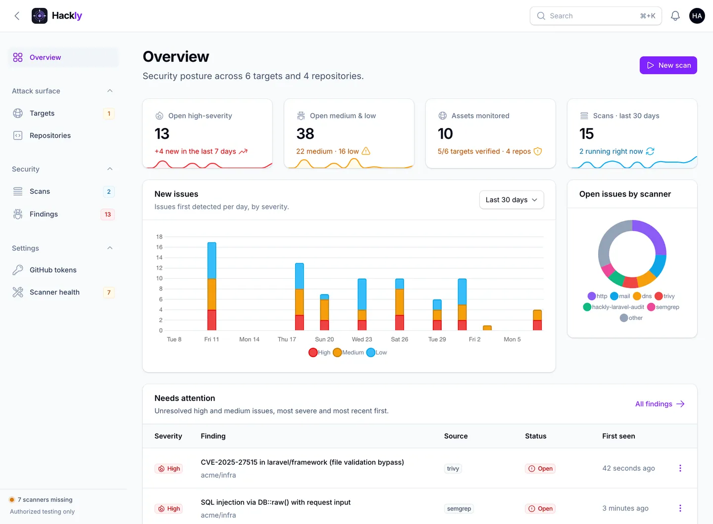
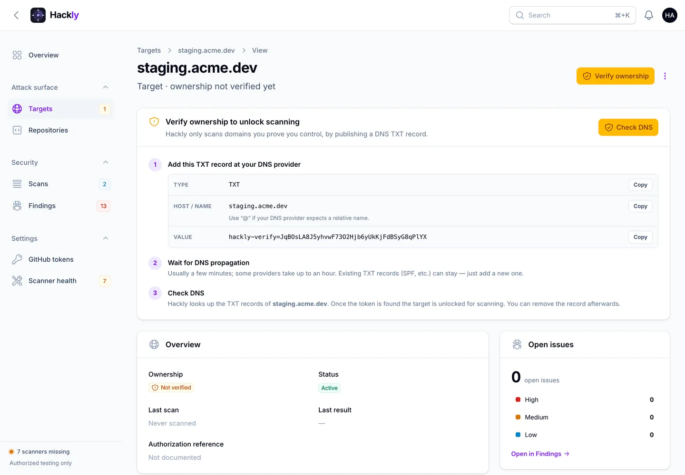
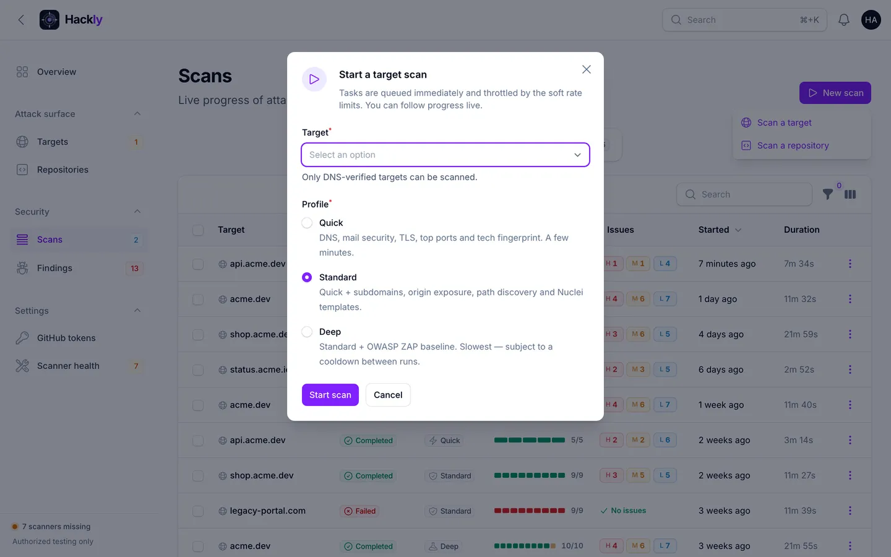
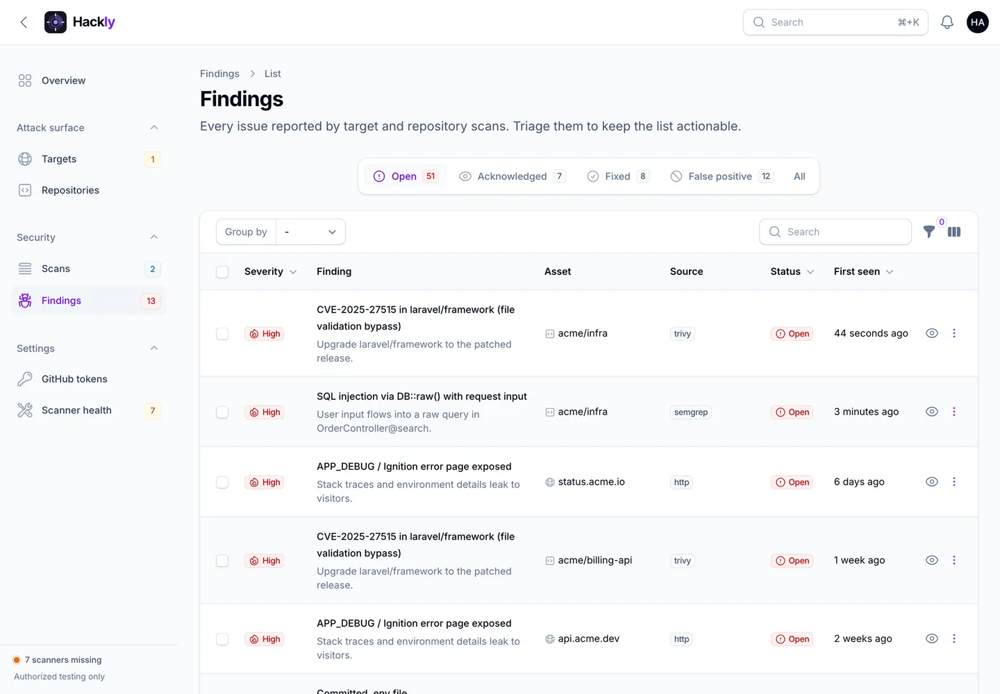

Patching servers (which Cipi does for you) is half of security. The other half is checking **your own** sites and code for weaknesses: exposed paths, weak TLS, missing headers, vulnerable dependencies, leaked secrets. [Hackly](https://hackly.web.ap.it) runs the industry's open-source scanners for you, safely, from one panel.

## Key ideas, in plain words {#ideas}

| Term | Meaning |
| --- | --- |
| **Target** | A domain you own and want to scan, e.g. `shop.example.com` |
| **DAST** | Dynamic testing: probing the running site from outside, like an attacker would |
| **SAST** | Static testing: reading the source code for dangerous patterns |
| **SCA** | Checking your dependencies (Composer, npm) for known vulnerabilities |
| **Finding** | One problem found, ranked High, Medium or Low |
| **Ownership check** | A DNS TXT record proving you control the domain, required before scanning |

```flow
Add target | your domain
> You register `shop.example.com` in Hackly. Nothing is scanned yet.
Prove ownership | DNS TXT record
> Hackly shows a TXT record. You publish it at your DNS provider and click **Check DNS**. No proof, no scan: Hackly can't be used against sites you don't control.
Scan | quick, standard or deep
> Scanners run in the background on Hackly's queue: DNS and TLS, ports, path discovery, Nuclei templates, OWASP ZAP; plus Semgrep, Trivy, Gitleaks, Checkov and Composer audits on linked repositories.
Triage | High to Low
> You go through findings by severity and mark each one Acknowledged, Fixed or False positive (with a note).
Report | PDF or Markdown
> Export a report for your team or your client, or share one finding through a link you can revoke.
```

<figure class="gui-shot">
<div class="gui-shot-frame">
<div class="gui-shot-bar" aria-hidden="true"><i></i><i></i><i></i><span class="gui-shot-url">hackly.example.com</span></div>

</div>
<figcaption>Hackly's overview: targets, open findings by severity, recent scans.</figcaption>
</figure>

## Before you start {#before}

- A **separate** server for scanning, with Cipi installed: 2 vCPU and 4 GB RAM is a comfortable minimum (OWASP ZAP is Java and memory-hungry).
- A subdomain such as `hackly.example.com` pointing at it.
- Working e-mail (weekly digest, e-mail two-factor codes).
- A GitHub account to fork Hackly, and (optional) a read-only GitHub token for repository scans.
- Written permission for every domain you scan that isn't yours.

## 1. Fork and create the app {#create}

Fork [github.com/andreapollastri/hackly](https://github.com/andreapollastri/hackly), then:

```bash
$ ssh cipi@SCANNER_IP
$ sudo cipi app create --user=hackly --domain=hackly.example.com \
    --repository=git@github.com:YOU/hackly.git --branch=main \
    --node-build='npm ci && npm run build'
```

Add the deploy key to your fork, then:

```bash
$ sudo cipi deploy hackly
$ sudo cipi ssl install hackly
$ sudo cipi app artisan hackly db:seed --force
```

The seeded admin is `admin@hackly.test` / `password`: **change it immediately** and enable two-factor authentication.

## 2. Install the scanners {#scanners}

The scanners are system programs, installed once as root with Hackly's own scripts. On a Cipi server, become root from the `cipi` user (`su root`), then:

```bash
# cd /home/hackly/current
# bash scripts/install-scanner-binaries-ubuntu.sh     # dig, whois, nmap, nuclei, nikto, wpscan, ZAP
# bash scripts/install-repo-scanners.sh               # semgrep, trivy, gitleaks, checkov
# exit
$ sudo cipi app artisan hackly hackly:check-binaries
```

Missing tools aren't fatal: tasks that need them are skipped and **Settings → Scanner health** tells you what's missing and how to fix it.

<cipi-term name="hackly-scan"></cipi-term>

## 3. Production settings {#settings}

```bash
$ sudo cipi app env hackly      # then set:
```

```text
HACKLY_ALLOW_PRIVATE_TARGETS=false      # never scan internal addresses
HACKLY_ALLOWLIST_ONLY=true              # only domains you list…
HACKLY_ALLOWLIST=example.com            # …here
HACKLY_JOB_TIMEOUT=960                  # longer than the slowest scanner (ZAP)
MAIL_MAILER=smtp                        # plus MAIL_HOST, MAIL_USERNAME…
```

```bash
$ sudo cipi app artisan hackly config:cache
$ sudo cipi worker restart hackly
```

Cipi already runs what Hackly needs: a queue worker (scans run there) and the scheduler (Sunday digest, daily scanner database updates, self-updates).

## 4. Add a target and prove you own it {#target}

**Targets → New**: enter the domain. Hackly shows the TXT record to publish:

<figure class="gui-shot">
<div class="gui-shot-frame">
<div class="gui-shot-bar" aria-hidden="true"><i></i><i></i><i></i><span class="gui-shot-url">hackly.example.com</span></div>

</div>
<figcaption>Publish the TXT record at your DNS provider, wait a few minutes, click Check DNS.</figcaption>
</figure>

Add it at your DNS provider (Cloudflare: **DNS → Add record → TXT**). Existing TXT records (SPF and others) stay. Then **Check DNS**. You can delete the record afterwards.

> [!tip] The scanner's IP is shown on that screen. If the site sits behind a WAF, CrowdSec or Cloudflare rules, allowlist that IP for the duration of the scans, or results will be blocked and incomplete.

## 5. Run a scan {#scan}

<figure class="gui-shot">
<div class="gui-shot-frame">
<div class="gui-shot-bar" aria-hidden="true"><i></i><i></i><i></i><span class="gui-shot-url">hackly.example.com</span></div>

</div>
<figcaption>Pick a profile. Start with quick on staging, then standard on production.</figcaption>
</figure>

| Profile | What it adds | When |
| --- | --- | --- |
| Quick | DNS, mail security (SPF, DKIM, DMARC), TLS, fingerprint | First look, any time |
| Standard | Ports, path discovery, Nuclei templates | Weekly |
| Deep | OWASP ZAP baseline | Before releases, off-peak |

From the CLI: `sudo cipi app artisan hackly hackly:scan shop.example.com --profile=standard`.

## 6. Scan your repositories too {#repos}

**Settings → GitHub tokens**: add a fine-grained token with **read-only** access to the repositories. Then **Repositories → New** `you/shop`, and link it to the `shop.example.com` target. A linked pair is scanned together, and the routes found in the code feed the site scan.

| Scanner | Finds |
| --- | --- |
| Semgrep | Dangerous PHP and Laravel patterns |
| Trivy, Composer audit, OSV | Vulnerable dependencies |
| Gitleaks | Secrets committed to Git |
| Checkov | Risky infrastructure files |
| Checkpoint | Laravel-specific checks ([guide](/guides/checkpoint-laravel-sast-ci)) |

## 7. Triage and report {#triage}

<figure class="gui-shot">
<div class="gui-shot-frame">
<div class="gui-shot-bar" aria-hidden="true"><i></i><i></i><i></i><span class="gui-shot-url">hackly.example.com</span></div>

</div>
<figcaption>Findings from High to Low. Fixed findings reopen automatically if they come back.</figcaption>
</figure>

| Status | Meaning |
| --- | --- |
| Open | Needs a look |
| Acknowledged | Real, planned |
| Fixed | Resolved; reopens if detected again |
| False positive | Not a problem (a note is required) |

Export a scan as **PDF or Markdown**, copy a finding as Markdown or as an AI prompt for your assistant, or share a read-only link you can turn off.

## A routine that works {#routine}

```flow
Every push | Checkpoint in CI
> Code-level checks before anything deploys ([Checkpoint guide](/guides/checkpoint-laravel-sast-ci)).
Weekly | standard scan + repos
> Hackly scans production and the linked repository; the Sunday digest summarises what changed.
Before big releases | deep scan on staging
> ZAP against staging, where heavy traffic doesn't bother anyone.
Every night | Cipi patches the server
> PHP and services patched by Cipi; Hackly covers what's yours: code, config, dependencies.
```

## Troubleshooting {#troubleshooting}

| Problem | Fix |
| --- | --- |
| Scan stays queued | Hackly's queue worker isn't running: `sudo cipi worker list hackly` |
| Tasks skipped | Scanner missing: Settings → Scanner health, re-run the install scripts as root |
| Check DNS fails | The TXT record isn't visible yet (wait), or it was added to the wrong name |
| Few or no web findings | A WAF blocked the scanner: allowlist its IP during the scan |
| Scan killed after ~15 minutes | Raise `HACKLY_JOB_TIMEOUT` and the queue's `retry_after` (`DB_QUEUE_RETRY_AFTER`) |
| No digest e-mail | Mail settings, or the scheduler is off: `sudo cipi schedule status hackly` |
