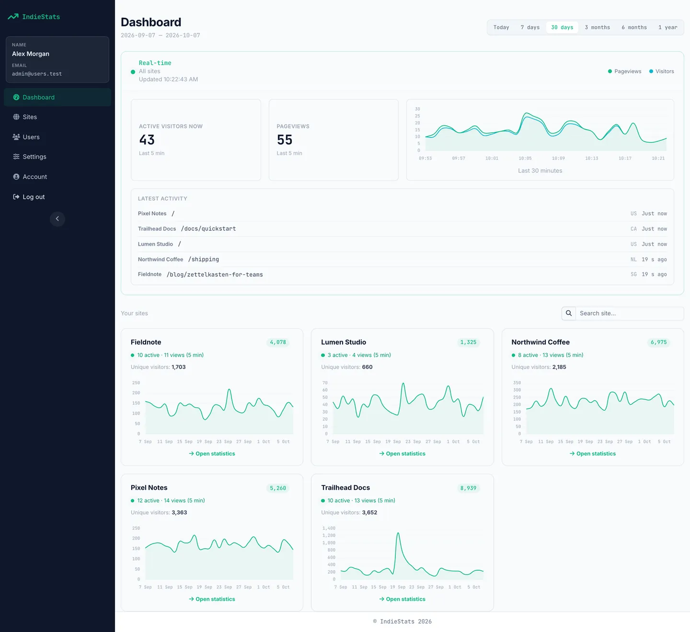
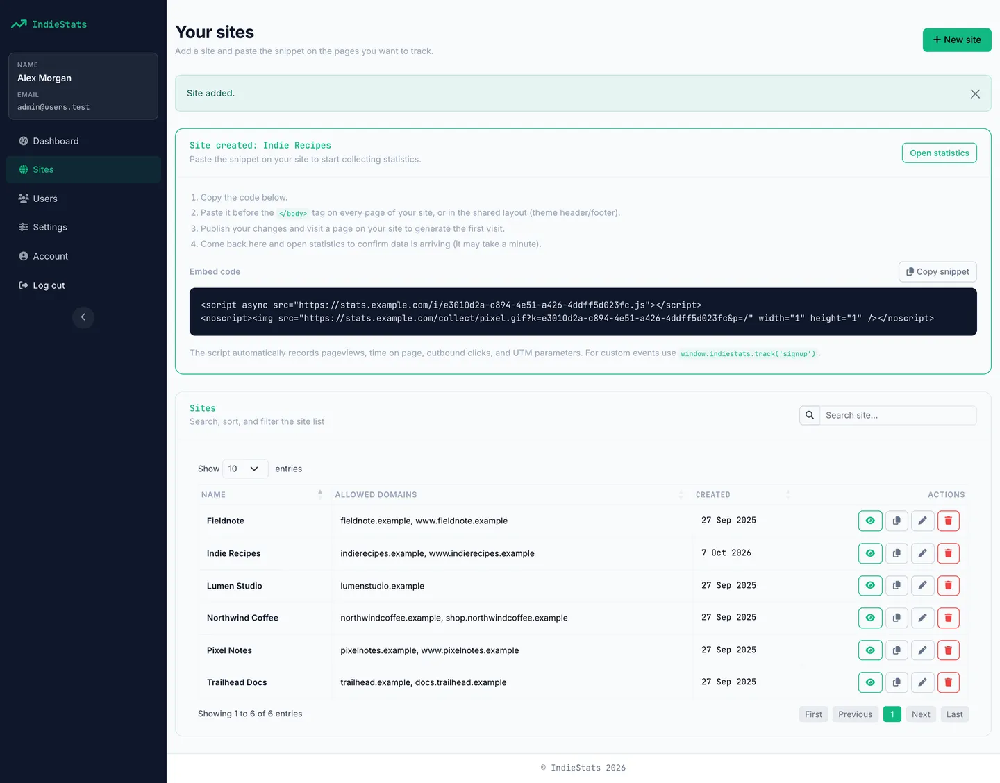
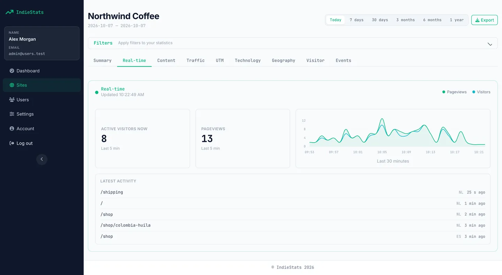
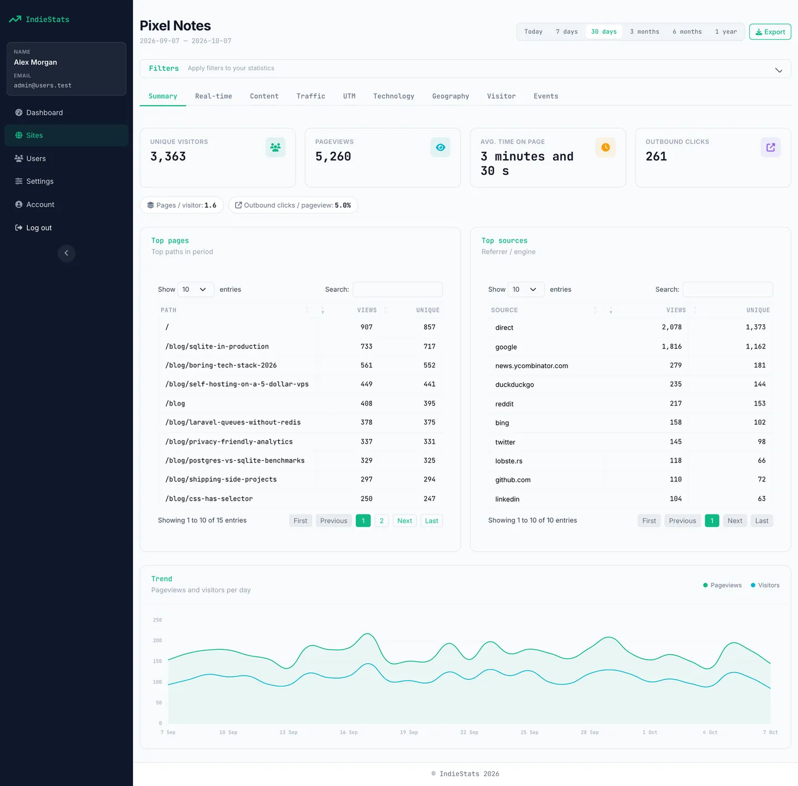

Most websites send every visitor to Google Analytics, with cookies, a consent banner and data leaving the EU. [IndieStats](https://indiestats.web.ap.it) gives you the numbers that matter (visitors, pages, sources, campaigns, conversions) from **your own server**, without cookies or third parties. On Cipi it's one Laravel app.

## Key ideas, in plain words {#ideas}

| Term | Meaning |
| --- | --- |
| **Pageview** | One page opened by one visitor |
| **Visitor ID** | A random identifier kept in the browser's `localStorage`, not a cookie |
| **Snippet** | A one-line `<script>` you paste in your site's layout |
| **Event** | Something a visitor does that you want to count: `signup`, `purchase` |
| **Goal** | An event you follow over time, to measure conversions |
| **Retention** | How long raw data is kept before it's deleted |

```flow
Visitor opens a page | your website
> The browser loads the IndieStats snippet from your stats domain, asynchronously, so your page doesn't wait.
Snippet sends a pageview | to stats.example.com
> Path, title, referrer, UTM tags, language, timezone and device type. A random visitor ID lives in `localStorage`; no cookies.
IndieStats checks the origin | domain allowlist
> Only domains you listed for that site are accepted, so nobody can pollute your numbers from elsewhere.
Data stays on your server | until retention deletes it
> Raw data is pruned after the retention window you choose. Nothing is sent to third parties.
```

<figure class="gui-shot">
<div class="gui-shot-frame">
<div class="gui-shot-bar" aria-hidden="true"><i></i><i></i><i></i><span class="gui-shot-url">stats.example.com</span></div>

</div>
<figcaption>All your sites in one dashboard, with live visitors.</figcaption>
</figure>

## Before you start {#before}

- A server with Cipi (it can share a server with other apps, or live on the same one as your [Boogle](/guides/boogle-laravel-monitoring)).
- A subdomain such as `stats.example.com` pointing at it.
- A GitHub account to fork IndieStats.

## 1. Create the app {#create}

Fork [github.com/andreapollastri/indiestats](https://github.com/andreapollastri/indiestats), then:

```bash
$ ssh cipi@YOUR_SERVER
$ sudo cipi app create --user=stats --domain=stats.example.com \
    --repository=git@github.com:YOU/indiestats.git --branch=main --php=8.5
```

Add the deploy key to your fork, then:

```bash
$ sudo cipi deploy stats
$ sudo cipi ssl install stats
$ sudo cipi app artisan stats db:seed --force
```

IndieStats needs PHP 8.4 or newer. Its built front-end assets are committed to the repository, so no Node build is needed on the server. The seeder creates `admin@users.test` / `password`: **log in and change it right away**.

| IndieStats needs | On Cipi |
| --- | --- |
| The scheduler every minute (pruning, GeoIP updates) | Already on |
| A queue worker (Excel exports) | Created with the app |
| HTTPS | `cipi ssl install` (needed: an HTTP script on an HTTPS site is blocked) |

## 2. Add your site {#site}

**Sites → New site**: name, and the **allowed domains** (`example.com, www.example.com`). IndieStats shows the snippet to copy:

<figure class="gui-shot">
<div class="gui-shot-frame">
<div class="gui-shot-bar" aria-hidden="true"><i></i><i></i><i></i><span class="gui-shot-url">stats.example.com</span></div>

</div>
<figcaption>Paste the snippet before the closing body tag of every page, or in the shared layout.</figcaption>
</figure>

## 3. Paste the snippet {#snippet}

In a Laravel app, put it in your main layout, before `</body>`, only in production:

```blade
@production
<script async src="https://stats.example.com/i/YOUR-SITE-KEY.js"></script>
<noscript></noscript>
@endproduction
```

WordPress: paste it in the theme's footer (or a "header and footer scripts" plugin). Static sites: the shared layout. Deploy, open a page, and the visit appears in **Real-time** within seconds.

<figure class="gui-shot">
<div class="gui-shot-frame">
<div class="gui-shot-bar" aria-hidden="true"><i></i><i></i><i></i><span class="gui-shot-url">stats.example.com</span></div>

</div>
<figcaption>Real-time: active visitors and the last pageviews as they happen.</figcaption>
</figure>

## 4. Track events and goals {#events}

```js
indiestats.track('signup');
indiestats.track('purchase', { plan: 'pro', price: 29.99, currency: 'EUR' });
```

Up to 20 properties per event. On the site's **Events** tab, add a goal to follow an event over time (for example `signup` per day).

## 5. Make it as private as you can {#privacy}

```bash
$ sudo cipi app env stats --set=ANALYTICS_RETENTION_DAYS=180
$ sudo cipi app artisan stats config:cache
```

| Setting | Why |
| --- | --- |
| Shorter retention | Less personal data kept (IPs are deleted with their pageviews) |
| Country only, or no GeoIP | The GeoIP and ASN databases are optional: skip them if you don't need location |
| Domain allowlist on every site | Only your sites can send data |
| Privacy policy | Say what you measure, why, and for how long |
| Real visitor IPs behind Cloudflare | IndieStats reads `CF-Connecting-IP`; behind other proxies configure Laravel's trusted proxies |

> [!note] This guide isn't legal advice. Cookieless, first-party, self-hosted analytics with short retention is the privacy-friendliest setup, but whether you need consent depends on your jurisdiction. Ask your DPO.

## What you'll see {#tabs}

| Tab | Answers |
| --- | --- |
| Summary | How many visitors, pageviews, time on page |
| Content | Which pages, which on-site searches |
| Traffic | Where visitors come from |
| UTM | Which campaigns work |
| Technology | Devices, browsers, systems |
| Geography | Countries and networks (optional databases) |
| Events | Conversions and goals |

<figure class="gui-shot">
<div class="gui-shot-frame">
<div class="gui-shot-bar" aria-hidden="true"><i></i><i></i><i></i><span class="gui-shot-url">stats.example.com</span></div>

</div>
<figcaption>One filter bar narrows every tab, chart and export.</figcaption>
</figure>

## Troubleshooting {#troubleshooting}

| Problem | Fix |
| --- | --- |
| No visits arrive | The site's domain isn't in the allowlist, or the snippet isn't on the page |
| Browser blocks the script | Mixed content: IndieStats must be on HTTPS (`cipi ssl install stats`) |
| Every visitor from one country/network | Behind a proxy without real IP: see [Cloudflare guide](/guides/cloudflare-proxy-ssl-wildcard#real-ip) |
| Excel export never finishes | Queue worker not running: `sudo cipi worker list stats` |
| Old data not deleted | Scheduler off: `sudo cipi schedule status stats` |
| Ad blockers hide some visits | Expected for any analytics; a first-party subdomain helps |
