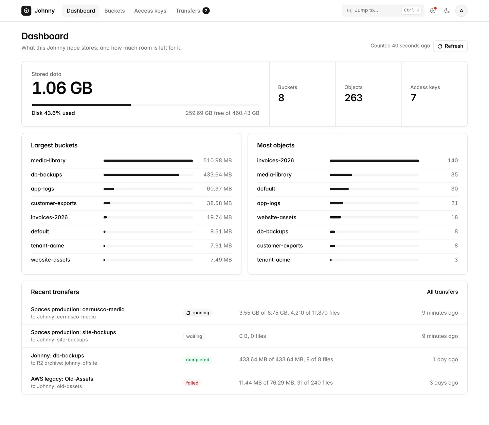
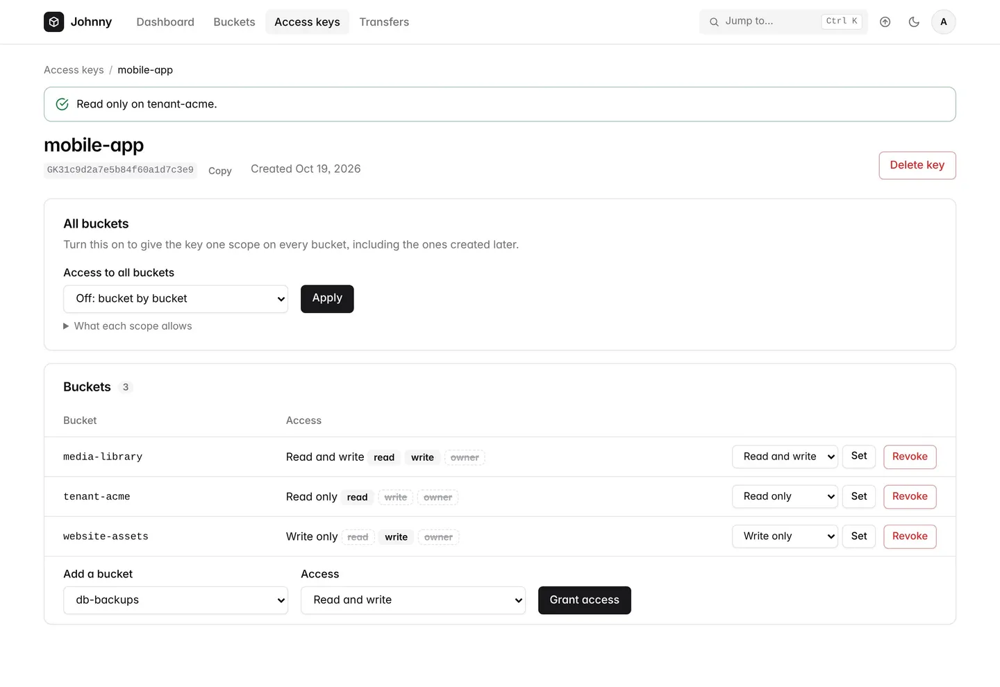
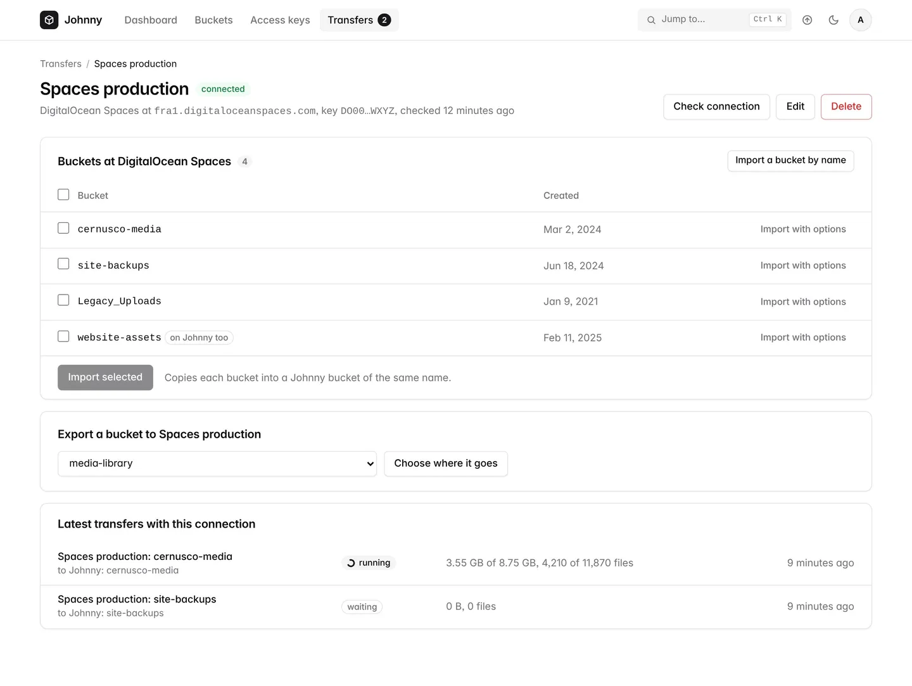

Laravel apps store uploads, exports and backups in **object storage**: S3 and its compatibles. [Johnny](https://johnny.web.ap.it) gives you that on your own VPS, with a clean panel. Your Cipi apps then use it exactly like AWS S3.

## Key ideas, in plain words {#ideas}

| Term | Meaning |
| --- | --- |
| **Object storage** | Storage for files ("objects") reached over HTTP, not a disk you mount |
| **S3** | Amazon's object storage API, now a standard many products speak |
| **Bucket** | A named container of files, e.g. `shop-uploads` |
| **Access key** | An ID and a secret an app uses to read or write buckets |
| **Endpoint** | The URL of the storage server, e.g. `https://s3.example.com` |
| **Path style** | Bucket in the path (`/shop-uploads/…`), as Johnny expects |

```stack
Cipi server | your Laravel apps, Storage::disk('s3')
HTTPS | path-style S3 requests
Johnny VPS | Caddy + Garage + panel
SFTP target | nightly copy of every bucket
```

## Before you start {#before}

- A **separate** VPS with **Ubuntu 24.04**, with enough disk for your files (storage-optimised plans are cheap at Hetzner, OVHcloud and others).
- Two subdomains pointing at it **before** installing: one for S3 (`s3.example.com`), one for the panel (`panel.storage.example.com`).
- Optional but recommended: an SFTP destination for nightly backups (a storage box, another server).

## 1. Install Johnny {#install}

```bash
$ ssh root@STORAGE_IP
$ mkdir -p /opt && git clone https://github.com/andreapollastri/johnny /opt/johnny
$ cd /opt/johnny
$ bash scripts/autoinstall.sh
```

The wizard installs Garage and Caddy, issues HTTPS for your S3 domain, creates a `default` bucket and keys, sets up the nightly jobs and, if you say yes, the panel. Check it:

```bash
$ source /etc/johnny/credentials/default-s3.env
$ aws s3 ls --endpoint-url "$AWS_ENDPOINT_URL"
```

Create your panel login:

```bash
$ sudo -u www-data php /opt/johnny/panel/artisan johnny:admin you@example.com 'a-strong-password'
```

Open the panel, sign in, and turn on two-factor authentication in **Settings**.

<figure class="gui-shot">
<div class="gui-shot-frame">
<div class="gui-shot-bar" aria-hidden="true"><i></i><i></i><i></i><span class="gui-shot-url">panel.storage.example.com</span></div>

</div>
<figcaption>The dashboard: what's stored, disk left, biggest buckets, recent transfers.</figcaption>
</figure>

## 2. Create a bucket and a key per app {#bucket}

**Buckets → New**: `shop-uploads`. Then **Access keys → New**: name it after the app, give it **read and write** on `shop-uploads` only.

<figure class="gui-shot">
<div class="gui-shot-frame">
<div class="gui-shot-bar" aria-hidden="true"><i></i><i></i><i></i><span class="gui-shot-url">panel.storage.example.com</span></div>

</div>
<figcaption>One key per app, limited to its own bucket: a leaked key can't touch anything else.</figcaption>
</figure>

Copy the key ID and secret now. In the bucket's **Connect** tab, Johnny shows ready-made configuration snippets.

## 3. Connect a Laravel app {#laravel}

In the app (on your laptop):

```bash
$ composer require league/flysystem-aws-s3-v3 "^3.0" --with-all-dependencies
```

Commit and deploy. Then set the variables on the Cipi server:

```bash
$ sudo cipi app env shop        # add these lines:
```

```text
FILESYSTEM_DISK=s3
AWS_ACCESS_KEY_ID=GK…
AWS_SECRET_ACCESS_KEY=…
AWS_DEFAULT_REGION=johnny
AWS_BUCKET=shop-uploads
AWS_ENDPOINT=https://s3.example.com
AWS_USE_PATH_STYLE_ENDPOINT=true
```

```bash
$ sudo cipi app artisan shop config:cache
$ sudo cipi worker restart shop
$ sudo cipi app artisan shop tinker --execute="Storage::disk('s3')->put('hello.txt','hi'); echo Storage::disk('s3')->exists('hello.txt') ? 'ok' : 'fail';"
```

`ok` means the app writes to Johnny. The file appears in the panel's object browser.

## 4. Send Cipi backups to Johnny {#backups}

Create a `cipi-backups` bucket and a key for it, then on each Cipi server:

```bash
$ sudo cipi backup destination add johnny --bucket=cipi-backups \
    --key=GK… --secret=… --region=johnny --endpoint=https://s3.example.com
$ sudo cipi backup destination test
$ sudo cipi backup profile add shop-nightly --scope=all --cron='0 2 * * *' \
    --keep-days=14 --dest=johnny --encrypt
```

Backups are encrypted on the Cipi server before they leave it, so Johnny only ever stores encrypted archives. [More on backups](/guides/backup-vps-s3).

## 5. Bring your files from AWS, Spaces or R2 {#import}

**Transfers → New connection**: enter the provider's endpoint and keys. Johnny lists its buckets: import them once, or set a scheduled sync (copy or mirror, with a dry run first).

<figure class="gui-shot">
<div class="gui-shot-frame">
<div class="gui-shot-bar" aria-hidden="true"><i></i><i></i><i></i><span class="gui-shot-url">panel.storage.example.com</span></div>

</div>
<figcaption>Import buckets from another provider; transfers show progress as they run.</figcaption>
</figure>

When the copy is complete, switch the app's `AWS_*` variables to Johnny and run `config:cache`.

## 6. Keep a copy elsewhere {#nightly}

Every night at 03:00 Johnny copies every bucket to the SFTP targets in `/etc/johnny/backup.json`, in dated folders, and deletes folders older than the retention (90 days by default). Add at least one target: a single storage server is a single point of failure. Logs: `/var/log/johnny-nightly.log`.

## Security checklist {#security}

| Do | Why |
| --- | --- |
| One key per app, scoped to its bucket | Limits the damage of a leaked key |
| Keys only in the server's `.env` | Never in Git ([secrets guide](/guides/laravel-env-secrets)) |
| Two-factor on the panel | The panel can create keys |
| An SFTP backup target in another place | Disk or server failure |
| Expiring share links | Links to private files expire in an hour, a day or a week |

> [!tip] **From the web panel.** With the optional [web panel](/web-panel) (cipi/gui 4.8.0+), the **Johnny** connector drives your Johnny panel's API: buckets with quotas, CORS and expiry rules, scoped keys, a bucket and its key for an app in one call with the `.env` Laravel reads, connections, imports, exports and scheduled syncs. See [Connectors](/docs/gui-connectors#johnny).

## Troubleshooting {#troubleshooting}

| Problem | Fix |
| --- | --- |
| `Could not resolve host shop-uploads.s3.example.com` | Path style is off: `AWS_USE_PATH_STYLE_ENDPOINT=true`, then `config:cache` |
| `AccessDenied` | The key isn't allowed on that bucket, or is read-only |
| `Class "League\Flysystem\AwsS3V3\…" not found` | Install `league/flysystem-aws-s3-v3` and deploy |
| Certificate error at install | DNS didn't point at the VPS before installing: fix DNS, run the installer again |
| `destination test` fails from Cipi | Check endpoint, region `johnny`, and that the key can write to the bucket |
| Uploads work, browser can't load files | Bucket is private (good): serve files through signed URLs (`Storage::temporaryUrl`) |
