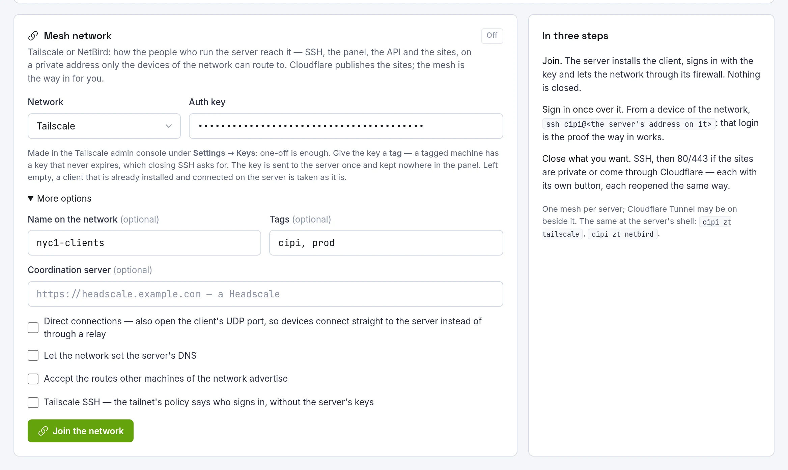
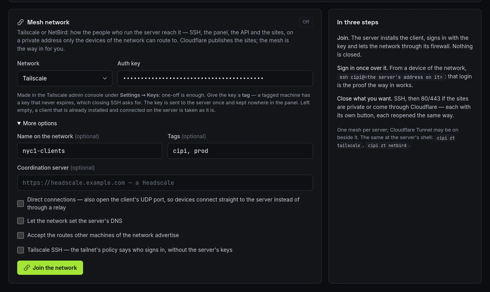

Port 22 open to the internet is knocked on thousands of times a day. Fail2ban and key-only logins keep those knocks harmless, but the simplest attack surface is none: **SSH that answers only your own devices**. A mesh network — **Tailscale** or **NetBird** — gives the server a private address your laptop, your colleagues and your CI runner can reach, wherever they are, and nobody else can route to. Then the public port can close.

## Key ideas, in plain words {#ideas}

| Term | Meaning |
| --- | --- |
| **Mesh network** | Your devices and servers connected to each other directly, encrypted with WireGuard |
| **Tailnet** | Tailscale's name for your network |
| **Auth key / setup key** | What a new machine joins with: Tailscale's *auth key*, NetBird's *setup key* |
| **Tag** | Tailscale: the machine belongs to the network, not to a person — its key never expires |
| **Lock** | Closing a port to the world while it stays open on the mesh |

## 1. Get a key

**Tailscale**: admin console → Settings → **Keys** → *Generate auth key*. Make it reusable if several servers will use it, and give it a **tag** (`tag:cipi`, defined in the ACL's `tagOwners`). **NetBird**: dashboard → **Setup Keys** → *Create setup key*.

In the network's policy, let your devices reach the server on TCP 22 (and 80, 443 if you'll use them). Both start with *everyone reaches everything*; tighten it when you're ready.

## 2. Join the server

```bash
$ sudo cipi zt tailscale enable --tags=cipi        # asks for the key
# or
$ sudo cipi zt netbird enable                       # asks for the setup key
```

Cipi installs the client from the vendor's signed repository, signs the server in (the key is used once and not kept), and lets the mesh interface through the firewall. **It closes nothing**: the server answers the world as before.

```bash
$ sudo cipi zt tailscale status
  State            connected (Running)
  Address          100.101.102.103   web1.tail1234.ts.net
  Node key         does not expire
```

From the **web panel**: the server's **Zero Trust** tab → *Mesh network* → Tailscale or NetBird, the key, *Join*. The key goes straight to the server and is never stored by the panel.

<figure class="gui-shot">
<div class="gui-shot-frame">
<div class="gui-shot-bar" aria-hidden="true"><i></i><i></i><i></i><span class="gui-shot-url">panel.example.com</span></div>


</div>
</figure>

## 3. Sign in over the mesh

Your laptop joins the same network (the Tailscale or NetBird app). Then:

```bash
$ ssh cipi@100.101.102.103          # or ssh cipi@web1 with MagicDNS
```

Same user, same keys. That one login is what Cipi waits for before it closes anything: it is the proof that this way in works.

## 4. Close SSH to the world

From the session that came over the mesh:

```bash
$ sudo cipi zt tailscale lock ssh
✓ SSH port closed to the world. SSH is Tailscale-only (100.101.102.103). Unlock: cipi zt tailscale unlock ssh
```

`lock ssh` refuses — with the reason — while the mesh isn't connected, nobody has signed in over it, the node key can still expire, or SSH doesn't listen on the mesh address. In the panel, the button is greyed out with the same reason. `cipi zt tailscale unlock ssh` reopens it.

> [!warning] Keep your provider's web console at hand. If the server ever leaves the network with 22 closed, the console is the way back in: `sudo cipi zt tailscale unlock ssh`.

## 5. Optional: close 80 and 443 too {#http}

For a server whose sites are private — staging, an internal tool, the panel itself:

```bash
$ sudo cipi ssl install staging --dns=cloudflare    # certificates must renew without port 80
$ sudo cipi zt tailscale lock http
```

Point the DNS records of those sites at the mesh address (a public `A` record on `100.x.y.z` is fine: nobody outside can route to it). For public sites, keep HTTP open, or publish them through a [Cloudflare Tunnel](/guides/cloudflare-zero-trust-laravel) and lock here too — the two work side by side.

## 6. Everyday use {#everyday}

| You want | Do |
| --- | --- |
| The database from TablePlus | A connection *over SSH* to the mesh address, then `127.0.0.1:3306`. Nothing to open |
| The web panel and API privately | Their records on the mesh address, a DNS-01 certificate, then `lock http` |
| SSH without managing keys (Tailscale) | `sudo cipi zt tailscale ssh enable`: the tailnet's policy decides who signs in as whom |
| A CI runner that deploys | Join the runner to the network (Tailscale's GitHub Action, NetBird's), deploy over SSH |
| See it all | `cipi zt status`, the panel's Zero Trust tab, `cipi-cli zt`, `GET /api/zt` |
| Move apps between two servers on the network | `cipi sync` and the panel's Transfer use the private addresses: nothing to open |
| Leave | `sudo cipi zt tailscale disable` — the locks are reopened first, then the client is removed |

From your laptop, with [cipi-cli](/docs/cli-client#zt): `cipi-cli zt join tailscale --tags cipi`, `cipi-cli zt lock ssh`, `cipi-cli zt leave`. Over the [API](/docs/api#endpoints-zt) with a `zt-manage` token, or the [PHP SDK](/docs/php-sdk#zero-trust).

## Self-hosted coordination {#self-hosted}

```bash
$ sudo cipi zt tailscale enable --login-server=https://headscale.example.com
$ sudo cipi zt netbird enable --management-url=https://netbird.example.com
```

Headscale is a self-hosted Tailscale control server; NetBird's management server is part of its open-source project. Traffic goes device to device either way; self-hosting moves only who decides which devices are on the network.

## Troubleshooting {#troubleshooting}

| Problem | Fix |
| --- | --- |
| `lock ssh` says nobody signed in over the mesh | Open a new session with `ssh cipi@<mesh address>` and lock from there |
| `lock ssh` says the node key expires | Tailscale: rejoin with a tagged key (`--reauth`), or *Disable key expiry* for the machine in the console |
| `ssh` over the mesh hangs | The network's policy doesn't allow TCP 22 to the server |
| `enable` says the server is on another mesh | One mesh at a time: both use `100.64.0.0/10`. `disable` the other first |
| `lock http` refused | An app renews its certificate over HTTP-01: `cipi ssl install <app> --dns=cloudflare` |
| Locked out | Provider's web console, then `sudo cipi zt tailscale unlock ssh` (or `netbird`) |
